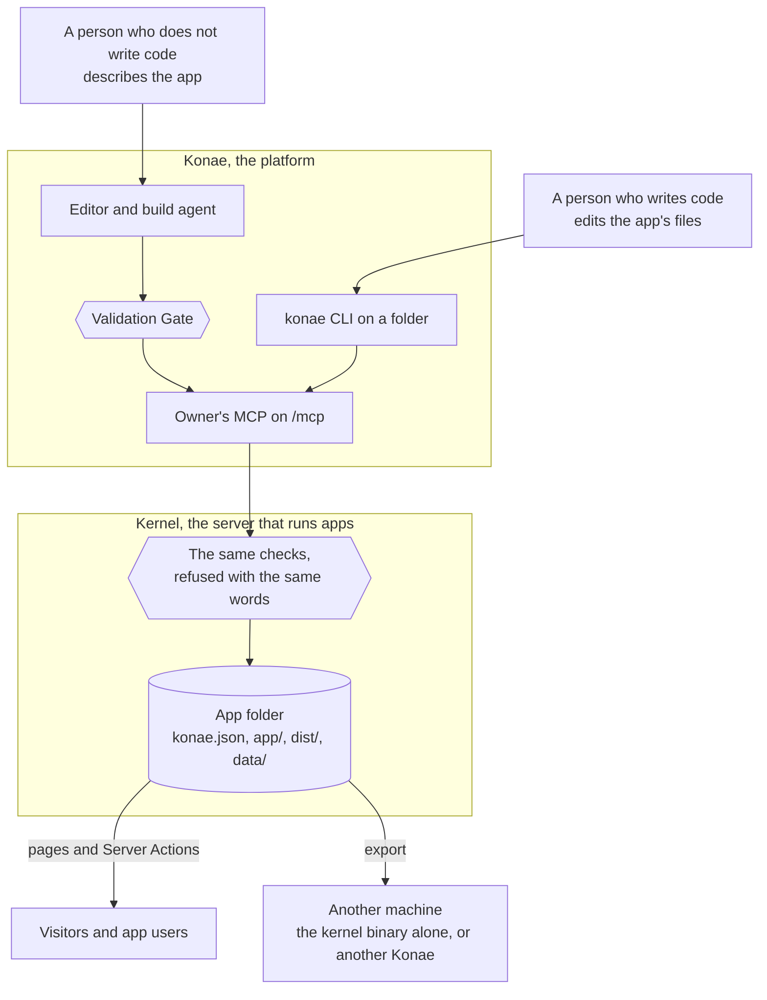

# Konae

Konae lets a person who does not write code, and a person who does, make the same small app and take it to another machine with its accounts, its data and its rules unchanged.

You describe an app to an agent in the editor, or write its files in a folder. Either way the app is one folder: its pages, `schema.sql`, the Server Actions in `actions.json`, its SQLite database and its app accounts. The editor's Validation Gate and the Kernel that serves the app refuse a broken rule with the same words, so an app the editor accepts still runs on the machine it moves to.

## Two halves

Konae is the platform. It holds the editor, the build agent, owner accounts, the owner's MCP on `/mcp` and the project list. It is the `konae` binary in `kernel-rs/konae` and the `konae` CLI in `scripts/konae.ts`.

The Kernel runs apps. It answers Server Actions, keeps each app's accounts, files, schedule, notices, routes, calls and Usage, and serves the built pages under a Content Security Policy. It is a Rust library and the `kernel` binary in `kernel-rs/kernel`, which serves a directory of app folders with no Konae around it. Konae links the Kernel, and `konae dev` runs the `kernel` binary on one folder.

Owners exist only in Konae. App users exist only in their app's folder, so an exported app carries its accounts and leaves its owner behind.



[The architecture](./docs/architecture.md) describes both crates, the app folder and which store each part owns. [Concepts](./docs/concepts.md) defines the words.

## Prerequisites

| Path | Needs |
| --- | --- |
| The editor, `bun run dev:local` | [Bun](https://bun.sh) 1.3 or newer, and a Rust toolchain with Cargo 1.91 or newer. The Docker images pin Bun 1.3.11. |
| The CLI, `konae dev` | Bun, and either the Rust toolchain above or a `kernel` binary from the [GitHub Release](https://github.com/danibram/konae/releases), which `KONAE_KERNEL_BIN` names. `konae init` needs only Bun. |
| Docker Compose, or an export in a container | Docker with Compose. |
| The tests | Google Chrome for the Playwright suites, which run with `channel: "chrome"`, and Docker for the S3 store. |

`bun run dev:local` and the first `konae dev` compile the Kernel with Cargo. The first compile takes about a minute with a warm Cargo cache, and later runs reuse the build. With `KONAE_KERNEL_BIN` set to a downloaded `kernel` binary, `konae dev` compiles nothing and needs no Rust. Each release publishes that binary for macOS and Linux on arm64 and x64, with a `SHA256SUMS` file ([Releasing](./docs/releasing.md) lists the names). To run Konae without Bun or Rust, see [Run it in Docker](#run-it-in-docker).

## Run it locally

```bash
git clone https://github.com/danibram/konae
cd konae
bun install
bun run dev:local
```

`dev:local` compiles and starts Konae, with its Kernel, on port `8790` and the editor on port `4173`. `KONAE_KERNEL_PORT` and `KONAE_EDITOR_PORT` change the ports. Open [http://localhost:4173](http://localhost:4173). It opens on the owner sign-in page. Press **Create owner account**, enter an email and a password, and keep the setup key the page fills in for this computer.

Local data stays under `data/kernel-local`, and `KONAE_DATA_DIR` moves it. Nothing sends real email locally. Account links and invitations land in `data/kernel-local/mailbox.jsonl`.

`docker compose up --build` runs the complete stack, with a gateway and an S3 store, at [http://app.localhost:8080](http://app.localhost:8080). [Operate an installation](./docs/operate.md) covers it, along with every environment variable, copies and restores, email, and what to set before a Kernel is reachable from outside.

## Run it in Docker

The published image carries Konae, its Kernel and the editor, so a machine with Docker needs no Bun, Rust or checkout. Replace `your-setup-key` with a key of your own before running this command. You will use it to create the first owner.

```sh
docker run -d --name konae -p 127.0.0.1:8787:8787 -v konae-data:/data \
  -e KONAE_SETUP_KEY='your-setup-key' -e KONAE_PUBLIC_ORIGIN=http://localhost:8787 \
  ghcr.io/danibram/konae:0.7.0
```

Open [http://localhost:8787](http://localhost:8787), press **Create owner account** and give that key. The data stays in the `konae-data` volume. The image is built for `linux/amd64` and `linux/arm64`. Without `KONAE_MAIL_TRANSPORT` the container sends no email, so invitations to app users are refused; `KONAE_MAIL_TRANSPORT=development` writes them to `mailbox.jsonl` in the volume instead. [Operate an installation](./docs/operate.md) covers the rest. The `0.6.0` image reads the key as `KONAE_ADMIN_KEY` and is built for `linux/amd64` only, so on Apple Silicon add `--platform linux/amd64`.

## Make a first app in the editor

Press **New project**, name it and pick a starting point. Press **Connect a model** to give the build agent your Anthropic, OpenAI or OpenRouter key, which stays in the browser, then describe a change. The Validation Gate checks the change, and **Apply** saves it. **Deploy** publishes the app and shows its address. [First app from the editor](./docs/guides/first-app-from-the-editor.md) walks through it.

## Make a first app from a folder

`init` and `dev` need no credential and no installation. Run the commands from this repository, or run `bun link` here once and write `konae` instead of `bun run konae --`.

```sh
bun run konae -- init --dir /tmp/my-list --name "My list" --template tasks
bun run konae -- dev --dir /tmp/my-list
```

`init` writes the app folder: `konae.json`, the sources in `app/`, `AGENTS.md`, `action-contract.md`, `actions.d.ts`, `compose.yaml`, `.env.example` and a `package.json` whose `npm run build` writes `dist/`. `dev` builds `dist/`, with no `npm install` for a template, and runs the `kernel` binary on the folder at `http://my-list.localhost:8796`, with the folder's own `data/`, and restarts it when a file in `app/` changes.

The `tasks` template is a public list that anyone with the link can use. The default template, `notes`, is private and takes accounts by invitation only, and `dev` prints the `kernel invite` command that creates a test account.

To publish, `login` saves a credential and the installation's address in the folder's `.konae/`, and the first `publish` registers the project there and prints its address. `--url` is the editor's address. On a fresh local install the line below creates the first owner with the setup key `local-development-key`. If you already pressed **Create owner account** in the editor, use that email and password. A reachable installation needs its operator's setup key, or an invitation code in `KONAE_INVITATION_CODE` for a later owner. A token cannot widen itself, so ask for `--manage-users` and `--export-data` now, because `pull`, `export --with-data` and inviting app users need them.

```sh
KONAE_EMAIL=you@example.com KONAE_PASSWORD=... KONAE_SETUP_KEY=local-development-key \
bun run konae -- login --dir /tmp/my-list --url http://localhost:4173 --manage-users --export-data
bun run konae -- publish --dir /tmp/my-list
```

An app published from a folder appears on the editor's project list beside the others, marked **Edited in a folder**. Its files stay in the folder, and you publish its changes from there. Its card opens its database, its app accounts and what it did.

To debug against what the published app holds, `pull` exports its database, accounts and files into `.konae/pull`, and `dev --reset` imports them into the local `data/`. Nothing travels back:

```sh
bun run konae -- pull --dir /tmp/my-list
bun run konae -- dev --dir /tmp/my-list --reset
```

[Edit files with the CLI](./docs/guides/edit-files-with-the-cli.md) explains each step, and [the CLI reference](./docs/cli.md) covers `sql`, `events`, `contract` and `conform`.

A page calls the SDK the build adds:

```js
const session = await miniapp.auth.session();
const rows = await miniapp.actions.call("tasks.list");
await miniapp.actions.call("tasks.create", { title: "Ship it" });
const files = await miniapp.files.list();
```

## Take the app to another machine

Export writes the app folder with its data. In the editor, **Export** downloads it as a tar. From a folder:

```sh
bun run konae -- export --dir /tmp/my-list --out /tmp/my-list-export --with-data
```

`konae dev` serves the exported folder in place, with its data, at its own address:

```sh
bun run konae -- dev --dir /tmp/my-list-export
```

The `kernel` binary also serves a directory of app folders with no Konae around it. Put the folder at `apps/<id>/` of a data directory, where `<id>` is the `id` in its `konae.json`, and start the binary:

```sh
cargo build --manifest-path kernel-rs/Cargo.toml --bin kernel
mkdir -p /tmp/kernel-data/apps
cp -R /tmp/my-list-export "/tmp/kernel-data/apps/$(bun -e 'console.log(require("/tmp/my-list-export/konae.json").id)')"
KONAE_DATA_DIR=/tmp/kernel-data KONAE_PUBLIC_ORIGIN=http://localhost:8787 kernel-rs/target/debug/kernel
```

Either way the Kernel checks the folder as Konae checks a release, prints `Serving My list at http://my-list.localhost:...`, and serves the app with its rows. App users sign in with the passwords they already have. The exported folder's `.env.example` names the Kernel image, so `cp .env.example .env` and `docker compose up -d` run the same binary in a container. The published image is built for `linux/amd64` and `linux/arm64`. The folder's `AGENTS.md` lists the `kernel` commands that manage users, keys and secrets. [Take the app elsewhere](./docs/guides/take-the-app-elsewhere.md) covers both, and the import into another Konae.

## Documentation

The documentation is markdown under [`docs/`](./docs/README.md). The docs site is itself a Konae app, [`examples/docs-site`](./examples/docs-site/README.md), which publishes those files.

| To | Read |
| --- | --- |
| Learn the words | [Concepts](./docs/concepts.md) |
| Write an app | [The Capsule](./docs/capsule.md), [Server Actions](./docs/server-actions.md), [the SDK](./docs/sdk.md) |
| Decide who gets in | [Accounts and access](./docs/accounts-and-access.md) |
| Do one task | The guides in [`docs/guides/`](./docs/guides/) |
| Drive it from an agent or a script | [MCP tools](./docs/mcp-tools.md), [the reference](./docs/reference/README.md), [the walkthrough](./docs/mcp-walkthrough.md), [the CLI](./docs/cli.md) |
| Know the numbers and the gaps | [Limits](./docs/limits.md), [Named divergences](./docs/divergences.md) |
| Operate a server | [Operate an installation](./docs/operate.md), [Releasing](./docs/releasing.md), [the architecture](./docs/architecture.md) |
| See why it is built this way | [The decision records](./docs/adr/README.md) |

`CONTEXT.md` holds the project's language, and `AGENTS.md` the rules for agents that work on this repository.

## Examples

- [`examples/showcase`](./examples/showcase/README.md) has six complete apps, each with a replay that publishes it and runs every flow. `starter` is the one to copy first.
- [`examples/product-fit`](./examples/product-fit/README.md) has eight smaller apps and a smoke run.
- [`examples/probes`](./examples/probes/README.md) has small Capsules that each prove one capability.
- [`examples/docs-site`](./examples/docs-site/README.md) is the docs site.
- [`examples/home`](./examples/home/README.md) is the page an installation answers on its bare domain once an app's path address is named `konae-home`.
- [`examples/politica-de-privacidad`](./examples/politica-de-privacidad/README.md) and [`examples/terminos-y-condiciones`](./examples/terminos-y-condiciones/README.md) are the legal pages at `<domain>/p/politica-de-privacidad/` and `<domain>/p/terminos-y-condiciones/`.
- [`examples/architecture-map`](./examples/architecture-map/README.md) is a map of the system.

## Tests

```bash
cargo test --manifest-path kernel-rs/Cargo.toml
bun run build
bun test --timeout 30000
bun run test:e2e:local
# Needs the Docker stack
bun run test:e2e:minio
```

Some integration tests copy to an S3 store. They read `KONAE_TEST_S3_ENDPOINT`, `http://127.0.0.1:9000` by default, with the `konae` credentials and the `konae` bucket that `docker compose up minio minio-init` creates.

## Status

Konae runs as a self-hosted installation. A version tag publishes `ghcr.io/danibram/konae` and `ghcr.io/danibram/konae-kernel`. [Releasing](./docs/releasing.md) is the cut process, and [CHANGELOG.md](./CHANGELOG.md) lists what each release holds. These are still missing:

- A production recipe. The repository ships a local stack, and [Operate an installation](./docs/operate.md#before-a-kernel-is-reachable) lists what an operator sets, but TLS and the proxy are the operator's own.
- Teams. A project has one owner.
- App release history. A publish replaces the app's built files, with no rollback.
- Quotas shown to owners, alerts and account closing.
- `"access": "granted"` on an action. Both doors refuse it until the Kernel supports deployment grants.

The S3 file store is tested against RustFS only.

## License

Konae is released under the MIT License. See [LICENSE](./LICENSE).
