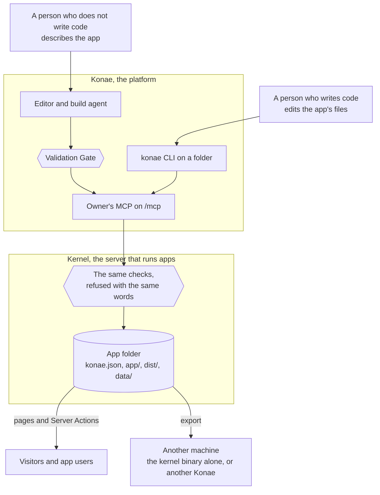

# Konae overview

Konae lets a person who does not write code, and a person who does, make the same small app and take it to another machine with its accounts, its data and its rules unchanged.

You describe an app in the editor, or write its files in a folder. The editor checks it before it runs, and the Kernel checks it again with the same words wherever the app moves.

## What Konae is made of



Both people end at the same app folder. The editor's Validation Gate checks a change before Apply, and the Kernel checks the app again at every publish and wherever a `kernel` binary starts the folder. An export hands the folder over with its accounts, its data and its rules.

- Konae is the platform: the editor, the build agent, owner accounts, the owner's MCP on `/mcp` and the project list.
- The Kernel runs apps. It is a library inside Konae and the `kernel` binary, which serves app folders on its own.
- An [app folder](./architecture.md#the-app-folder) is the app: `konae.json`, the sources in `app/`, the built pages in `dist/` and its database, accounts and files in `data/`. It looks the same on a laptop, inside the Kernel and in an export.
- The [Capsule](./capsule.md) is the part you edit, `app/`: pages, scripts, `schema.sql` and `actions.json`.
- [Server Actions](./server-actions.md) are the page's only way to the database. Each one is a named SQL statement with typed inputs and a declared audience.
- The `konae` [CLI](./cli.md) and the [owner's MCP](./mcp-tools.md) do from a folder or an agent what the editor does from the browser.

## The five jobs

1. A person who does not write code describes an app and gets one that runs.
2. A person who writes code edits the same app's files.
3. Both of them hit the same checks. A query that reads rows names a LIMIT, in the editor and on the Kernel that leaves with the app.
4. Either person can take the app to another machine with its accounts, its data and its rules.
5. Who may open the app, and who may read a row, stay decisions of the app. The host does not replace them.

## Start here

The editor runs at `http://localhost:4173` after `bun run dev:local`, at `http://app.localhost:8080` under Docker Compose, and at `https://app.<domain>` on an installation with `KONAE_DOMAIN` set.

### 1. Sign in

The editor opens on the owner sign-in page. The first owner of an installation presses **Create owner account** and gives the setup key, which a local install fills in. Every later owner needs an invitation code, which the operator issues with the `owner-code-create` command of the server binary (`kernel-rs/target/debug/konae` under `bun run dev:local`, `docker compose exec --user konae kernel konae` under Compose), which the `konae` CLI does not have. [Add a second owner](./guides/add-a-second-owner.md) shows the command, and [Owner admission](./operate.md#owner-admission) has the rules.

### 2. Make an app in the editor

If you do not write code, stay in the editor. Create a project, press **Connect a model**, describe the app, apply the change the Validation Gate lets through, and press **Deploy**. The [first app guide](./guides/first-app-from-the-editor.md) walks through it.

### 3. Or work from a folder with the CLI

Run the commands from the Konae repository. `login` reads `KONAE_EMAIL` and `KONAE_PASSWORD`, and asks for either one that is unset when it runs in a terminal. On a fresh local install, `KONAE_SETUP_KEY=local-development-key` creates the first owner. A reachable installation needs its operator's key, or an invitation code in `KONAE_INVITATION_CODE` for a later owner. A token cannot widen itself, so one `login` asks for `--manage-users` and `--export-data` up front.

```sh
bun run konae -- init --dir ./my-app --name 'My app' --template tasks
bun run konae -- dev --dir ./my-app
KONAE_EMAIL=you@example.com KONAE_PASSWORD=... KONAE_SETUP_KEY=local-development-key \
bun run konae -- login --dir ./my-app --url http://localhost:4173 --manage-users --export-data
bun run konae -- publish --dir ./my-app
```

`init` writes the app folder. The `tasks` template is public. Without `--template`, `init` writes `notes`, a private app with invitation signup, and its first `dev` serves a sign-in page. `dev` invites `test@example.com` and prints a link that opens the invitation, so you can choose a password and sign in. `dev` compiles the Kernel on its first run, which takes about a minute, runs the folder with the `kernel` binary, and starts it again when the files change. `login` saves a 24-hour credential in `./my-app/.konae/credentials.json`, and the first `publish` registers the project on that installation. The [CLI guide](./guides/edit-files-with-the-cli.md) explains each step.

### 4. Prove it

- Open the Deployment URL.
- Call one Server Action from the page.
- Read the project back with `project_inspect` over MCP.
- When you are checking a contract, run `conform` against `action-contract.json`.

After any write through MCP or the editor, observe the effect through the same door before you retry or tell the owner it worked. The `rules` topic of `platform_guide` lists the read-back for each write tool.

### 5. Take it elsewhere

Export the app folder with its data, and run it on the `kernel` binary or import it into another Konae. [Take the app elsewhere](./guides/take-the-app-elsewhere.md) shows both.

## For agents

An agent that connects over MCP calls `platform_describe` and `projects_list` first. It then reads the `rules` and `pieces` topics of `platform_guide`. The [MCP tools and guide topics](./mcp-tools.md) page lists every topic. The docs site publishes `llms.txt`, which links to the markdown of each page.

## Read next

- [Concepts](./concepts.md), the words the rest of the docs use
- [The Capsule](./capsule.md), the files of an app
- [Pick the smallest piece](./pieces.md), which declaration fits a need
- [Example apps](./examples.md)
- [Operate an installation](./operate.md), for whoever runs a Kernel
