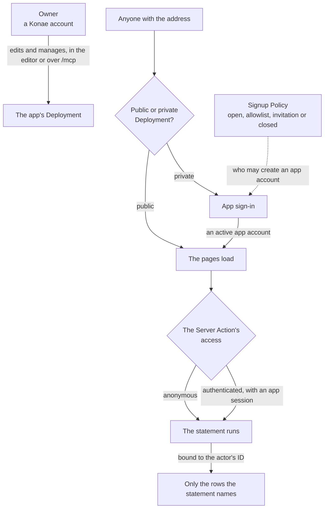

# Accounts and access

Three questions stay separate: who edits the app, who may open it and who may read a row. Each has its own mechanism, and the app decides the last two, never the host.



The owner manages the Deployment and never opens a row as a Runtime Actor. Visibility decides who may load the pages, the Signup Policy decides who may hold an app account, and each Server Action decides what its caller reads or writes, in its `access` and in the statement that binds the actor's ID.

## Who is who

| Role | What it is |
| --- | --- |
| Owner | A person with a Konae account who edits a Project and manages its data, files, Usage and Deployment. Owners exist only in Konae, and an export leaves them behind. |
| Runtime Actor | Whoever calls a Deployment at runtime. It is an anonymous visitor, a signed-in app user, or a service holding an API key. |
| App user | A person with an account in one app. The Kernel keeps the account in the app's `data/identity.sqlite` and keeps no role for it. |

Server Actions decide what a Runtime Actor may do, and no Runtime Actor is ever an owner. Do not build a users table of your own that bypasses the Runtime Actor. Use the Signup Policy and invitations.

## Who may read a row

The app decides, in the statement and its bindings. A Server Action binds the caller with `{ "source": "actor", "field": "id" }`.

- `id` is the app user's ID or the API key's ID. It is null for a visitor and for a schedule's run.
- Roles are rows in the app's own tables. An app that needs an administrator keeps a table such as `profiles(user_id, role)` and checks it in SQL against that ID. The owner names the first one with SQL in Data.

```json
"items.list": {
  "kind": "query",
  "access": "authenticated",
  "statement": "SELECT id,title FROM items WHERE user_id=?1 LIMIT 50",
  "bindings": [{ "source": "actor", "field": "id" }]
}
```

Public visibility of a Deployment grants no database access. A signed-out visitor may call only Server Actions declared `anonymous`, and may list and read files marked public. To keep an action to an app's administrators, join the actor's ID to the app's roles table in the statement, as the `members` template does with `WHERE (SELECT role FROM profiles WHERE user_id = ?1) IN ('admin', 'owner')`, and give a mutation a `guard` so a refused call says why.

## Public and private Deployments

- A Public Deployment opens its shell without signing in.
- A Private Deployment requires a signed-in Runtime Actor before anything loads or runs.

When the owner's request leaves access open for an app with accounts, `platform_guide` tells an agent to propose a private Deployment with the `invitation` signup mode.

## Signup Policy

The Signup Policy decides who may create an app account on one Deployment.

| Mode | Who may create an account |
| --- | --- |
| `open` | Anyone. |
| `invitation` | Nobody signs up. An invited person creates the account from the invitation link. |
| `closed` | Nobody signs up. A person the owner invites can still accept the invitation. |
| `allowlist` | Only exact emails or `@domain` entries, up to 100. A domain entry matches that exact domain, not its subdomains. Entering an address sends no invitation. |

Public Deployments start Open. Private Deployments start Closed. A first release may name another mode. After that, a republish never changes it, except that republishing a public app as private turns Open into Closed.

The owner changes it in the editor's Auth > Users view, or with `signup_policy_set`, which needs the `manage_users` permission. An app folder published with the CLI takes its first release's policy from `signupPolicy` in `konae.json`, which `konae init` sets to `invitation`.

In local verification mode, Konae does not verify email addresses. Whoever signs up first with a listed address gets that account. Use Closed for apps that hold private data, or require verification.

## Sign in with Google

Every app account can sign in with email and password. The owner can add Google for one app, with that app's own Google OAuth client. The installation holds no Google client.

1. Make a Web application client in your Google Cloud console.
2. Set its two halves as the signing secrets `google_client_id` and `google_client_secret`, with `secret_set` and `use: "google"`, or in the editor's Auth > Users view.
3. Register the redirect URIs that `sign_in_methods_read` lists in that client.
4. Turn Google on with `sign_in_methods_set` and `["password", "google"]`, which needs `manage_users`.

A Google sign-in reaches the app account with the same email. For an email with no account, the Signup Policy decides as it does for a password. Password stays on, so every account keeps a way back in. An export carries the setting and the accounts but never the client, so on another installation the owner sets the two secrets again. [The MCP guide](./mcp.md#sign-in-methods) states every rule and refusal.

## Invitations

An invitation offers one email an account on one Deployment. The link lasts seven days. Accepting it sets the password and activates the account, and the Kernel rechecks the Signup Policy and the account's state in the same transaction.

- `app_invitations_create` sends the email. Call it only when the owner asked for those invitations.
- Check `mail_status` first. Inviting needs `sending: true`.
- `app_invitations_list` shows each status. `app_invitation_resend` sends a new link. `app_invitation_revoke` ends one.

An invitation never changes an active account's password or resumes a suspended one. An export and a restore keep the invitation as history without its link, and the owner resends it.

## Suspending and resuming

An account is pending until it proves control of its email, active, or suspended. Only an active account gets a session. `app_user_suspend` ends sessions and keeps the account's ID and rows. `app_user_resume` returns it to `active` if it ever verified, otherwise `pending`. `app_users_list` shows each account's state and whether it verified its email.

## Entering as a user

An owner can see the app as one of its people. **Open as**, beside an active account in the editor's Auth > Users view, calls `app_user_enter` and opens a link on the app's own address that works once, for two minutes, and signs that tab in as the account. The owner's audit log records who entered as whom. The session is marked, so Usage and Signals do not count what it does as that person, but its writes are real rows of that account. Only the owner's own browser session can ask for a link; an agent's credential cannot. Outside Konae the same function is `kernel enter <email>` on the machine, and the Kernel's log records it.

## Credentials for agents

An Agent Credential grants no Runtime Actor identity. Its permissions are `read`, `write`, `publish`, `manage_users` and `export_data`. Only `manage_users` lists, suspends and invites app accounts or changes a Signup Policy. See [MCP tools and guide topics](./mcp-tools.md).

## Read next

- [Invite people](./guides/invite-people.md)
- [Server Actions](./server-actions.md)
- [MCP tools and guide topics](./mcp-tools.md)
- [Concepts](./concepts.md)
