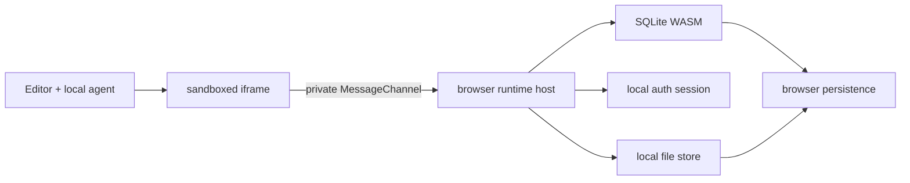
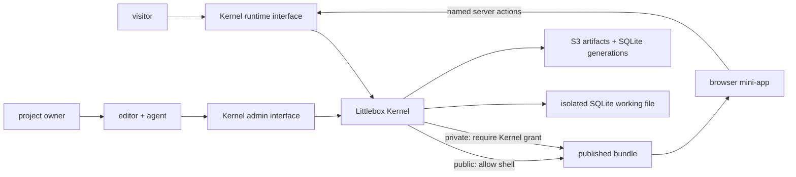

# Littlebox architecture

## Product rule

A new mini-app creates **no process, VM or container**. It is a static bundle plus logical capabilities on a shared data plane. Idle apps should have effectively zero marginal compute cost.

The **Littlebox Kernel** owns product security semantics. Infrastructure providers are adapters: they may execute code or persist sessions, databases and files, but they never decide who an actor is, whether a Deployment is public or private, or which action that actor may invoke.

## Capsule v1

```text
mini-app/
├── littlebox.manifest.json
├── index.html
├── styles.css
├── app.js
├── src/
│   └── feature.ts
├── schema.sql
└── actions.json
```

The editor stores an arbitrary source tree in one exportable JSON object. The browser compiles `app.js` or `src/main.ts` and its relative imports with WebAssembly. Its versioned manifest contains deployment visibility, declared runtime actions and capability policies, but never SQL implementations, credentials or administrative grants.

## Current local topology



The iframe has `allow-scripts` but not same-origin access. Generated code cannot read the editor's storage or credentials directly. Each preview receives one private MessageChannel; runtime requests are no longer accepted through the page's global message listener.

This is a development boundary, not yet a hardened hostile-code sandbox. Hosted execution must add quotas, statement validation, capability grants, CSP, audit logs and infrastructure-enforced tenant isolation.

## Current self-hosted topology



The Docker development stack uses Nginx only for hostname routing: `editor.localhost` reaches Vite and the Kernel Admin Interface, while every other `*.localhost` hostname reaches the Rust Kernel Runtime Interface. MinIO provides the same S3 operations used with hosted providers. Nginx and MinIO do not make authorization decisions.

### Two independent policy axes

Deployment visibility and data authorization are deliberately independent:

| Deployment | Who can open the app shell | Who can read data |
| --- | --- | --- |
| Public | Anyone | Only actors allowed by each server action |
| Private | Explicitly granted actors | Only actors allowed by each server action |

A public deployment may contain private user records. Public means its HTML, CSS and JavaScript are public; it never means the database is public. A private deployment additionally protects the application shell, but still requires per-action authorization because authenticated users need not share the same data.

Blob access in Capsule v1 follows shell visibility: blobs belonging to a public Deployment can be read by its visitors, while a private Deployment requires a grant before list, upload or read. Per-actor private blobs in a public app require a future declared file-action policy and must not be stored through the public v1 file capability.

### Database boundary

The hosted browser runtime must never receive:

- a D1, libSQL, Turso or provider credential;
- the SQLite file or an endpoint that downloads it;
- a generic SQL-over-HTTP interface;
- owner/admin capabilities embedded in JavaScript;
- private fields that the current action does not explicitly return.

The browser calls named server actions. The Kernel resolves the deployment and actor from trusted server-side state, validates the action input, applies authorization and quotas, then executes parameterized statements through an adapter. Developer tools can replay any browser request, so security cannot depend on hiding SDK methods or UI controls.

The editor is a different trust domain. SQL Studio, schema migrations, backups and database export are served only through the Kernel Admin Interface after owner/workspace authorization, with audit logging and stronger checks for destructive operations. Runtime sessions are never accepted by admin operations.

The stable seams are:

```ts
interface LittleboxKernel {
  handleRuntime(request: RuntimeRequest): Promise<Response>;
  handleAdmin(request: AdminRequest): Promise<Response>;
}

interface IdentityStoreAdapter {
  readSession(sessionId: string): Promise<KernelSession | null>;
  writeSession(session: KernelSession): Promise<void>;
  readGrants(actorId: string): Promise<KernelGrant[]>;
}

interface DatabaseAdapter {
  query(databaseId: string, statement: PreparedStatement): Promise<unknown[]>;
  execute(databaseId: string, statement: PreparedStatement): Promise<unknown>;
  export(databaseId: string): Promise<ReadableStream>;
}

interface BlobAdapter {
  createUpload(bucketId: string, input: UploadRequest): Promise<SignedUpload>;
  list(bucketId: string): Promise<BlobRecord[]>;
}
```

Adapters do not receive authority to make access decisions. The Kernel passes them already-resolved opaque resource IDs and constrained operations only after authentication and authorization have succeeded.

## Provider adapters

- A managed adapter may use Workers, D1/libSQL and R2/S3.
- A self-hosted adapter may use one Bun/Node process, SQLite files and local disk or S3.
- A Railway adapter may provide a shared Node runtime and an escape hatch for applications that need Docker or unrestricted server packages.

All adapters implement the same Kernel seams. Provider identity products may optionally protect infrastructure administration, but they are never the application session or grant authority. The exported unit must eventually contain source, manifest, migrations, a standard SQLite file and its blobs. Provider-specific identifiers must not appear in application code.

## Near-term security decisions

Before accepting untrusted public apps:

1. Replace browser-supplied SQL with declared server actions; the current local SQL subset is only a preview-development bridge.
2. Bind every request server-side to deployment, deploy version, actor and capability grant. Never trust browser-supplied identifiers.
3. Enforce per-app request, CPU, row, statement, database and blob quotas.
4. For remote object-store adapters, upload blobs with short-lived signed URLs and validate MIME/magic bytes. The current local adapter streams bounded multipart files to isolated disk.
5. Make previews expire and garbage-collect all associated data.
6. Keep system apps signed and privileged; user apps can only call granted capabilities.
7. Serve owner SQL, migrations, backups and export from the Kernel Admin Interface with audit logs.
8. Require authenticated deployment grants before serving private app shells, while keeping data authorization action-specific in both visibility modes.

## Local bootstrap boundary

The current Docker editor authenticates Admin Interface requests with a development key injected at build time. That is acceptable only on a developer machine. A shared or internet-facing installation must exchange it for a Kernel-issued owner session, origin/CSRF checks, TLS, rate limiting, audit records and explicit Project Owner grants. Runtime sessions are already separate and can never authorize Admin Interface calls.
