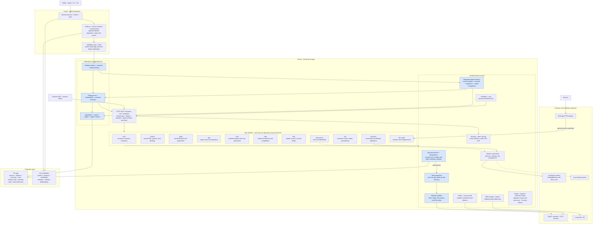
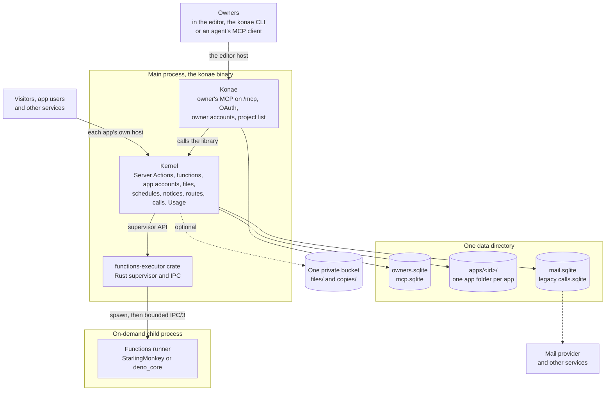
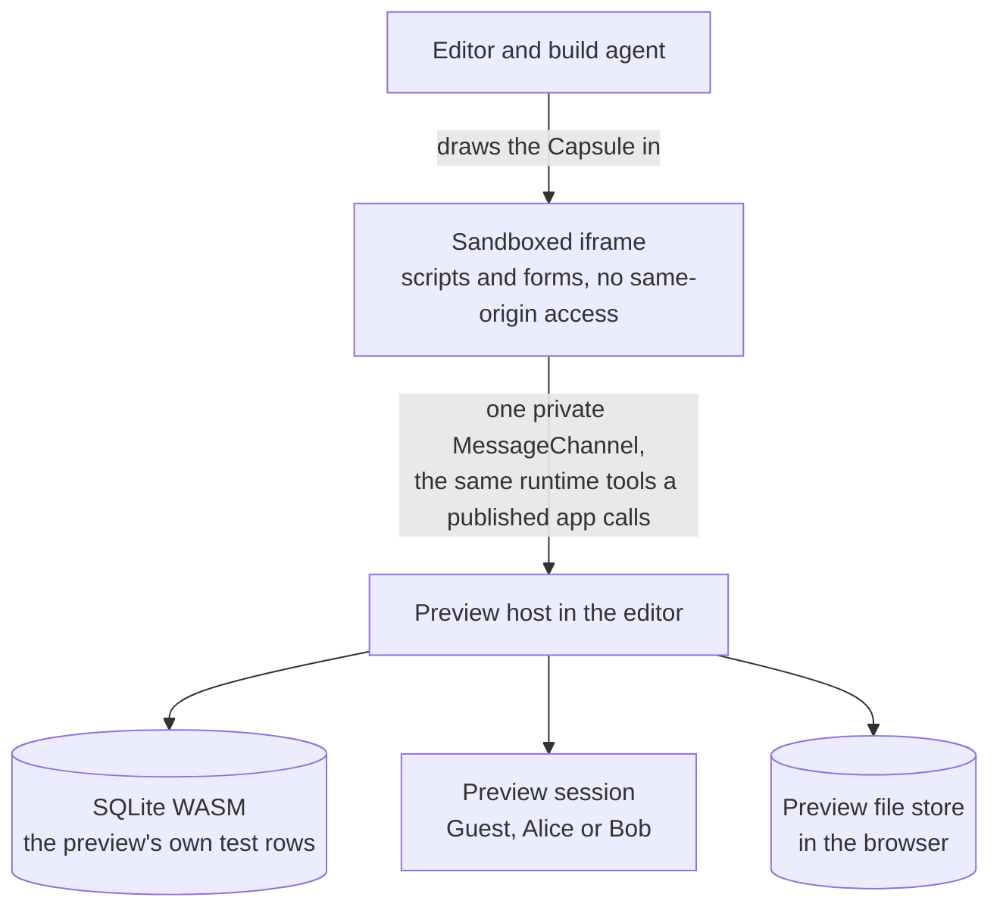
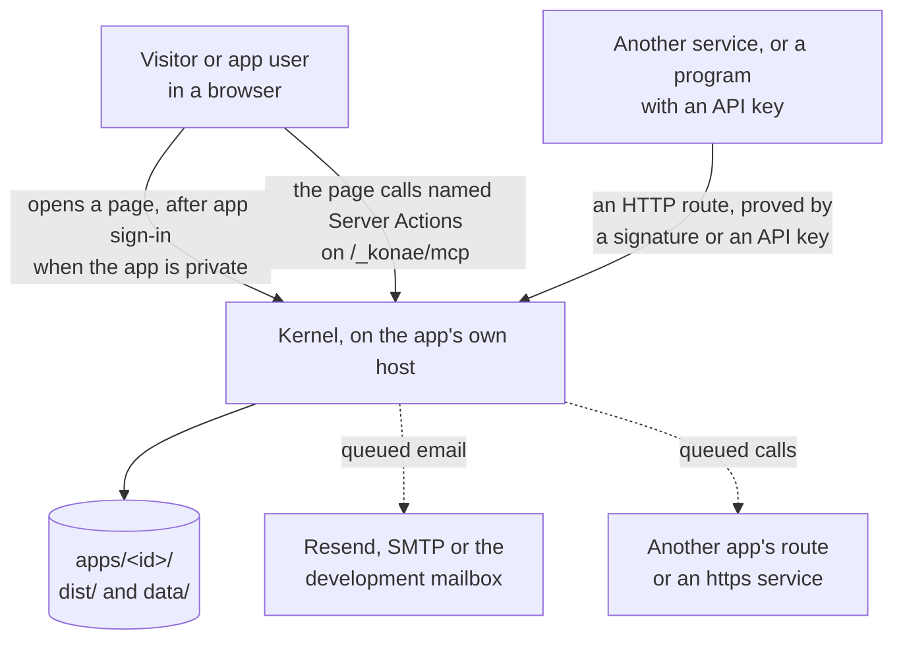

# Konae architecture

## Complete architecture

This map shows how the Kernel serves apps, runs workers and talks to installation adapters. Blue boxes mark shared Kernel services. Each app keeps its own accounts, rows and access rules.



The registry describes each module's state, reserved tables, format version and export components. Publication checks pending work against the candidate schema before activation. HTTP, MCP, Functions, schedules and cron resolve the app, release, actor or job, permissions and limits. Calls, Notify, Documents and File intake handle their own durable records through the shared dispatcher.

### What app authors must declare

Konae requires app authors to make backend decisions in the app's declarations. The Kernel enforces the accepted contract whenever the operation runs. Authors should receive access checks, resource limits, transaction handling and operational records by using that contract, without writing middleware for each app. Functions must use the same declared operations and verified identity.

| Author decision | Enforcement in the current Kernel | Benefit for the app |
| --- | --- | --- |
| Name an operation and declare its input bindings | Both validation doors check the declaration; the Kernel binds input to prepared SQL. The browser has no generic SQL endpoint. | Invalid inputs fail before SQL execution; the operation has a stable name for usage records. |
| Declare access and use the verified actor in row rules | The Kernel checks access and supplies actor bindings. Input cannot replace the actor. | Identity checks are shared by SDK, HTTP and Function calls. The app still owns its row policy. |
| Bound row reads and use declared queries or mutations | Validation requires bounded queries. Runtime applies result budgets, deadlines and SQL admission. GET Functions cannot invoke mutations. | Requests have resource limits without each author implementing them. |
| Request an effect through its module | Notify intentions commit with the mutation. Calls retains its accepted request and continuation. | The app does not need its own notification queue or recovery loop. |
| Declare a Function's allowed actions | The Kernel checks the allowlist and actor on each call. A POST with allowed actions requires an idempotency key and stores its receipt with the changes. | JavaScript cannot acquire additional authority; a replay cannot duplicate a committed Function mutation. |
| Keep app state in declared schemas and module-owned storage | The lifecycle code packages accounts, rows, module records and referenced blobs. | Moving the app uses the same export path as other apps. |

The Kernel records usage and execution outcomes on the supported operation paths, and Functions also records timing. Signals describe occurrences the author explicitly names. Operational telemetry must not require an app to emit its own Signal for every request.

### Contract work still needed

`authenticated` proves an identity, not the correctness of arbitrary row-filtering SQL. The Kernel cannot infer whether a table belongs to a household, an organization or every app user. The next access-contract work should require an explicit scope and allowed/denied examples that run through both doors and after import. It must preserve app-defined roles. Today the portable permission examples demonstrate these checks, but publication does not require every app to supply them.

Idempotency is currently guaranteed for the declared Function POST contract and internal durable work. Ordinary Server Action mutations do not acquire that guarantee automatically. A future mutation retry contract must define its key, scope and replay result before the Kernel accepts automatic retries.

Each new module must expose its operation name, outcome and resource use through the common execution path. Uniform cross-module timing and correlation are still extension work; the current Functions timing store is not a complete tracing system. The acceptance test for a module must invoke it through every supported entry, reject unauthorized input, exercise its budget, inspect its operational record and move its state to another Kernel. Missing runtime guarantees cannot be replaced by a recommendation in the app's README.

### Dependencies between the boxes

| Caller | Uses | Reason |
| --- | --- | --- |
| Files | Auth, blob storage | Account-owned uploads and byte storage |
| HTTP | Actions | Expose named actions through declared routes |
| Page | Actions, routing | Resolve declared page paths and parameters |
| SEO | Routing and published page metadata | Generate addresses and search metadata |
| Calls | Actions, durable work, HTTP transport | Commit an outgoing request and later apply its completion |
| Functions | Worker supervisor, explicitly allowed operations | Run app code with a fixed actor and bounded authority |
| Schedule and cron | Actions or Functions | Start the declared operation at its due time; committed effects wake their dispatcher |
| Notify | Mutation result, verified recipient, mail transport | Request an email after an accepted mutation |
| Documents | Actions, transactions, blobs, dispatcher, Typst | Freeze document input, render it and authorize downloads |
| File intake | Transactions, blobs, dispatcher | Accept a version and record its change for declared consumers |
| FTPS adapter | File intake | Translate a device transfer into an accepted app version |
| Export, import, copies and cleanup | Every module's data inventory | Preserve live state and pending work, identify referenced bytes |
| Usage and Signals | Execution outcomes and declared signals | Report what happened without controlling domain decisions |

Functions requires Actions when its declaration invokes actions. Documents requires Auth when its access query requires an app session. Intake requires Functions when its consumer is JavaScript. A module's declaration determines these dependencies.

### The architectural changes

| Shared piece | Implemented behavior | Extension point |
| --- | --- | --- |
| Module registry | `modules.json` and the compiled registry own module settings, reserved table names, state versions and export components. Schema migration and SQL authorization consult registered names. | A module registers its tables, version, migration and export components once. |
| Execution and transactions | `execution::Context` carries app, release, actor or job, typed job authority, allowed operations and limits. Actions, Functions, schedules and Calls continuations use the same authority checks. Typed effects prepare receipts and Notify intents on the app transaction's connection. | New in-process handlers receive the context and connection-owned services without depending on a JavaScript engine. |
| Background execution | The compiled registry starts the Calls and Notify workers. The dispatcher gives ready apps turns by resource. Import and maintenance resume wake all registered handlers. | A module registers its handler and keeps its durable records, retry policy and transport adapter. |
| Publication and lifecycle | The publisher checks pending Calls against the candidate schema before activation. Static GET captures bytes and ETag under the lock for the same release, including rollback. | A module declares retained inputs and compatibility checks before adding a data migration. |
| Export and import | Registered reserved names and export components keep internal state known to schema migration, SQL authorization and portable packages, including when Actions is off. | New module state joins the registered inventory and the existing package path. |

Mail delivery remains at installation scope. New Calls live in each app's `database.sqlite` beside its rows. The Calls registry declares its table, format version and migration. The offline queue migration transfers old installation rows into the app database, keeps each `callId`, and deletes a source row only after the app commit. Account mail and owner administration keep their respective identity and installation stores. A transaction spanning app rows and an effect must use the same SQLite database. Blobs are staged before that transaction and become visible through committed references.

#### Migrating the legacy queues

The Kernel does not convert `calls.sqlite` during startup. The operator stops the Kernel first, then runs these commands against a local copy of the installation data. The first `queues preflight` reads installed records without upgrading app settings. It reports affected app IDs and whether their consumers are paused. Put those apps in maintenance, then run preflight again and proceed only when `consumersPaused` is true. Preflight also checks for a declaration for each pending Call in the current release, the supported `mail.sqlite` columns, and the key that opens every encrypted account link. It reports a short key fingerprint, never the key.

Legacy Calls did not retain their accepted declarations. Migration fixes the currently published declaration for each old job, matching the declaration the old worker would use at that moment. If the declaration is missing or the old job requires different behavior, drain it with the previous release before migrating. New jobs retain their declaration when accepted.

```sh
export KONAE_DATA_DIR=/path/to/local-installation-copy
export KONAE_QUEUE_CONSUMERS_PAUSED=1
./konae queues preflight
./kernel maintenance on --app <affected-id>
./konae queues preflight
./konae queues migrate
./konae queues rollback /path/printed/by/migrate
```

Stop every process that serves this data directory before the first command. Repeat the maintenance command for every app ID returned by preflight. The exclusive Kernel lock makes migration and rollback refuse while a serving Kernel runs. `migrate` writes a checksummed backup of the queue and app databases before changing anything. It copies each Calls row transactionally and deletes its source only after the target commit, so interruption can resume without changing IDs or duplicating rows. It leaves `mail.sqlite` and all app files in place. Rollback checks every backup checksum before restoring databases and sidecars. Use rollback before resuming writes because it restores the database contents at backup time.

`mail.sqlite` is an ordinary SQLite database, not an encrypted database. Account links in `jobs.link_sealed` use AES-256-GCM with the job ID as associated data. The migration reads `KONAE_MAIL_SECRET`, then `KONAE_SETUP_KEY`, then the private `mail-key` fallback, and checks the ciphertext before proceeding. Keep the same installation key through migration. Never copy it into an app folder or export. If no key opens the old bytes, use the previous release and its original key to drain those messages; a replacement key cannot decrypt them.

### How another module is added

A module supplies declarations and their validation cases, typed operations with access checks, versioned state and the lifecycle hooks it needs. A module with background work also supplies a job handler. The Kernel provides an app-scoped execution context and only the services the operation declares.

Register modules explicitly when compiling the Kernel. Ordinary app logic uses Actions and Functions. A new native capability adds a module and its tests. The architecture succeeds when that addition leaves unrelated modules' implementations intact and the existing publication, export and dispatch paths handle it through the registered contract.

| Module responsibility | Registration point |
| --- | --- |
| Settings, internal tables and portable format | `modules.json`, with validation cases and the module's migration code |
| Rows and effects in one commit | `TransactionEffect::prepare` on the supplied app connection |
| Work after the response | A handler in the compiled registry, durable app records and a dispatcher resource |
| Stored bytes | A blob-reference provider in `modules`; Files keeps its own download ACL |
| Retained SQL requirements | A compatibility hook called by `modules::check_pending_work` inside the candidate schema transaction |

Documents and File intake register private blobs and durable work. FTPS feeds the intake operation. App MCP publishes selected query Actions under the app account's authority. Each module follows the existing publication, permissions and portability checks.

## One installation



An installation has a main server process and one data directory. Functions may start child runner processes on demand. Owners reach Konae on the editor host, through the editor, the CLI or an agent's MCP client. Visitors, app users and other services reach the Kernel on each app's own host. Konae keeps owners and the project list in its two stores. The Kernel keeps pending Calls and Notify intents in each app folder, while the installation mail queue tracks delivery. The legacy `calls.sqlite` remains until queue migration. The `kernel` binary is the Kernel alone, with no Konae in front.

## Kernel, Konae and the functions executor

The Cargo workspace under `kernel-rs` contains the Kernel, Konae, the backup library, and the Functions executor. Each runner and the preparer have their own Cargo workspace and lockfile. The Kernel owns identity, authorization, SQLite, and request admission. The executor supervises workers and sends bounded IPC/3 messages. StarlingMonkey is the default runner. The Kernel uses its preparer before serving a published bundle. [ADR-0020](./adr/0020-wasm-functions-runner.md)

```text
kernel-rs/
├── kernel/              the Kernel library and binary
├── konae/               the Konae binary, which links the Kernel
├── backup/              snapshot and copy formats and storage
├── functions-executor/  worker supervision and the IPC protocol
├── functions-runner/    the deno_core worker binary
├── functions-runner-wasm/ the StarlingMonkey worker binary
└── functions-prepare/   the StarlingMonkey component preparer
```

`kernel` runs apps. Its binary opens every folder under `<KONAE_DATA_DIR>/apps/`, checks each as a release, and applies the schema change `app/schema.sql` asks of `data/database.sqlite` when actions is on. It serves Server Actions, app accounts, files, schedules, notices, HTTP routes, functions, calls and Usage according to each app's modules. It answers the runtime endpoint `/_konae/mcp` that the browser SDK calls. It never opens an owner's records. Its commands on one app (`users`, `invite`, `suspend`, `resume`, `signup-policy`, `api-key`, `secret`, `sql`, `events`, `maintenance`, `enter`, `import`) live in `server/operator.rs`, and each calls the function the matching owner tool calls. It also runs the installation commands `restore`, `reconcile`, `files-migrate` and `files-reconcile`.

The Functions interface, actor binding, action allowlist, replay behavior, and export boundary are documented in [Server functions](./functions.md). [Functions research](./architecture/functions-research.md) records earlier experiments.

`konae` is the platform. It starts the same Kernel with an `Installation` that adds its own stores, and adds the owner's MCP on `/mcp`, OAuth for MCP clients, owner accounts and their admission, optional Clerk sign-in, the `platform_guide` topics, the project list and, when `KONAE_EDITOR_DIR` names it, the built editor on the editor host. It runs the same installation commands, and adds `owner-code-*` and `owner-account-*` commands that admit and suspend owners.

The editor in `src/` and the CLI in `scripts/konae.ts` talk to Konae over the owner's MCP. Both publish through `publishProject` in `src/deployments/release.ts`, and `konae tool <name>` calls any owner tool by name, so a new tool needs no new command. `konae dev` talks to neither: it builds the folder and runs the `kernel` binary on it.

### Modules of `kernel`

The Kernel groups code under `kernel-rs/kernel/src/` by the decisions it makes. The server assembles the routes and workers. Capability modules own their rules and expose the operations that HTTP, MCP, and the commands call.

| Module | Owns |
| --- | --- |
| `server/` | Startup, route composition, runtime MCP, transfer protocol, middleware, and operator commands |
| `deployments/` | The live Deployment, publishing, artifact activation, and applied settings |
| `app_folders/` | Folder layout, startup from an app folder, saved sources, import, and export |
| `app_accounts/` | Signup Policy, account verification, sessions, invitations, and Google sign-in |
| `app_data/` | App database connections, schema changes, Owner SQL, and app database backups |
| `actions/` | Action declarations, bindings, SQL rules, and execution |
| `files/` | File access policy, the app's index, upload, listing, reads, and deletion |
| `functions/` | Manifest and artifact checks, HTTP admission, worker reuse, and the Function-specific idempotency receipt |
| `execution.rs` | App and release context, actor authority, operation limits, shared SQL admission, typed effects, and the bounded in-process dispatcher |
| `server/state.rs`, `server/startup.rs` | Dispatcher ownership, fair admission, and recovery wake-ups |
| `integrations/calls.rs` | Portable Calls records, accepted declaration and input, job handler, transport boundary, and guarded completion |
| `notify.rs`, `installation/mail.rs` | Portable notice intents, per-recipient delivery state, idempotent handoff, and installation mail transport |
| `modules.json`, `modules/` | Module state contract, reserved database objects, versions, migrations, dependencies, and package components |
| `app_data/schema_change.rs`, `app_data/schema_transform.rs` | Registered table ownership, schema planning, and module migrations |
| `routing/` | Hostnames, domains, path addresses, pages, static responses, and SEO |
| `modules/` | The registry, module state, options, and dependencies |
| `installation/`, `copies/` | Installation stores, mail delivery, maintenance, copies, restore, and revocation records |
| `file_store.rs` | Local and S3 blob adapters, quotas, migration, and reconciliation |
| `usage.rs`, `usage/` | Usage, Signals, and Functions timing data |
| `refusal.rs` | Refusal codes, messages, and hints |

Keep decisions in the module that owns the state. For example, the file URL and the runtime MCP both ask `files` which files the actor may read. The blob adapter handles the bytes. Shared case files stay in `kernel-rs/kernel/src/` so the editor and Kernel can run the same examples.

### Dependencies between app modules

A dependency follows a declared operation. A Function that calls a Server Action needs Actions. One that returns text can run alone. A module that shares blob storage with Files can run with Files off.

| Proposed operation | What happens |
| --- | --- |
| Issue a document | An Actions mutation returns the document ID, recipient and snapshot. Before commit, Documents records the pending issue on the same SQLite connection and pins the template, fonts, assets and compiler version. Rollback cancels both writes. After commit a worker renders the PDF. Retries publish one result per issue ID. Downloads run the app's access query for the current actor and serve the stored PDF. |
| Receive a file | One FTPS listener maps each credential to one app and source. Intake stages the bytes, then commits the version and a pending change before acknowledging the transfer. A new path records a creation. Replacing its contents records an update. Each event identifies the source, path and immutable version. The source declares how to recognize a retransmission after a lost acknowledgement. |
| Process a file | The app declares a consumer for the source. The dispatcher can redeliver after a crash. The consumer reads that version and records its result once per version and consumer. A JavaScript parser would require a narrowly scoped Function input for those bytes. Intake and Documents themselves both work with Functions off. |

File intake v1 implements the source and consumer records with reserved app tables, immutable shared-store blobs and a declared Actions mutation. The mutation receives version metadata and fixed app input, not bytes or host access. See [File intake v1](file-intake.md) for declarations, replay and local acceptance.

Keep module records in Kernel-controlled tables. When a mutation promises an effect, give the module a typed way to append its record to that mutation's transaction. App SQL must have no direct write access to those tables. After a move, existing PDFs remain readable and pending work resumes once its required renderer is available. New device uploads resume once the operator binds the FTPS source.

### Compatibility across Kernel versions

The compiled registry is the source of reserved table names, module data versions, migrations and export components. Schema planning applies a module migration only when its registration is present. SQL authorization denies app writes to registered internal tables, and package export asks each registered module for its data components even when Actions is off. A module can therefore retain private state without enabling the app's SQL interface.

Publication checks the candidate release against durable work before switching the active database or artifact. Pending Calls keep their accepted declaration and input; the publisher prepares each continuation against the candidate schema and refuses incompatible changes with `schema.pending-work`. Static GET reads access rules, bytes and ETag while holding the shared app lock, so a successful switch or rollback cannot mix revisions. These checks run in the normal plan, publish and serving paths.

An unknown module explicitly set to `on: false` can remain in the folder without being executed. An active unknown module is refused. An exported package also declares versions of its module data, and import rejects unknown or unsupported declared data versions. Older packages without that field follow the existing package validation path. These checks do not make an older Kernel understand a new active capability.

### Background dispatch in use

Pending Calls and Notify intents live in each app database. The in-process dispatcher keeps bounded, deduplicated queues of ready app IDs and gives each app one turn. Calls and notice handoff have separate resource queues. Their handlers claim durable work from the app database, and the mail transport keeps its own installation queue and worker. Each module defines when its job has succeeded. Workers receive references to stored bytes.

Each module admits at most 1,000 pending jobs of its handled kind per app. Producers signal after committing. Startup checks served apps once to recover lost signals, while import and maintenance resume signal the affected app. Each resource keeps at most one queued entry and one retry timer per app. There is no fixed cap that drops wake-ups when many apps become ready. A handler takes one job and returns the app to the queue if more work remains. Failed reads use the same retry timer with backoff. Idle apps need no repeated scans.

Notice handoff uses the installation mail queue and its separate worker. Mail reconciles changed recipient outcomes in batches and records which results reached the app database. A confirmed result causes no further app writes until its delivery state changes.

When moving an app, recover its pending internal work and coordinate the handover before resuming external deliveries. An SMTP server may already have accepted a message when the sender loses its connection.

### Local workers and scaling

A self-hosted installation starts one serving process. Its Rust code uses Tokio to coordinate I/O, timers, work admission and child processes. Keep reads and short mutations on the request path. Use Tokio's blocking pool for short blocking calls and bound how many run at once. For work that needs its own memory limit or must stop at a deadline, the Kernel starts and supervises a local child process. The operator starts the same service in either case.

Use the existing dispatcher for durable work. Each module keeps its own job records and decides when work is complete. Give ready apps turns and bound concurrent jobs by app and installation. Functions already has both limits and scheduled Functions use the same runner. Keep the current cron order within an app.

Documents is the first external renderer. Its handler sends a local Typst process the frozen input, template and assets for one render attempt. The Kernel remains the sole writer of the app folder. It checks the result and commits it only while that attempt is current. A retry keeps the same emission ID. File intake v1 uses the shared dispatcher for pending Actions consumers. MCP reads continue through the app's Actions.

Check this design by filling one app's render slots while another serves reads. Measure read latency and render wait time. Stop a render process mid-job, then check that a retry produces one PDF and that a late result cannot replace it. If render capacity later limits an installation, a remote worker can take the same render inputs and return the result to the owning Kernel. If contention comes from the app's database or its total load, [move the app to its own Kernel](#when-one-app-needs-its-own-kernel).

### Functions execution

`functions/manifest_artifact.rs` checks declarations and reads bundled handlers. `functions/http.rs` selects the Deployment and authenticates the request. `execution::Context` pins app, artifact release, actor, operation allowlist and limits. Actions, Functions, scheduled mutations and call continuations use that authority check. `functions/invocation.rs` keeps the Function transaction open across its declared actions, and its typed `FunctionReceiptEffect` writes the existing idempotency receipt on that same connection before commit. Actions run synchronous SQL directly. A Function reuses its connection, budget and admitted app and installation slots for every action it groups.

`execution::TransactionEffect::prepare(&Connection)` is the in-process hook for a module-owned effect that must commit with app rows. `TransactionEffects` runs those hooks before the transaction commits. A handler must use the supplied SQLite connection, perform no network I/O, open no nested transaction and acquire no second SQL slot. Function receipts and notice intents use this hook. Calls persist their accepted declaration and input in the app database. After commit, the dispatcher wakes their module handlers. A Calls result commits only while its app, accepted release, operation ID and attempt still own the job. Notify delivery keeps its durable intent and per-recipient outcome in the app database, then transfers it idempotently to the installation mail queue.

A standalone HTTP host could use the worker runtime once it has a second caller. That host would mount validated bundles and supply the capabilities it allows. Konae's app identity, Server Action permissions, and data rules belong to the Kernel host.

### Modules of `konae`

| Module | Owns |
| --- | --- |
| `main.rs`, `state.rs` | Start the Kernel with Konae's routes, stores, and account settings |
| `mcp/` | The Owner's MCP on `/mcp`, its tool catalogue, credentials, and audit |
| `projects/` | Source revisions, release planning and apply, import, and export |
| `owners/` | Owner accounts, admission, optional Clerk sign-in, OAuth, and sign-in pages |
| `conversations/` | Account-scoped editor conversations and their history |
| `editor/` | Serving the built editor from `KONAE_EDITOR_DIR` |
| `guide.rs` | The topics that `platform_guide` returns |

## The app folder

An app is one folder, laid out the same way on a laptop, inside a Kernel and in an export. `kernel-rs/kernel/src/app_folders/layout.rs` names every path.

```text
apps/<id>/
├── konae.json          app settings, identity and manifest
├── app/                sources, including text and binary assets
├── dist/               the Build Artifact the Kernel serves
├── server/             private Functions bundles, not served to browsers
├── data/
│   ├── database.sqlite # app rows, module state and pending Calls
│   ├── identity.sqlite # app accounts, sessions, challenges, invitations and API keys
│   ├── usage.sqlite    # Usage, Signals and scheduled runs
│   ├── files/          # file index and local uploads, unless a bucket holds bytes
│   └── secrets.sqlite  # signing secrets and the Google client
└── .konae/             installation state, never exported
    ├── deployment.json # project record and applied artifact metadata
    ├── backups/        # snapshots before import or on request
    ├── hostname.json   # generated hostname history
    ├── domain.json     # custom domain and proof
    ├── path.json       # path address
    └── maintenance.json # only while the app is in maintenance
```

A folder from `konae init` also carries developer files beside `konae.json`: `AGENTS.md`, `action-contract.md`, `actions.d.ts`, `compose.yaml`, `.env.example`, `.gitignore`, `package.json`, `tsconfig.json`, `scripts/build.mjs`, `scripts/static-artifact.mjs`, `scripts/local-builder.mjs` and `scripts/runtime.js`. The Kernel opens a portable folder with `konae.json`, `app/`, `dist/` and `data/`; generated developer files are optional. It does not require `.konae/sources.json` or `manifest.runtime`.

Inside Konae, `.konae/` keeps installation state and never leaves in an export. It contains the project record, applied artifact metadata, backups, address state and maintenance state.

The `<id>` is the project's ID, and it names the Deployment too. An export hands over everything above except `.konae/` and `data/secrets.sqlite`. It carries the app's accounts and leaves its owner, sessions, email links and signing secrets behind, and its API keys arrive revoked ([ADR-0008](./adr/0008-an-app-leaves-by-export-and-returns-by-import.md)). The `kernel` binary starts an exported folder by writing its own `.konae/`.

`schema.sql` is the only model of the database. At publish, at import and when the `kernel` binary starts a folder, the Kernel compares it with the live database and derives the schema change. A new table, column or index applies. A dropped table, a dropped column or a retyped column applies only with the confirmation the plan names ([ADR-0005](./adr/0005-schema-sql-is-the-only-model-and-a-release-is-all-or-nothing.md)).

### One revision per request

Publishing switches `dist/` before replacing the in-memory Deployment. Static serving takes the app's shared database lock, resolves the Deployment again under that lock, and captures the artifact bytes before releasing it. The publisher holds the matching exclusive lock while it replaces the database, sources, artifact and Deployment. A GET therefore uses one release for its access rules, ETag and bytes, including when publication rolls back. Static serving drops the lock before dispatching a page action.

The publisher holds the app lock only while it checks and installs the candidate database and switches release files. A release with identical `schema.sql` and schema-transform declarations checks pending Calls against the live database and skips the database copy. Other schema changes use a staged database. Before activation, the publisher prepares every pending Calls continuation against the candidate schema. A continuation that no longer prepares blocks publication with `schema.pending-work`; finishing the job permits the owner to plan and confirm the change. In a concurrent publish test, the body and ETag must belong to the same revision after success or rollback, and a second app must answer while the first is switching.

### Refactor acceptance

Each worker result must name the app, accepted release, operation ID and attempt. The Kernel commits a result only while that attempt still owns the job. A retry or restart must keep the accepted declaration and input. The durable Calls and Notify handlers carry these ownership checks through their normal dispatch and completion paths.

Publication tests must read a response body and its ETag from one release, then repeat after a failed switch. A Calls test must enqueue under release A, publish release B, export and import the app, then deliver the saved A request and continuation.

The portable Club permission case binds `notes.mine` to a freshly authenticated app actor and the row rule `notes.user_id = actor.id`. It runs allowed and denied reads against the imported database on the receiving Kernel. Its synthetic fixture is part of the tested source revision and stays outside `dist/`. The replay reports the fixture/source revision digest separately from the active artifact release. A host account does not replace the app's row decision.

## Who owns which store

```text
<KONAE_DATA_DIR>/
├── apps/<id>/              the Kernel: one app folder per app
├── mail.sqlite             the Kernel: the email queue
├── calls.sqlite            the Kernel: legacy Calls rows awaiting app migration
├── transfers.sqlite        the Kernel: unfinished MCP transfers and upload receipts
├── transfers/              the Kernel: their bytes
├── files-store.json        the Kernel: which file store holds the bytes
├── mail-key                private mail fallback key, created by kernel startup or app commands on either volume
├── mailbox.jsonl           the Kernel: the development mailbox, with KONAE_MAIL_TRANSPORT=development
├── recovery-hold.json      the Kernel: only after a restore that could not read the revocation record
├── owners.sqlite           Konae: owner accounts, sessions, challenges and invitation codes
└── mcp.sqlite              Konae: the project list, agent credentials, OAuth and the audit log
```

`konae dev` keeps test mail separately at `<app folder>/.konae/kernel/mail-testbox.jsonl`. The `mailbox.jsonl` above remains the live Kernel's development transport file.

| Store | Owner | Leaves with an export | Leaves with a copy |
| --- | --- | --- | --- |
| `apps/<id>/data/database.sqlite`, `identity.sqlite`, `usage.sqlite`, `files/` | The app | Yes | Yes |
| `apps/<id>/data/secrets.sqlite` | The app, on this installation | No | Yes |
| `apps/<id>/.konae/` | The installation | No | Yes |
| `mail.sqlite`, `calls.sqlite`, `transfers.sqlite` | The Kernel | No | Yes |
| `owners.sqlite`, `mcp.sqlite` | Konae | No | Yes, under Konae |

A bare `kernel` keeps no owner and no audit log. Under Konae the same Kernel adds `owners.sqlite` and `mcp.sqlite` to the stores a copy carries and a restore installs.

Export and import temporarily hold the app in maintenance and synchronize its mail receipts. If a notice has reached `mail.sqlite` but remains pending there, the transfer refuses with a count and asks the operator to drain that queue first. Handed-off terminal and uncertain outcomes travel with the app and are not retried. Intents that have not reached the mail transport stay portable and resume after import. For a move, keep the source in maintenance until the receiving Kernel takes over.

With `KONAE_S3_BUCKET` set, upload bytes live under `files/` in the installation's bucket, and `data/files/index.json` in the app folder still decides which files exist and who may read them ([ADR-0009](./adr/0009-file-bytes-go-through-one-store-and-the-index-stays-with-the-app.md)). SQLite, sources and `dist/` stay local. With `KONAE_COPY_S3=1`, copies go to `copies/` in the same bucket and carry their own file bytes, so a copy restores a file deleted after it was made.

The module inventory enumerates unique blob IDs and sizes from each registered provider. Export, import preflight, restore, copy, quota checks, cleanup and `files-migrate` use that inventory regardless of the Files switch. A failed inventory read stops cleanup before deletion. An archive can carry a module's private blob without adding it to the Files index or granting access through Files.

Documents and File intake register their own blob references. The Kernel checks the shared quota under the app lock before committing a reference. Documents keeps the frozen render inputs with its issue. File intake keeps each version's SHA-256 and confirms the upload after the version and consumer jobs commit.

For the portability test, render one receipt with template A and leave a second pending. Publish B, export and import on another machine with Files off. Disconnect the source. The first download must match its original SHA-256. The second must render with A's distinct content. For `files-migrate`, switch from S3 to local, disconnect the bucket and run reconciliation. Verify the stored hashes of the PDF and a pending FTP version. A separate quota test should race two uploads for space that can hold only one.

## Two doors, one set of refusals

A Capsule meets two checks. The Validation Gate (`src/agent/gate.ts`, with the parser in `src/kernel/actions.ts`) runs in the editor before Apply. When actions is on, the Kernel parses the same `actions.json` and `schema.sql` at `release_plan` and when the `kernel` binary starts a folder. When actions is off, it accepts both files missing and creates no app database. Both refuse a used module that is off with the same code and sentence. Shared rules have case files that both test suites run, such as `module-use-cases.json`, `sql-rule-cases.json`, `action-cases.json`, `http-binding-cases.json`, `guard-cases.json`, `schedule-cases.json` and `call-cases.json`. Other case files cover one side only ([ADR-0004](./adr/0004-the-gate-and-the-kernel-refuse-with-the-same-code-and-words.md)). The query bound is `src/lib/query-bound.ts` on one side and its port in `actions/sql.rs` on the other.

An artifact holds pages and the files they load. `src/lib/static-artifact.js` decides which Capsule files become the artifact, and the CLI, the editor and an app folder's `npm run build` all run it. When a module with a browser call is on, it refuses a Capsule with an entry (`src/main.tsx`, `src/main.ts` or `app.js`) whose pages are all whole documents that load no script, because that entry would never run, and the Validation Gate refuses it with the same sentence. With all such modules off, the builder accepts those documents and injects no SDK. `kernel-rs/kernel/src/routing/artifact.rs` decides which file answers a path: an exact file first, then `<path>.html` for a path with no extension and `<path>/index.html` for one that ends in `/`. Under the default `pages` routing anything else answers 404 with the artifact's `404.html` or a small Kernel page. Under `spa` it serves `index.html`.

### A shared parser for action declarations

The two parsers can disagree about which rule failed first. Give them 101 actions with `bindings` missing from one. The editor parser reports the 100-action limit. The Kernel reports the missing field. A proposed Rust parser would return either the normalized action program or the first refusal with its code, message and hint. The Kernel would call it natively. The editor would load it as WebAssembly on the first Actions validation and pass the resulting program to Preview. Published pages would ship none of the parser. Each host would still check statements against its own SQLite database, and the Kernel would enforce runtime access.

The [validation experiment](./adr/0004-the-gate-and-the-kernel-refuse-with-the-same-code-and-words.md) measured a 178 KB gzipped prototype. Before replacing the TypeScript parser, measure cold validation in the editor and run both builds on the same corpus. Include files with multiple errors to verify refusal order, and valid files to compare bindings and the results that Preview and the Kernel return for the same actor and rows.

## The editor preview



The preview iframe has `allow-scripts` and `allow-forms` but no same-origin access, so generated code cannot read the editor's storage or credentials. Each preview gets one private MessageChannel and calls the same runtime tools a published app calls. The build agent edits a candidate copy of the Capsule. It appears in Preview before Apply, with separate candidate rows, files and actor. Discard drops that state. Apply is available after the candidate builds and its preview host is ready. The Gate shows refusal details and remedies, and reports only the stages it checked. When PREVIEW_BEHIND skips row checks, the summary says so ([ADR-0007](./adr/0007-the-build-agent-edits-a-scratch-copy-and-operates-through-the-owners-mcp.md)).

The preview is a development boundary, not a sandbox for hostile code. It applies no Content Security Policy and has no HTTP routes, schedule timer, notice email, Usage store or call outbox. [Named divergences](./divergences.md) lists every difference.

## A published app



Every request to an app arrives at the Kernel on that app's host. A browser loads the pages and then calls named Server Actions, and another service calls an HTTP route with its proof. The Kernel answers from the app folder, and email and calls leave later from its queues. The owner never comes in this way. The editor, the CLI and an agent reach the same app through the owner's MCP on Konae, as [One installation](#one-installation) shows.

Visibility and data authorization are independent.

| Deployment | Who can open the pages | Who can read data |
| --- | --- | --- |
| Public | Anyone | Only actors each Server Action allows |
| Private | App users signed in to this app | Only actors each Server Action allows |

On a public Deployment a visitor may call actions declared `anonymous`, and may list and read files marked public. On a private Deployment nothing loads or runs without an app session, except the HTTP routes of actions declared `anonymous`. A route answers the callers it declares, and `kernel-rs/kernel/src/integrations/http.rs` resolves the caller before any SQL runs ([ADR-0013](./adr/0013-http-routes-take-named-callers-and-calls-leave-through-the-kernel.md)).

| Caller | Proof | Acts as |
| --- | --- | --- |
| Another service | The route's signature, under a signing secret of the app | A visitor, with no actor ID |
| A program the owner wrote | An API key that names the action, sent as `Authorization: Bearer` | A Runtime Actor with the key's ID |
| A signed-in person | The app session cookie | The app user |

The browser never receives a database credential, the SQLite file, a generic SQL endpoint or an owner capability. A page calls named Server Actions, and the Kernel resolves the Deployment and the actor from the host and the session or key, validates the input, applies the action's access and the quotas, then runs its prepared statement. Developer tools can replay any browser request, so security never depends on hiding an SDK method or a button.

HTTP routes, declared pages and runtime MCP calls read the action declarations for the active Deployment. Each request still checks access against its actor. MCP distinguishes a malformed stored program (500) from an unknown action (404). The publisher installs the action program with the release under the app lock.

The owner side is a different trust domain. SQL on the live database, backups, export and import go through the owner's MCP, with the owner's permissions and Konae's audit log. An app session never authorizes an owner tool. A path under `/_konae/` that names no route of the Kernel answers 410 and points to the owner's MCP.

An upload is private to the app user who uploaded it unless the upload sets it public. With the `files` module option `fileAccess` set to `"app-users"`, every signed-in user of the app may read every upload, and only the uploader deletes one. `GET /_konae/files/<id>` serves a file to a caller allowed to read it: a signed-in app user from the app's own origin, a visitor for a public file of a public Deployment, or an API key that names the file's visibility. Only the uploader changes a file's visibility or deletes it. Nothing is served from the bucket, and no bucket URL reaches the browser.

Every verification, recovery and invitation link leaves through the queue in `mail.sqlite` ([ADR-0012](./adr/0012-email-leaves-through-one-queue-to-addresses-the-app-has-proved.md)). The transaction that issues a challenge writes its email job too, and a worker in the Kernel sends due jobs, retrying a provider outage for about two hours. While the sender preflight refuses, signup and recovery answer 503 and nothing is queued.

A scheduled copy takes each app's locks, snapshots its SQLite files with `VACUUM INTO`, copies the rest of its folder and writes a manifest of SHA-256 checksums last. `restore` installs one copy into an empty data directory, verifies every checksum, signs out every session and agent credential, and ends every open email link. Suspensions and API key revocations made after the copy are written to each copy target as they happen, and restore applies them, or starts the installation in maintenance when it cannot read them. A copy moves an installation for the same owner. An export moves one app, maybe to another owner, so an import revokes its API keys and a restore keeps them.

## Isolation of hosted code

Every app runs on its own host, `<slug>.<KONAE_HOST_SUFFIX>` when that name is free, or `<slug>-<code>.<KONAE_HOST_SUFFIX>` when another Deployment already holds the slug or the name is one of the installation's own hosts, and the editor runs on a host no app shares (`app.<domain>` when `KONAE_DOMAIN` is set). An app may also answer on one custom domain its owner proved with a TXT record ([ADR-0014](./adr/0014-an-app-answers-on-its-hostname-a-custom-domain-or-a-path.md)). The Kernel resolves it to the same Deployment, so it is that app's origin too, and no other app or the editor can take it. `kernel-rs/kernel/src/server/security.rs` adds the headers below to every response, so a bare `kernel` sends them too.

`<domain>` is one origin that the installation home and every path address share. An app on a path address answers its pages, routes and runtime under `<domain>/p/<id>` or `<domain>/p/<name>`, so a script of one app can open another app's page in the same origin, read its DOM through `window.open`, and send another app's session cookie with a request to its runtime. The Kernel refuses a runtime call whose Referer names another app's path, but only when the browser sends a Referer, so that check is not a boundary. The owner accepts this sharing when turning a path address on for an app with accounts or a private app. The isolation this section describes holds for generated hostnames and custom domains only.

App hosts get this Content Security Policy:

```text
default-src 'self'; script-src 'self' 'sha256-...';
style-src 'self' 'unsafe-inline' https://fonts.googleapis.com;
font-src 'self' data: https://fonts.gstatic.com;
img-src 'self' blob: data:; media-src 'self' blob: data:;
connect-src 'self'; form-action 'self'; frame-ancestors 'none';
object-src 'none'; base-uri 'none'
```

A fragment page in a Build Artifact inlines the runtime and the compiled module when a module with a browser call is on. A whole-document page loads the runtime from `/runtime.js` and its modules from the app's origin under the same condition. With every browser-call module off, pages ship without the runtime. The Kernel hashes every inline `<script>` of each HTML response and lists those hashes, so exactly the scripts in the published file run. Inline event handler attributes, `eval`, `new Function`, WebAssembly, Blob scripts and scripts from other origins do not run, because `script-src` names neither `'unsafe-eval'` nor `'wasm-unsafe-eval'`.

- Styles allow `'unsafe-inline'` because apps write `style="..."` attributes through `innerHTML` and the artifact inlines `styles.css`. Google Fonts is the only other origin, because the templates import it. Neither font host can read app data.
- Images and media accept `blob:` and `data:` so a page can show bytes it built itself, such as a generated PDF or an image preview before upload.
- `connect-src 'self'` limits `fetch` to the app's origin, plus the origins the manifest's `connects` lists, at most 10. A request that needs a secret or a key is a call action, which the Kernel sends.

Every host sends `frame-ancestors 'none'` and `X-Frame-Options: DENY`. Konae's pages on the editor host, such as owner sign-in, get `default-src 'self'` with their script hashes, and its JSON and errors get `default-src 'none'`. When `KONAE_PUBLIC_ORIGIN` or `KONAE_MCP_ORIGIN` is HTTPS, every response carries `Strict-Transport-Security: max-age=31536000; includeSubDomains`. A custom domain gets `max-age=31536000` alone, because the names under the owner's domain are not the installation's.

`konae` serves the built editor on the editor host when `KONAE_EDITOR_DIR` names it, as the `konae` image does, and the `kernel` binary never serves it. Vite serves it in development and in the Docker stack. The editor's policy stops at `frame-ancestors 'none'`, because its preview is a `srcdoc` iframe that inherits the editor's policy, and esbuild, sql.js and the model providers the agent calls need more than `'self'`.

Under HTTPS the owner cookie is `__Host-konae_owner_session` and the app cookie `__Host-konae_app_session`, both `Secure`, `Path=/` and without `Domain`. The Kernel ignores unprefixed names under HTTPS, so an app cannot plant a cookie for another. The app cookie is `SameSite=Lax` and the owner cookie `SameSite=Strict`. Over plain HTTP, as in the local stack, the cookies keep unprefixed names and no HSTS is sent.

The owner's MCP, owner sign-in and the OAuth routes refuse a request whose `Origin` is an app host before they read a credential. The runtime endpoint refuses an `Origin` that differs from its `Host`, so one app's page cannot call another app's runtime, and each app keeps its own accounts, so its session means nothing to another app.

`tests/security-http.integration.test.ts` and `tests/security-auth.integration.test.ts` check each of these against a local Kernel. `bun run examples/product-fit/smoke.ts` opens every example in Chrome and fails on a policy violation.

## When one app needs its own Kernel

App folders separate data. SQLite's memory limit applies to the whole process, including owner sign-in and the mail queue. Runtime SQL takes per-app and installation admission slots. A transaction keeps its slot through execution, including grouped Function actions and durable continuations. One admitted query can still consume the shared SQLite memory budget. [Limits](./limits.md)

Use two local apps to decide when to split. Measure errors and p95 latency for an ordinary read on B and for owner sign-in, first at rest and then while A runs its normal report. If a single report still breaks the installation's latency or availability target, try moving A's whole folder to a Kernel with its own memory budget and one writer. This preserves local SQL transactions and the existing app format. An SQL worker process would add a protocol for transactions and cancellation. Consider it if moving whole apps proves too costly. A separate machine becomes useful if the two processes still contend for CPU or disk.

Today the owner can move an app with maintenance, export and import. Automatic placement would also have to route runtime traffic and owner operations to the same Kernel, arrange backups, and transfer responsibility for pending deliveries before resuming them. App accounts and rules travel with the folder. Installation mail queues and owner credentials have their own lifecycle. [Export and import](./adr/0008-an-app-leaves-by-export-and-returns-by-import.md)

## Known gaps

- No per-app CPU quota. Request rates, rows, statement time, database size and file size and total have limits ([Limits](./limits.md)).
- Uploads are not checked by their magic bytes. The file path serves only raster images inline and everything else as a download.
- `"access": "granted"` is refused by both doors until the Kernel supports deployment grants.
