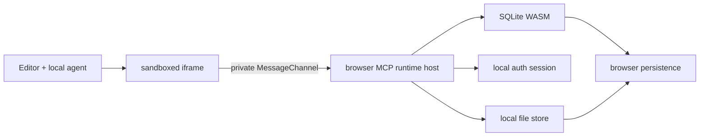
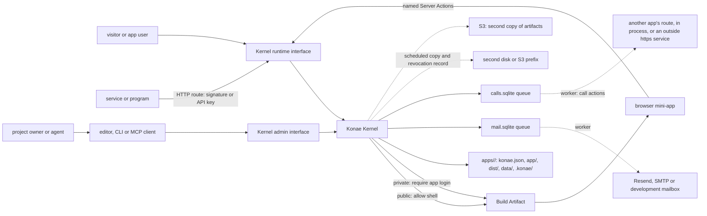

# Konae architecture

## Product rule

A new mini-app creates **no process, VM or container**. It is a static Build Artifact plus logical capabilities on a shared data plane. An idle app uses no CPU. It costs only the disk its folder takes.

The **Konae Kernel** owns product security semantics. Infrastructure providers are adapters. They may execute code or persist sessions, databases and files, but they never decide who an actor is, whether a Deployment is public or private, or which action that actor may invoke.

## Capsule v1

```text
mini-app/
├── index.html
├── about.html        # every .html at the root is a page
├── 404.html          # answers an unknown path under the default routing
├── pages/            # more pages, published without the prefix
├── public/           # published as they are
├── styles.css
├── app.js            # or src/main.ts
├── src/
│   └── feature.ts
├── package.json      # optional, the npm packages the app imports
├── schema.sql
└── actions.json
```

[The Capsule](./capsule.md) says what each file does. The editor stores an arbitrary source tree in one exportable JSON object. The browser compiles `app.js`, or `src/main.ts` when it exists, and its relative imports with WebAssembly. The Project record also carries a versioned manifest (`CapsuleManifest` in `src/deployments/manifest.ts`) with deployment visibility, declared runtime actions and capability policies, but never SQL implementations, credentials or administrative grants. The manifest is a field of the Project, not a file in the tree. A folder the CLI publishes keeps it in `konae.json`.

## Current local topology



The iframe has `allow-scripts` and `allow-forms` (so a `<form>` submit button works as it does in a published app) but not same-origin access. Generated code cannot read the editor's storage or credentials directly. Each preview receives one private MessageChannel and an ephemeral preview credential. The app uses MCP tool calls over that channel. The global message listener only establishes the channel.

This is a development boundary, not a hardened hostile-code sandbox. The preview applies no Content Security Policy, so code that the published policy blocks, such as an `onclick="..."` attribute, still runs in the preview. The agent prompt states the published policy. A published app gets what the preview lacks, the policy, quotas, the statement rules and the owner audit log, on the Kernel described below. Isolation enforced by infrastructure, beyond one Kernel process and one host per app, is not built.

## Current self-hosted topology



The Kernel's data directory is the authority. A copy of a Deployment's folder, with the stores beside it, is the app. When S3 is configured, the Kernel also uploads each artifact to the artifact bucket and reads from it only when the local file is missing.

```text
<KONAE_DATA_DIR>/
├── owners.sqlite           # creator accounts, sessions, challenges and invitation codes
├── mcp.sqlite              # projects and their save counts, agent credentials, OAuth, audit
├── mail.sqlite             # the account email queue, ADR-0012
├── calls.sqlite            # the call actions' queue and outbox, ADR-0019
├── mailbox.jsonl           # the development mailbox, only with KONAE_MAIL_TRANSPORT=development
├── transfers.sqlite        # unfinished MCP transfers and the receipts of file uploads
├── transfers/              # the bytes of unfinished MCP uploads and downloads
├── recovery-hold.json      # only after a restore that could not read the revocation record
└── apps/<id>/              # one app folder, the project's ID, ADR-0027
    ├── konae.json          # name, visibility, Signup Policy, sign-in methods, contact email, Kernel version
    ├── app/                # the sources the editor saved
    ├── dist/               # the Build Artifact it serves
    ├── data/
    │   ├── database.sqlite # the app's rows, in WAL mode (ADR-0023)
    │   ├── identity.sqlite # app accounts, sessions, challenges, invitations, API keys, accepted route signatures
    │   ├── usage.sqlite    # Usage and Signals, ADR-0010
    │   ├── files/          # index.json, and the uploads unless a bucket holds them (ADR-0025)
    │   └── secrets.sqlite  # signing secrets and the Google client; a copy carries it, an export never does
    └── .konae/             # this installation's part, never exported
        ├── deployment.json # hostname, release and published actions.json
        ├── sources.json    # the editor's name, manifest and folders of app/
        ├── backups/        # Data panel snapshots
        ├── domain.json     # the custom domain and its proof, ADR-0015
        ├── path.json       # the path address
        └── maintenance.json # only while the app is in maintenance
```

### The Kernel's modules

`kernel-rs/src/main.rs` holds the server, the Server Action parser and runner, publishing, the static file path and the operator subcommands that are not listed here. The other modules each own one part:

| Module | Owns |
| --- | --- |
| `mcp.rs` | The admin and runtime MCP endpoints, the tool catalogue, scopes, transfers and the audit log |
| `oauth.rs` | OAuth discovery, registration, consent and tokens for MCP clients |
| `auth.rs` | The account core of both scopes: states, passwords, sessions and challenges |
| `accounts.rs` | Signup, verification, recovery and the pages a challenge link opens, and creator suspension |
| `admission.rs` | Invitation codes and the setup key's one use |
| `clerk.rs` | The optional hosted creator sign-in adapter |
| `invitations.rs` | App invitations and the owner's user tools behind `manage_users` |
| `mail.rs` | The email queue, its worker, the Resend, SMTP and development transports, the sender preflight and the limits |
| `http.rs` | HTTP routes, their callers and signatures, signing secrets, API keys and `GET /_konae/files/<id>` |
| `provider.rs` | A provider's signature schemes, a route's `fields` and the memory of accepted deliveries ([ADR-0018](./adr/0018-a-route-verifies-a-providers-own-signature.md)) |
| `calls.rs` | Call actions, their queue and worker in `calls.sqlite`, the address rules, `then` mutations, `calls_read` and the manifest's `connects` |
| `guard.rs` | A mutation's guard |
| `sql_rules.rs` | The statement rules both doors share |
| `usage.rs` | Usage and Signals |
| `file_store.rs` | Where file bytes live (`LocalFolder`, `S3Store`), the file quotas, `files-migrate` and `files-reconcile` |
| `files.rs` | Changing a file's visibility and deleting it |
| `artifact.rs` | Which artifact file answers a path, and binary files in an artifact |
| `security.rs` | The response headers of every host |
| `limits.rs` | Per-client limits on unauthenticated requests |
| `copies.rs` | Scheduled copies and `konae-kernel restore` |
| `schedule.rs` | A mutation's schedule, the timer that runs it and the record of each run ([ADR-0017](./adr/0017-the-kernel-runs-a-declared-schedule.md)) |
| `recovery.rs` | The revocation record and `konae-kernel reconcile` |
| `layout.rs` | Where each part of an app folder lives |
| `sources.rs` | The editor's saved sources as the files of `app/` |
| `package.rs` | `project_export`, the one export of an app folder, and the import of its data |
| `maintenance.rs` | The maintenance state and its guards |
| `domain.rs` | Custom domains: the hostname rules, the TXT proof through the Kernel's own DNS lookup, and the alias index |

### Two doors, one set of refusals

A Capsule meets two checks. The Validation Gate (`src/agent/gate.ts`, with the parser in `src/kernel/actions.ts`) runs in the editor before anything is applied. The Kernel parses the same `actions.json` and `schema.sql` again at `release_plan`, on every installation, including one unpacked from an export. Where both refuse a declaration they use the same words, and each rule has one case file that both test suites run: `sql-rule-cases.json` for statements, `http-binding-cases.json` for routes and their callers, `signal-cases.json` for Signals, `guard-cases.json` for guards, `signature-cases.json` for route signatures, `schedule-cases.json` for schedules and `call-cases.json` for call actions and `connects`, all in `kernel-rs/src`. The query bound is `src/lib/query-bound.ts` on one side and its port in `main.rs` on the other ([ADR-0009](./adr/0009-the-gate-and-the-kernel-share-one-query-bound.md)). The Action Contract written from a Capsule lists the refusals a third backend would have to give.

An artifact holds pages and the files they load. `kernel-rs/src/artifact.rs` decides which file answers a path: an exact file first, then `<path>.html` for a path with no extension and `<path>/index.html` for one that ends in `/`. Under the default `pages` routing anything else answers 404 with the artifact's `404.html` or a small Kernel page; under `spa` it serves `index.html`. The rules for which Capsule files become the artifact live in one file, `src/lib/static-artifact.js`, which the CLI, the editor and an exported app folder's `npm run build` all run. The [MCP guide](./mcp.md#what-the-build-publishes) lists both.

A scheduled copy takes each Deployment's data and identity locks, snapshots its SQLite files with `VACUUM INTO`, copies the rest of its folder and writes a manifest of SHA-256 checksums last. It sends the result to a directory on another disk, an S3 prefix in the data bucket, or both, and keeps 24 recent and 30 daily copies. Copy failures are logged and reported under `copies` in `/_konae/health`; they never block serving. `konae-kernel restore` is the only way back: it installs one copy into an empty data directory, verifies every checksum, signs out every session and agent credential and ends every open email link. App API keys stay valid, because a restore brings back the same installation for the same owner; an import into another installation revokes them. Suspensions and key revocations made after the copy are written to each copy target as they happen, and restore applies them, or starts the installation in maintenance when it cannot read them ([ADR-0014](./adr/0014-an-app-migrates-with-one-writer-at-a-time.md)). With `KONAE_COPY_SECRET` the files sent to S3 are encrypted.

A Deployment in maintenance, by its own state or after an unreconciled restore, keeps that state in `apps/<id>/.konae/maintenance.json` or the data directory's `recovery-hold.json`. One middleware answers its host with a maintenance page or a 503, the administrative tools that would change it refuse, and the mail worker holds its email. The Kernel reads nothing from the data bucket at startup.

A copy moves a whole installation for the same owner; an export moves one app, possibly to another owner, so its import revokes API keys and a restore keeps them.

### Account email

Every verification, recovery and invitation link leaves through the queue in `mail.sqlite` ([ADR-0012](./adr/0012-account-email-goes-through-a-persistent-queue.md)). The transaction that issues a challenge writes its email job too, and a worker inside the Kernel sends due jobs through Resend, SMTP or the development mailbox, retrying a provider outage for about two hours. The sender preflight checks that the transport may send as the configured sender, and while it refuses, signup and recovery answer 503 and nothing is queued. Limits per recipient, client address, creator, app and installation refuse a request before anything is stored. Fixed templates hold the text; only the app name, the inviter's account email and the link vary.

The Docker development stack uses Nginx only for hostname routing. `app.localhost` (`KONAE_DOMAIN=localhost` derives it, ADR-0024) reaches Vite and the Kernel Admin Interface, and every other hostname, a custom domain included, reaches the Rust Kernel Runtime Interface with `Host` unchanged. MinIO provides the same S3 operations used with hosted providers. Nginx and MinIO do not make authorization decisions.

### Two independent policy axes

Deployment visibility and data authorization are deliberately independent:

| Deployment | Who can open the app shell | Who can read data |
| --- | --- | --- |
| Public | Anyone | Only actors allowed by each server action |
| Private | Signed-in app accounts, created under the Deployment's signup policy | Only actors allowed by each server action |

On a public Deployment a signed-out visitor may call the actions declared `anonymous`, and may list and read files marked public. Uploads, private files, and authenticated actions require an app session. On a private Deployment nothing loads or runs without a login, except the HTTP routes of actions declared `anonymous`: a route answers the callers it takes, a signed route its signature or an API key and an unsigned route an API key or a session, and an action whose route does not answer anyone answers only there ([ADR-0011](./adr/0011-one-verified-account-core-for-creators-and-app-users.md), updates of 2026-11-06). Each Deployment's signup policy (Open, Invitation only, Closed or Allowlist) decides who can create an app account; public Deployments start Open and private ones start Closed. Under Invitation only an account comes only from an emailed invitation, which `kernel-rs/src/invitations.rs` issues and accepts.

A public deployment may contain private user records. Public means its HTML, CSS and JavaScript are public; it never means the database is public. A private deployment also protects the application shell, but still requires per-action authorization because authenticated users need not share the same data.

An upload is private to the uploading app user unless the upload sets visibility to public. Another account cannot read a private file. On a public Deployment, visitors can read public files. On a private Deployment, any signed-in app user can read public files. `GET /_konae/files/<id>` serves a file to a caller allowed to read it: a signed-in user from the app's own origin, a visitor for a public file of a public Deployment, or an API key that names the file's visibility; `miniapp.files.url` returns that path. Only the uploader changes a file's visibility or deletes it, with `files_update` and `files_delete` in `kernel-rs/src/files.rs`, and a deleted file frees its share of the quota. There is no unauthenticated object URL, and nothing is served from the bucket.

### Database boundary

The hosted browser runtime must never receive:

- a D1, libSQL, Turso or provider credential;
- the SQLite file or an endpoint that downloads it;
- a generic SQL-over-HTTP interface;
- owner/admin capabilities embedded in JavaScript;
- private fields that the current action does not explicitly return.

The browser calls named server actions. An action declared `anonymous` may also bind an HTTP route, and a route has three kinds of caller ([ADR-0011](./adr/0011-one-verified-account-core-for-creators-and-app-users.md)):

| Caller | Proof | Acts as |
| --- | --- | --- |
| A third-party service | The route's signature, an HMAC under the project's signing secret over the time, a nonce, the method, the path, the canonical query string and the body, or over what the provider's own scheme signs ([ADR-0018](./adr/0018-a-route-verifies-a-providers-own-signature.md)) | A visitor, with no actor ID |
| A program the owner wrote | An API key that names the action, sent as `Authorization: Bearer` | A Runtime Actor of kind service, with the key's ID |
| A signed-in person | The app session cookie | The app user |

The route's `callers` list names which it takes; `kernel-rs/src/http.rs` resolves the caller before any SQL runs. An action whose route does not answer anyone answers only there, never through `actions_invoke`. The Kernel resolves the deployment and actor from trusted server-side state, validates the action input, applies authorization and quotas, then executes parameterized statements through an adapter. Developer tools can replay any browser request, so security cannot depend on hiding SDK methods or UI controls.

The editor is a different trust domain. SQL Studio, schema migrations, backups and database export are served only through the Kernel Admin Interface after owner/workspace authorization, with audit logging and stronger checks for destructive operations. Runtime sessions are never accepted by admin operations.

The seams a second adapter would implement are sketched below. They are a design, not code. The Rust Kernel implements them as modules of one process, and no adapter interface exists in the repository.

```ts
interface KonaeKernel {
  handleRuntime(request: RuntimeRequest): Promise<Response>;
  handleAdmin(request: AdminRequest): Promise<Response>;
}

interface IdentityStoreAdapter {
  readSession(sessionId: string): Promise<KernelSession | null>;
  writeSession(session: KernelSession): Promise<void>;
  readGrants(actorId: string): Promise<KernelGrant[]>;
}

interface DatabaseAdapter {
  query(databaseId: string, statement: PreparedStatement): Promise<unknown[]>;
  execute(databaseId: string, statement: PreparedStatement): Promise<unknown>;
  export(databaseId: string): Promise<ReadableStream>;
}

interface BlobAdapter {
  createUpload(bucketId: string, input: UploadRequest): Promise<SignedUpload>;
  list(bucketId: string): Promise<BlobRecord[]>;
}
```

An adapter would not receive authority to make access decisions. The Kernel would pass it already-resolved opaque resource IDs and constrained operations only after authentication and authorization have succeeded.

## Provider adapters

- A managed adapter may use Workers, D1/libSQL and R2/S3.
- The self-hosted adapter is the Rust Kernel in `kernel-rs/`: one process with SQLite files and local disk, plus optional S3 for artifacts. It spawns no other process.
- A Railway adapter may provide a shared Node runtime and an escape hatch for applications that need Docker or unrestricted server packages.

All adapters implement the same Kernel seams. Provider identity products may optionally protect infrastructure administration, but they are never the application session or grant authority. An export holds the app folder: the sources, `konae.json`, the built files and, with live state, the standard SQLite files and uploads. Provider-specific identifiers must not appear in application code. Only the self-hosted adapter exists today.

## Isolation of hosted code

Every app runs on its own host, `<slug>-<id>.<KONAE_HOST_SUFFIX>`, and the editor runs on a host no app shares (`app.<domain>` when `KONAE_DOMAIN` is set, ADR-0024). An app may also answer on one custom domain its owner proved with a TXT record ([ADR-0015](./adr/0015-a-deployment-answers-on-one-custom-domain.md)); the Kernel resolves it to the same Deployment, so it is that app's origin too, and no other app or the editor can take it. One layer in `kernel-rs/src/security.rs` adds the headers below to every Kernel response, so an exported Kernel sends them too.

`<domain>` is one origin that the home and every path address share ([ADR-0024](./adr/0024-an-installation-names-its-hosts-from-one-domain-and-an-app-may-answer-on-a-path.md)). An app on a path address answers its pages, routes and runtime under `<domain>/p/<id>` or `<domain>/p/<name>`, and every such app shares that origin with the others and with the home. A script of one app can therefore open another app's page in the same origin, read its DOM through `window.open`, and send another app's session cookie with a request to its runtime. The Kernel refuses a runtime call whose Referer names another app's path, but only when the browser sends a Referer, so that check is not a boundary. The owner accepts this when turning a path on for an app with accounts or a private app. The isolation this section describes holds for generated hostnames and aliases only.

App hosts get this Content Security Policy:

```text
default-src 'self'; script-src 'self' 'sha256-...';
style-src 'self' 'unsafe-inline' https://fonts.googleapis.com;
font-src 'self' data: https://fonts.gstatic.com;
img-src 'self' blob: data:; media-src 'self' blob: data:;
connect-src 'self'; form-action 'self'; frame-ancestors 'none';
object-src 'none'; base-uri 'none'
```

A fragment page in a Build Artifact inlines the runtime and the compiled module; a page that is a whole document loads the runtime from `/runtime.js` and its modules from the app's origin, which `script-src 'self'` allows. The Kernel reads each HTML response, hashes every inline `<script>` with SHA-256 and lists those hashes, so exactly the scripts in the published file run. Inline event handler attributes, `eval`, Blob scripts and scripts from other origins do not. Any other file, such as an SVG opened directly, gets the policy with no hash. The private sign-in page uses the same mechanism for its own script.

- Styles allow `'unsafe-inline'` because apps write `style="..."` attributes through `innerHTML`, as the `poll` example does, and the artifact inlines `styles.css`. A hash cannot cover a generated attribute. Google Fonts is the only foreign origin because the starter templates import it and the agent is told to keep the fonts it finds. Neither font host can read app data.
- Images and media accept `blob:` and `data:` because `miniapp.files.read` hands a file to the app as a Blob URL and apps keep small inline copies of images, as the `portfolio` example does. `miniapp.files.url` returns `/_konae/files/<id>`, which `connect-src 'self'` allows a page to fetch again.
- `connect-src 'self'` limits `fetch` to the app's origin, where the runtime reaches `/_konae/mcp`, plus the origins the manifest's `connects` lists, at most 10 ([ADR-0019](./adr/0019-an-app-calls-another-from-the-kernel.md)). A request that needs a secret or a key is a call action, which the Kernel sends.

Every host, apps included, sends `frame-ancestors 'none'` and `X-Frame-Options: DENY`. The Kernel's pages on the editor host, such as owner sign-in, get `default-src 'self'` with their script hashes; its JSON and errors get `default-src 'none'`. When `KONAE_PUBLIC_ORIGIN` or `KONAE_MCP_ORIGIN` is HTTPS, every response carries `Strict-Transport-Security: max-age=31536000; includeSubDomains`. `includeSubDomains` makes a browser that has visited the installation's host use HTTPS for app hosts beneath it before their first visit. A custom domain gets `max-age=31536000` alone, because the names under the owner's domain are not the installation's. There is no `preload`; the operator decides that.

The Kernel does not serve the editor. Vite serves it in development and in the Docker stack, and nothing in this repository serves the built `dist/` in production. Vite's dev and preview servers send `frame-ancestors 'none'` and `X-Frame-Options: DENY`. A gateway that serves `dist/` must send the same two headers. The editor has no script policy yet. The preview is a `srcdoc` iframe, which inherits the editor's policy, so a `script-src` without `'unsafe-inline'` would stop the preview. esbuild and sql.js also need `'wasm-unsafe-eval'` and a `blob:` worker, and the agent calls model providers from the browser, so `connect-src` cannot be `'self'`. A script policy for the editor waits until the preview moves to its own origin.

Under HTTPS the owner cookie is `__Host-konae_owner_session` and the app cookie `__Host-konae_app_session`, both `Secure`, `Path=/` and without `Domain`. A browser refuses a `__Host-` cookie that names a domain, so an app can only plant an unprefixed name for the whole suffix, and the Kernel ignores unprefixed names under HTTPS. The app cookie is `SameSite=Lax`; the owner cookie is `SameSite=Strict`. Over plain HTTP, as in the local Docker stack, cookies keep unprefixed names and no HSTS is sent.

Administrative MCP, owner sign-in and the OAuth routes refuse a request whose `Origin` is an app host before they read a credential. An app host is a deployment hostname, a claimed custom domain, or any host under the suffix other than the installation's public or MCP host. The runtime endpoint refuses an `Origin` that differs from its `Host`, so one app's page cannot call another app's runtime, and each Deployment keeps its own identity store, so its session means nothing to another app.

`tests/security-http.integration.test.ts` and `tests/security-auth.integration.test.ts` check each of these against a local Kernel. `bun run examples/product-fit/smoke.ts` opens every example in Chrome and fails on a policy violation.

## Near-term security decisions

Before accepting untrusted public apps:

1. Bind every request server-side to a deploy version and a capability grant. The Deployment and the actor already come from the hostname and the session or key, never from the browser.
2. Enforce a per-app CPU quota. Request rates, rows, statement time, database size and file size and total already have limits.
3. Validate uploaded files by magic bytes. Uploads arrive through chunked, checksummed `files_upload` transfers, and the file path serves only raster images inline and everything else as a download.
4. Make previews expire and garbage-collect all associated data.
5. Keep system apps signed and privileged; user apps can only call granted capabilities.
6. Support explicit `granted` actions and deployment grants. Private shells already require a login, and the signup policy limits who can create one; data authorization stays action-specific in both visibility modes.

Owner SQL, migrations, backups and export already go through the Admin Interface and its audit log.

Published apps no longer send SQL: they call declared server actions, and the browser preview's SQL runs only against its local `sql.js` database.

## Local bootstrap boundary

The editor authenticates MCP administration with an HttpOnly owner session. External agents use OAuth with PKCE or delegated credentials whose scope, project grants, expiry and revocation the Kernel checks. Runtime MCP uses the Deployment's separate app identity store. Runtime sessions never authorize administrative tools.

The setup key creates the first owner and remains outside the editor bundle; every later creator needs an invitation code. The first owner claims legacy Deployments. Each later owner starts with a separate project registry. Native development binds to localhost; the Docker gateway preserves Host and routes MCP, authorization and login to the Kernel.

MCP is the operation protocol under [ADR-0008](./adr/0008-authenticated-mcp-is-the-platform-operation-protocol.md). The old operation routes return HTTP 410, except `GET /_konae/files/<id>`, which serves a file to its allowed callers and answers 404 or 405 otherwise. File and artifact transfers use authenticated tools with bounded chunks and checksums. Login, OAuth discovery and static documents retain their HTTP routes. [The MCP guide](./mcp.md) describes the implemented tools and limits, and [the decision records](./adr/README.md) say which ADR decides what.
