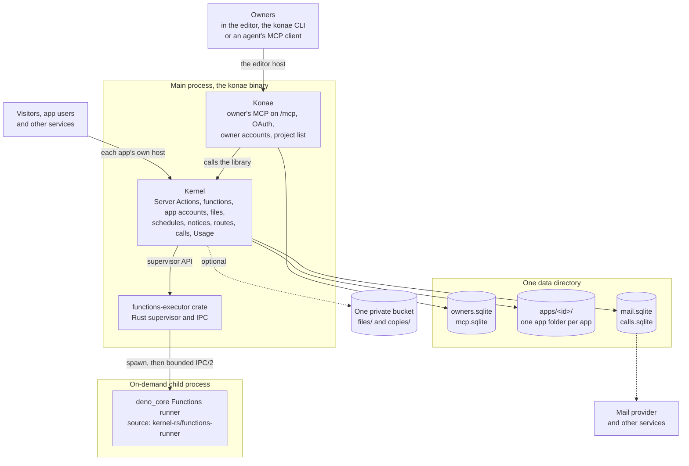
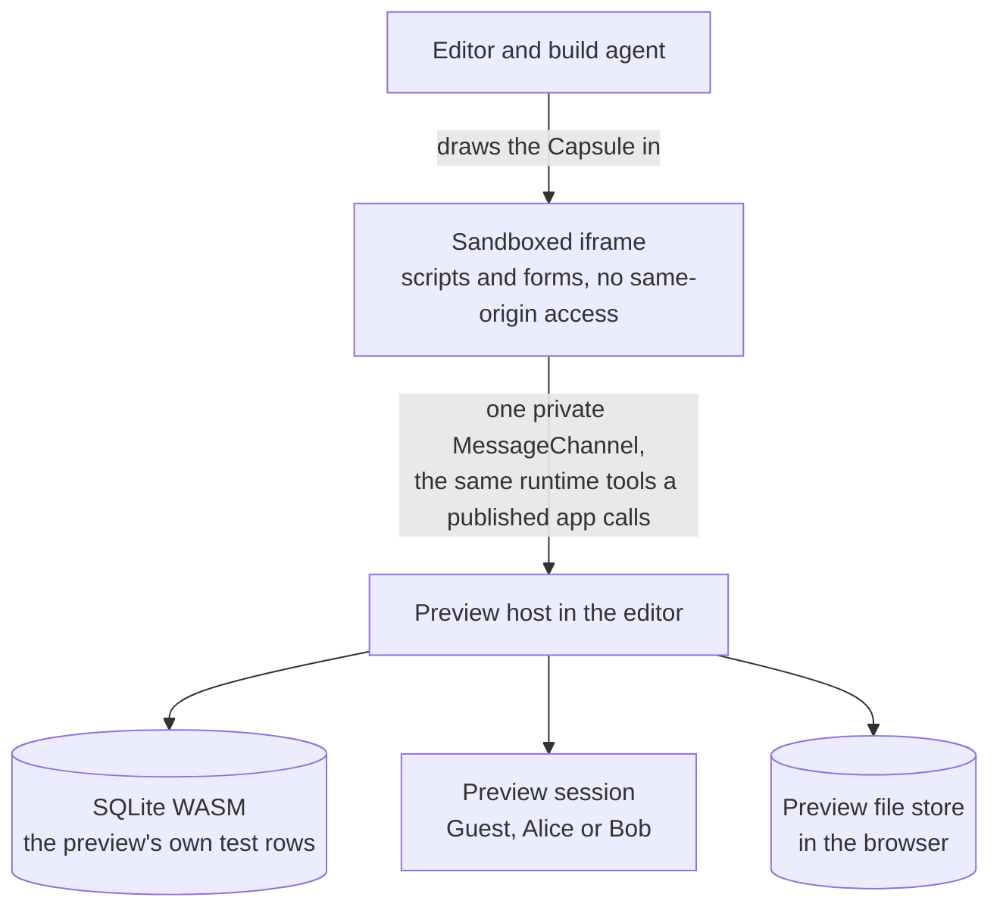
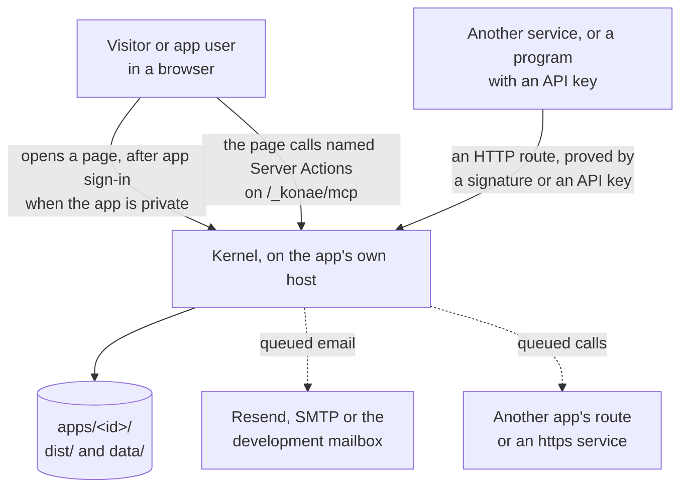

# Konae architecture

## Product rule

A new app starts no process, VM or container. It is one app folder: a static Build Artifact, a SQLite database and the declarations the Kernel runs. Functions starts a child worker only when an admitted request needs one, then keeps it warm until its idle timeout. A recently used app can retain worker memory during that interval.

The Kernel decides who an actor is, whether a Deployment is public or private, and which action that actor may call. A proxy, an S3 store or a mail provider stores or carries bytes and makes no access decision.

## One installation



An installation has a main server process and one data directory. Functions may start child runner processes on demand. Owners reach Konae on the editor host, through the editor, the CLI or an agent's MCP client. Visitors, app users and other services reach the Kernel on each app's own host. Konae keeps owners and the project list in its two stores, and the Kernel keeps one app folder per app and the queues for email and calls. The `kernel` binary is the Kernel alone, with no Konae in front.

## Kernel, Konae and the functions executor

The Cargo workspace under `kernel-rs` contains the Kernel, Konae, the backup library, and the Functions executor. The JavaScript runner has its own Cargo workspace and lockfile. The Kernel owns identity, authorization, SQLite, and request admission. The executor supervises workers and sends bounded IPC/2 messages to the runner ([ADR-0018](./adr/0018-typescript-functions-load-on-demand-and-use-kernel-services.md), [ADR-0019](./adr/0019-functions-stream-request-bodies-with-bounded-ipc.md)).

```text
kernel-rs/
├── kernel/              the Kernel library and binary
├── konae/               the Konae binary, which links the Kernel
├── backup/              snapshot and copy formats and storage
├── functions-executor/  worker supervision and the IPC protocol
└── functions-runner/    the deno_core worker binary
```

`kernel` runs apps. Its binary opens every folder under `<KONAE_DATA_DIR>/apps/`, checks each as a release, and applies the schema change `app/schema.sql` asks of `data/database.sqlite` when actions is on. It serves Server Actions, app accounts, files, schedules, notices, HTTP routes, functions, calls and Usage according to each app's modules. It answers the runtime endpoint `/_konae/mcp` that the browser SDK calls. It never opens an owner's records. Its commands on one app (`users`, `invite`, `suspend`, `resume`, `signup-policy`, `api-key`, `secret`, `sql`, `events`, `maintenance`, `enter`, `import`) live in `server/operator.rs`, and each calls the function the matching owner tool calls. It also runs the installation commands `restore`, `reconcile`, `files-migrate` and `files-reconcile`.

The Functions interface, actor binding, action allowlist, replay behavior and export boundary are documented in [Server functions](./functions.md). Current evidence and isolated candidates are separated in [Functions research](./architecture/functions-research.md).

`konae` is the platform. It starts the same Kernel with an `Installation` that adds its own stores, and adds the owner's MCP on `/mcp`, OAuth for MCP clients, owner accounts and their admission, optional Clerk sign-in, the `platform_guide` topics, the project list and, when `KONAE_EDITOR_DIR` names it, the built editor on the editor host. It runs the same installation commands, and adds `owner-code-*` and `owner-account-*` commands that admit and suspend owners.

The editor in `src/` and the CLI in `scripts/konae.ts` talk to Konae over the owner's MCP. Both publish through `publishProject` in `src/deployments/release.ts`, and `konae tool <name>` calls any owner tool by name, so a new tool needs no new command. `konae dev` talks to neither: it builds the folder and runs the `kernel` binary on it.

### Modules of `kernel`

The Kernel groups code under `kernel-rs/kernel/src/` by the decisions it makes. The server assembles the routes and workers. Capability modules own their rules and expose the operations that HTTP, MCP, and the commands call.

| Module | Owns |
| --- | --- |
| `server/` | Startup, route composition, runtime MCP, transfer protocol, middleware, and operator commands |
| `deployments/` | The live Deployment, publishing, artifact activation, and applied settings |
| `app_folders/` | Folder layout, startup from an app folder, saved sources, import, and export |
| `app_accounts/` | Signup Policy, account verification, sessions, invitations, and Google sign-in |
| `app_data/` | App database connections, schema changes, Owner SQL, and app database backups |
| `actions/` | Action declarations, bindings, SQL rules, and execution |
| `files/` | File access policy, the app's index, upload, listing, reads, and deletion |
| `functions/` | Manifest and artifact checks, HTTP admission, worker reuse, and transactions for Server Actions called by Functions |
| `integrations/` | HTTP Actions, callers and signatures, and the call action outbox |
| `routing/` | Hostnames, domains, path addresses, pages, static responses, and SEO |
| `modules/` | The registry, module state, options, and dependencies |
| `installation/`, `copies/` | Installation stores, mail delivery, maintenance, copies, restore, and revocation records |
| `file_store.rs` | Local and S3 blob adapters, quotas, migration, and reconciliation |
| `usage.rs`, `usage/` | Usage, Signals, and Functions timing data |
| `refusal.rs` | Refusal codes, messages, and hints |

Keep decisions in the module that owns the state. For example, the file URL and the runtime MCP both ask `files` which files the actor may read. The blob adapter handles the bytes. Shared case files stay in `kernel-rs/kernel/src/` so the editor and Kernel can run the same examples.

### Functions execution

`functions/manifest_artifact.rs` checks declarations and reads bundled handlers. `functions/http.rs` selects the Deployment and authenticates the request. `functions/invocation.rs` binds the actor and owns the SQLite transaction and idempotency receipt. `functions/runtime.rs` keeps workers warm and can take explicit runtime configuration. The executor and runner use the same IPC protocol.

A standalone HTTP host could use the worker runtime once it has a second caller. That host would mount validated bundles and supply the capabilities it allows. Konae's app identity, Server Action permissions, and data rules belong to the Kernel host.

### Modules of `konae`

| Module | Owns |
| --- | --- |
| `main.rs`, `state.rs` | Start the Kernel with Konae's routes, stores, and account settings |
| `mcp/` | The Owner's MCP on `/mcp`, its tool catalogue, credentials, and audit |
| `projects/` | Source revisions, release planning and apply, import, and export |
| `owners/` | Owner accounts, admission, optional Clerk sign-in, OAuth, and sign-in pages |
| `conversations/` | Account-scoped editor conversations and their history |
| `editor/` | Serving the built editor from `KONAE_EDITOR_DIR` |
| `guide.rs` | The topics that `platform_guide` returns |

## The app folder

An app is one folder, laid out the same way on a laptop, inside a Kernel and in an export. `kernel-rs/kernel/src/app_folders/layout.rs` names every path.

```text
apps/<id>/
├── konae.json          app settings, identity and manifest
├── app/                sources, including text and binary assets
├── dist/               the Build Artifact the Kernel serves
├── server/             private Functions bundles, not served to browsers
├── data/
│   ├── database.sqlite # app rows
│   ├── identity.sqlite # app accounts, sessions, challenges, invitations and API keys
│   ├── usage.sqlite    # Usage, Signals and scheduled runs
│   ├── files/          # file index and local uploads, unless a bucket holds bytes
│   └── secrets.sqlite  # signing secrets and the Google client
└── .konae/             installation state, never exported
    ├── deployment.json # project record and applied artifact metadata
    ├── backups/        # snapshots before import or on request
    ├── hostname.json   # generated hostname history
    ├── domain.json     # custom domain and proof
    ├── path.json       # path address
    └── maintenance.json # only while the app is in maintenance
```

A folder from `konae init` also carries developer files beside `konae.json`: `AGENTS.md`, `action-contract.md`, `actions.d.ts`, `compose.yaml`, `.env.example`, `.gitignore`, `package.json`, `tsconfig.json`, `scripts/build.mjs`, `scripts/static-artifact.mjs`, `scripts/local-builder.mjs` and `scripts/runtime.js`. The Kernel opens a portable folder with `konae.json`, `app/`, `dist/` and `data/`; generated developer files are optional. It does not require `.konae/sources.json` or `manifest.runtime`.

Inside Konae, `.konae/` keeps installation state and never leaves in an export. It contains the project record, applied artifact metadata, backups, address state and maintenance state.

The `<id>` is the project's ID, and it names the Deployment too. An export hands over everything above except `.konae/` and `data/secrets.sqlite`. It carries the app's accounts and leaves its owner, sessions, email links and signing secrets behind, and its API keys arrive revoked ([ADR-0008](./adr/0008-an-app-leaves-by-export-and-returns-by-import.md)). The `kernel` binary starts an exported folder by writing its own `.konae/`.

`schema.sql` is the only model of the database. At publish, at import and when the `kernel` binary starts a folder, the Kernel compares it with the live database and derives the schema change. A new table, column or index applies. A dropped table, a dropped column or a retyped column applies only with the confirmation the plan names ([ADR-0005](./adr/0005-schema-sql-is-the-only-model-and-a-release-is-all-or-nothing.md)).

## Who owns which store

```text
<KONAE_DATA_DIR>/
├── apps/<id>/              the Kernel: one app folder per app
├── mail.sqlite             the Kernel: the email queue
├── calls.sqlite            the Kernel: the call actions' queue and outbox
├── transfers.sqlite        the Kernel: unfinished MCP transfers and upload receipts
├── transfers/              the Kernel: their bytes
├── files-store.json        the Kernel: which file store holds the bytes
├── mail-key                private mail fallback key, created by kernel startup or app commands on either volume
├── mailbox.jsonl           the Kernel: the development mailbox, with KONAE_MAIL_TRANSPORT=development
├── recovery-hold.json      the Kernel: only after a restore that could not read the revocation record
├── owners.sqlite           Konae: owner accounts, sessions, challenges and invitation codes
└── mcp.sqlite              Konae: the project list, agent credentials, OAuth and the audit log
```

`konae dev` keeps test mail separately at `<app folder>/.konae/kernel/mail-testbox.jsonl`. The `mailbox.jsonl` above remains the live Kernel's development transport file.

| Store | Owner | Leaves with an export | Leaves with a copy |
| --- | --- | --- | --- |
| `apps/<id>/data/database.sqlite`, `identity.sqlite`, `usage.sqlite`, `files/` | The app | Yes | Yes |
| `apps/<id>/data/secrets.sqlite` | The app, on this installation | No | Yes |
| `apps/<id>/.konae/` | The installation | No | Yes |
| `mail.sqlite`, `calls.sqlite`, `transfers.sqlite` | The Kernel | No | Yes |
| `owners.sqlite`, `mcp.sqlite` | Konae | No | Yes, under Konae |

A bare `kernel` keeps no owner and no audit log. Under Konae the same Kernel adds `owners.sqlite` and `mcp.sqlite` to the stores a copy carries and a restore installs.

With `KONAE_S3_BUCKET` set, upload bytes live under `files/` in the installation's bucket, and `data/files/index.json` in the app folder still decides which files exist and who may read them ([ADR-0009](./adr/0009-file-bytes-go-through-one-store-and-the-index-stays-with-the-app.md)). SQLite, sources and `dist/` stay local. With `KONAE_COPY_S3=1`, copies go to `copies/` in the same bucket and carry their own file bytes, so a copy restores a file deleted after it was made.

## Two doors, one set of refusals

A Capsule meets two checks. The Validation Gate (`src/agent/gate.ts`, with the parser in `src/kernel/actions.ts`) runs in the editor before Apply. When actions is on, the Kernel parses the same `actions.json` and `schema.sql` at `release_plan` and when the `kernel` binary starts a folder. When actions is off, it accepts both files missing and creates no app database. Both refuse a used module that is off with the same code and sentence. Shared rules have case files that both test suites run, such as `module-use-cases.json`, `sql-rule-cases.json`, `action-cases.json`, `http-binding-cases.json`, `guard-cases.json`, `schedule-cases.json` and `call-cases.json`. Other case files cover one side only ([ADR-0004](./adr/0004-the-gate-and-the-kernel-refuse-with-the-same-code-and-words.md)). The query bound is `src/lib/query-bound.ts` on one side and its port in `actions/sql.rs` on the other.

An artifact holds pages and the files they load. `src/lib/static-artifact.js` decides which Capsule files become the artifact, and the CLI, the editor and an app folder's `npm run build` all run it. When a module with a browser call is on, it refuses a Capsule with an entry (`src/main.tsx`, `src/main.ts` or `app.js`) whose pages are all whole documents that load no script, because that entry would never run, and the Validation Gate refuses it with the same sentence. With all such modules off, the builder accepts those documents and injects no SDK. `kernel-rs/kernel/src/routing/artifact.rs` decides which file answers a path: an exact file first, then `<path>.html` for a path with no extension and `<path>/index.html` for one that ends in `/`. Under the default `pages` routing anything else answers 404 with the artifact's `404.html` or a small Kernel page. Under `spa` it serves `index.html`.

## The editor preview



The preview iframe has `allow-scripts` and `allow-forms` but no same-origin access, so generated code cannot read the editor's storage or credentials. Each preview gets one private MessageChannel and calls the same runtime tools a published app calls. The build agent edits a candidate copy of the Capsule. It appears in Preview before Apply, with separate candidate rows, files and actor. Discard drops that state. Apply is available after the candidate builds and its preview host is ready. The Gate shows refusal details and remedies, and reports only the stages it checked. When PREVIEW_BEHIND skips row checks, the summary says so ([ADR-0007](./adr/0007-the-build-agent-edits-a-scratch-copy-and-operates-through-the-owners-mcp.md)).

The preview is a development boundary, not a sandbox for hostile code. It applies no Content Security Policy and has no HTTP routes, schedule timer, notice email, Usage store or call outbox. [Named divergences](./divergences.md) lists every difference.

## A published app



Every request to an app arrives at the Kernel on that app's host. A browser loads the pages and then calls named Server Actions, and another service calls an HTTP route with its proof. The Kernel answers from the app folder, and email and calls leave later from its queues. The owner never comes in this way. The editor, the CLI and an agent reach the same app through the owner's MCP on Konae, as [One installation](#one-installation) shows.

Visibility and data authorization are independent.

| Deployment | Who can open the pages | Who can read data |
| --- | --- | --- |
| Public | Anyone | Only actors each Server Action allows |
| Private | App users signed in to this app | Only actors each Server Action allows |

On a public Deployment a visitor may call actions declared `anonymous`, and may list and read files marked public. On a private Deployment nothing loads or runs without an app session, except the HTTP routes of actions declared `anonymous`. A route answers the callers it declares, and `kernel-rs/kernel/src/integrations/http.rs` resolves the caller before any SQL runs ([ADR-0013](./adr/0013-http-routes-take-named-callers-and-calls-leave-through-the-kernel.md)).

| Caller | Proof | Acts as |
| --- | --- | --- |
| Another service | The route's signature, under a signing secret of the app | A visitor, with no actor ID |
| A program the owner wrote | An API key that names the action, sent as `Authorization: Bearer` | A Runtime Actor with the key's ID |
| A signed-in person | The app session cookie | The app user |

The browser never receives a database credential, the SQLite file, a generic SQL endpoint or an owner capability. A page calls named Server Actions, and the Kernel resolves the Deployment and the actor from the host and the session or key, validates the input, applies the action's access and the quotas, then runs its prepared statement. Developer tools can replay any browser request, so security never depends on hiding an SDK method or a button.

The owner side is a different trust domain. SQL on the live database, backups, export and import go through the owner's MCP, with the owner's permissions and Konae's audit log. An app session never authorizes an owner tool. A path under `/_konae/` that names no route of the Kernel answers 410 and points to the owner's MCP.

An upload is private to the app user who uploaded it unless the upload sets it public. With the `files` module option `fileAccess` set to `"app-users"`, every signed-in user of the app may read every upload, and only the uploader deletes one. `GET /_konae/files/<id>` serves a file to a caller allowed to read it: a signed-in app user from the app's own origin, a visitor for a public file of a public Deployment, or an API key that names the file's visibility. Only the uploader changes a file's visibility or deletes it. Nothing is served from the bucket, and no bucket URL reaches the browser.

Every verification, recovery and invitation link leaves through the queue in `mail.sqlite` ([ADR-0012](./adr/0012-email-leaves-through-one-queue-to-addresses-the-app-has-proved.md)). The transaction that issues a challenge writes its email job too, and a worker in the Kernel sends due jobs, retrying a provider outage for about two hours. While the sender preflight refuses, signup and recovery answer 503 and nothing is queued.

A scheduled copy takes each app's locks, snapshots its SQLite files with `VACUUM INTO`, copies the rest of its folder and writes a manifest of SHA-256 checksums last. `restore` installs one copy into an empty data directory, verifies every checksum, signs out every session and agent credential, and ends every open email link. Suspensions and API key revocations made after the copy are written to each copy target as they happen, and restore applies them, or starts the installation in maintenance when it cannot read them. A copy moves an installation for the same owner. An export moves one app, maybe to another owner, so an import revokes its API keys and a restore keeps them.

## Isolation of hosted code

Every app runs on its own host, `<slug>.<KONAE_HOST_SUFFIX>` when that name is free, or `<slug>-<code>.<KONAE_HOST_SUFFIX>` when another Deployment already holds the slug or the name is one of the installation's own hosts, and the editor runs on a host no app shares (`app.<domain>` when `KONAE_DOMAIN` is set). An app may also answer on one custom domain its owner proved with a TXT record ([ADR-0014](./adr/0014-an-app-answers-on-its-hostname-a-custom-domain-or-a-path.md)). The Kernel resolves it to the same Deployment, so it is that app's origin too, and no other app or the editor can take it. `kernel-rs/kernel/src/server/security.rs` adds the headers below to every response, so a bare `kernel` sends them too.

`<domain>` is one origin that the installation home and every path address share. An app on a path address answers its pages, routes and runtime under `<domain>/p/<id>` or `<domain>/p/<name>`, so a script of one app can open another app's page in the same origin, read its DOM through `window.open`, and send another app's session cookie with a request to its runtime. The Kernel refuses a runtime call whose Referer names another app's path, but only when the browser sends a Referer, so that check is not a boundary. The owner accepts this sharing when turning a path address on for an app with accounts or a private app. The isolation this section describes holds for generated hostnames and custom domains only.

App hosts get this Content Security Policy:

```text
default-src 'self'; script-src 'self' 'sha256-...';
style-src 'self' 'unsafe-inline' https://fonts.googleapis.com;
font-src 'self' data: https://fonts.gstatic.com;
img-src 'self' blob: data:; media-src 'self' blob: data:;
connect-src 'self'; form-action 'self'; frame-ancestors 'none';
object-src 'none'; base-uri 'none'
```

A fragment page in a Build Artifact inlines the runtime and the compiled module when a module with a browser call is on. A whole-document page loads the runtime from `/runtime.js` and its modules from the app's origin under the same condition. With every browser-call module off, pages ship without the runtime. The Kernel hashes every inline `<script>` of each HTML response and lists those hashes, so exactly the scripts in the published file run. Inline event handler attributes, `eval`, `new Function`, WebAssembly, Blob scripts and scripts from other origins do not run, because `script-src` names neither `'unsafe-eval'` nor `'wasm-unsafe-eval'`.

- Styles allow `'unsafe-inline'` because apps write `style="..."` attributes through `innerHTML` and the artifact inlines `styles.css`. Google Fonts is the only other origin, because the templates import it. Neither font host can read app data.
- Images and media accept `blob:` and `data:` so a page can show bytes it built itself, such as a generated PDF or an image preview before upload.
- `connect-src 'self'` limits `fetch` to the app's origin, plus the origins the manifest's `connects` lists, at most 10. A request that needs a secret or a key is a call action, which the Kernel sends.

Every host sends `frame-ancestors 'none'` and `X-Frame-Options: DENY`. Konae's pages on the editor host, such as owner sign-in, get `default-src 'self'` with their script hashes, and its JSON and errors get `default-src 'none'`. When `KONAE_PUBLIC_ORIGIN` or `KONAE_MCP_ORIGIN` is HTTPS, every response carries `Strict-Transport-Security: max-age=31536000; includeSubDomains`. A custom domain gets `max-age=31536000` alone, because the names under the owner's domain are not the installation's.

`konae` serves the built editor on the editor host when `KONAE_EDITOR_DIR` names it, as the `konae` image does, and the `kernel` binary never serves it. Vite serves it in development and in the Docker stack. The editor's policy stops at `frame-ancestors 'none'`, because its preview is a `srcdoc` iframe that inherits the editor's policy, and esbuild, sql.js and the model providers the agent calls need more than `'self'`.

Under HTTPS the owner cookie is `__Host-konae_owner_session` and the app cookie `__Host-konae_app_session`, both `Secure`, `Path=/` and without `Domain`. The Kernel ignores unprefixed names under HTTPS, so an app cannot plant a cookie for another. The app cookie is `SameSite=Lax` and the owner cookie `SameSite=Strict`. Over plain HTTP, as in the local stack, the cookies keep unprefixed names and no HSTS is sent.

The owner's MCP, owner sign-in and the OAuth routes refuse a request whose `Origin` is an app host before they read a credential. The runtime endpoint refuses an `Origin` that differs from its `Host`, so one app's page cannot call another app's runtime, and each app keeps its own accounts, so its session means nothing to another app.

`tests/security-http.integration.test.ts` and `tests/security-auth.integration.test.ts` check each of these against a local Kernel. `bun run examples/product-fit/smoke.ts` opens every example in Chrome and fails on a policy violation.

## Known gaps

- No per-app CPU quota. Request rates, rows, statement time, database size and file size and total have limits ([Limits](./limits.md)).
- Uploads are not checked by their magic bytes. The file path serves only raster images inline and everything else as a download.
- `"access": "granted"` is refused by both doors until the Kernel supports deployment grants.
