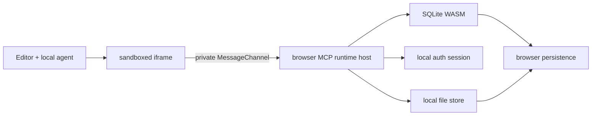
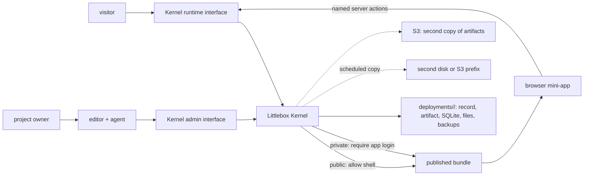

# Littlebox architecture

## Product rule

A new mini-app creates **no process, VM or container**. It is a static bundle plus logical capabilities on a shared data plane. Idle apps should have effectively zero marginal compute cost.

The **Littlebox Kernel** owns product security semantics. Infrastructure providers are adapters: they may execute code or persist sessions, databases and files, but they never decide who an actor is, whether a Deployment is public or private, or which action that actor may invoke.

## Capsule v1

```text
mini-app/
├── index.html
├── styles.css
├── app.js            # or src/main.ts
├── src/
│   └── feature.ts
├── schema.ts
└── actions.json
```

The editor stores an arbitrary source tree in one exportable JSON object, together with the Drizzle Database Model shown as `schema.ts`. The browser compiles `app.js`, or `src/main.ts` when it exists, and its relative imports with WebAssembly. The Project record also carries a versioned manifest (`CapsuleManifest` in `src/deployments/manifest.ts`) with deployment visibility, declared runtime actions and capability policies, but never SQL implementations, credentials or administrative grants. The manifest is a field of the Project, not a file in the tree. External Projects keep it in `littlebox.json`.

## Current local topology



The iframe has `allow-scripts` but not same-origin access. Generated code cannot read the editor's storage or credentials directly. Each preview receives one private MessageChannel and an ephemeral preview credential. The app uses MCP tool calls over that channel. The global message listener only establishes the channel.

This is a development boundary, not yet a hardened hostile-code sandbox. The preview applies no Content Security Policy, so code that the published policy blocks, such as an `onclick="..."` attribute, still runs in the preview. The agent prompt states the published policy. Hosted execution must add quotas, statement validation, capability grants, audit logs and infrastructure-enforced tenant isolation.

## Current self-hosted topology



The Kernel's data directory is the authority. Each Deployment is one folder, `deployments/<id>/`, holding `deployment.json`, the Build Artifact in `artifact/`, `database.sqlite`, `identity.sqlite`, uploads in `files/` and Data panel snapshots in `backups/`; `owners.sqlite` and `mcp.sqlite` sit at the top. A copy of a folder is the app. When S3 is configured, the Kernel also uploads each artifact to the artifact bucket and reads from it only when the local file is missing.

A scheduled copy takes each Deployment's data and identity locks, snapshots its SQLite files with `VACUUM INTO`, copies the rest of its folder and writes a manifest of SHA-256 checksums last. It sends the result to a directory on another disk, an S3 prefix in the data bucket, or both, and keeps 24 recent and 30 daily copies. Copy failures are logged and reported under `copies` in `/_littlebox/health`; they never block serving. `littlebox-kernel restore` is the only way back: it installs one copy into an empty data directory, verifies every checksum and signs out every session and credential. The Kernel no longer reads anything from the data bucket at startup.

The Docker development stack uses Nginx only for hostname routing: `editor.localhost` reaches Vite and the Kernel Admin Interface, while every other `*.localhost` hostname reaches the Rust Kernel Runtime Interface. MinIO provides the same S3 operations used with hosted providers. Nginx and MinIO do not make authorization decisions.

### Two independent policy axes

Deployment visibility and data authorization are deliberately independent:

| Deployment | Who can open the app shell | Who can read data |
| --- | --- | --- |
| Public | Anyone | Only actors allowed by each server action |
| Private | Signed-in app accounts, created under the Deployment's signup policy | Only actors allowed by each server action |

On a public Deployment a signed-out visitor may call the actions declared `anonymous`, and may list and read files marked public. Uploads, private files, and authenticated actions require an app session. On a private Deployment nothing loads or runs without a login. Each Deployment's signup policy (Open, Allowlist or Closed) decides who can create an app account; public Deployments start Open and private ones start Closed.

A public deployment may contain private user records. Public means its HTML, CSS and JavaScript are public; it never means the database is public. A private deployment also protects the application shell, but still requires per-action authorization because authenticated users need not share the same data.

An upload is private to the uploading app user unless the upload sets visibility to public. Another account cannot read a private file. On a public Deployment, visitors can read public files. On a private Deployment, any signed-in app user can read public files. There is no HTTP download path.

### Database boundary

The hosted browser runtime must never receive:

- a D1, libSQL, Turso or provider credential;
- the SQLite file or an endpoint that downloads it;
- a generic SQL-over-HTTP interface;
- owner/admin capabilities embedded in JavaScript;
- private fields that the current action does not explicitly return.

The browser calls named server actions. The Kernel resolves the deployment and actor from trusted server-side state, validates the action input, applies authorization and quotas, then executes parameterized statements through an adapter. Developer tools can replay any browser request, so security cannot depend on hiding SDK methods or UI controls.

The editor is a different trust domain. SQL Studio, schema migrations, backups and database export are served only through the Kernel Admin Interface after owner/workspace authorization, with audit logging and stronger checks for destructive operations. Runtime sessions are never accepted by admin operations.

The stable seams are:

```ts
interface LittleboxKernel {
  handleRuntime(request: RuntimeRequest): Promise<Response>;
  handleAdmin(request: AdminRequest): Promise<Response>;
}

interface IdentityStoreAdapter {
  readSession(sessionId: string): Promise<KernelSession | null>;
  writeSession(session: KernelSession): Promise<void>;
  readGrants(actorId: string): Promise<KernelGrant[]>;
}

interface DatabaseAdapter {
  query(databaseId: string, statement: PreparedStatement): Promise<unknown[]>;
  execute(databaseId: string, statement: PreparedStatement): Promise<unknown>;
  export(databaseId: string): Promise<ReadableStream>;
}

interface BlobAdapter {
  createUpload(bucketId: string, input: UploadRequest): Promise<SignedUpload>;
  list(bucketId: string): Promise<BlobRecord[]>;
}
```

Adapters do not receive authority to make access decisions. The Kernel passes them already-resolved opaque resource IDs and constrained operations only after authentication and authorization have succeeded.

## Provider adapters

- A managed adapter may use Workers, D1/libSQL and R2/S3.
- The self-hosted adapter is the Rust Kernel in `kernel-rs/`: one process with SQLite files and local disk, plus optional S3 for artifacts. It spawns Bun only to derive schema migrations.
- A Railway adapter may provide a shared Node runtime and an escape hatch for applications that need Docker or unrestricted server packages.

All adapters implement the same Kernel seams. Provider identity products may optionally protect infrastructure administration, but they are never the application session or grant authority. The exported unit must eventually contain source, manifest, migrations, a standard SQLite file and its blobs. Provider-specific identifiers must not appear in application code.

## Isolation of hosted code

Every app runs on its own host, `<slug>-<id>.<LITTLEBOX_HOST_SUFFIX>`, and the editor runs on a host no app shares. One layer in `kernel-rs/src/security.rs` adds the headers below to every Kernel response, so an exported Kernel sends them too.

App hosts get this Content Security Policy:

```text
default-src 'self'; script-src 'self' 'sha256-...';
style-src 'self' 'unsafe-inline' https://fonts.googleapis.com;
font-src 'self' data: https://fonts.gstatic.com;
img-src 'self' blob: data:; media-src 'self' blob: data:;
connect-src 'self'; form-action 'self'; frame-ancestors 'none';
object-src 'none'; base-uri 'none'
```

A Build Artifact inlines the runtime and the compiled module in `index.html`. The Kernel reads each HTML response, hashes every inline `<script>` with SHA-256 and lists those hashes, so exactly the scripts in the published file run. Inline event handler attributes, `eval`, Blob scripts and scripts from other origins do not. Any other file, such as an SVG opened directly, gets the policy with no hash. The private sign-in page uses the same mechanism for its own script.

- Styles allow `'unsafe-inline'` because apps write `style="..."` attributes through `innerHTML`, as the `poll` example does, and the artifact inlines `styles.css`. A hash cannot cover a generated attribute. Google Fonts is the only foreign origin because the starter templates import it and the agent is told to keep the fonts it finds. Neither font host can read app data.
- Images and media accept `blob:` and `data:` because the SDK hands files to the app as Blob URLs and apps keep small inline copies of images, as the `portfolio` example does.
- `connect-src 'self'` limits `fetch` to the app's origin, where the runtime reaches `/_littlebox/mcp`.

Every host, apps included, sends `frame-ancestors 'none'` and `X-Frame-Options: DENY`. The Kernel's pages on the editor host, such as owner sign-in, get `default-src 'self'` with their script hashes; its JSON and errors get `default-src 'none'`. When `LITTLEBOX_PUBLIC_ORIGIN` or `LITTLEBOX_MCP_ORIGIN` is HTTPS, every response carries `Strict-Transport-Security: max-age=31536000; includeSubDomains`. `includeSubDomains` makes a browser that has visited the installation's host use HTTPS for app hosts beneath it before their first visit. There is no `preload`; the operator decides that.

The Kernel does not serve the editor. Vite serves it in development and in the Docker stack, and nothing in this repository serves the built `dist/` in production. Vite's dev and preview servers send `frame-ancestors 'none'` and `X-Frame-Options: DENY`. A gateway that serves `dist/` must send the same two headers. The editor has no script policy yet. The preview is a `srcdoc` iframe, which inherits the editor's policy, so a `script-src` without `'unsafe-inline'` would stop the preview. esbuild and sql.js also need `'wasm-unsafe-eval'` and a `blob:` worker, and the agent calls model providers from the browser, so `connect-src` cannot be `'self'`. A script policy for the editor waits until the preview moves to its own origin.

Under HTTPS the owner cookie is `__Host-littlebox_owner_session` and the app cookie `__Host-littlebox_app_session`, both `Secure`, `Path=/` and without `Domain`. A browser refuses a `__Host-` cookie that names a domain, so an app can only plant an unprefixed name for the whole suffix, and the Kernel ignores unprefixed names under HTTPS. The app cookie is `SameSite=Lax`; the owner cookie is `SameSite=Strict`. Over plain HTTP, as in the local Docker stack, cookies keep unprefixed names and no HSTS is sent.

Administrative MCP, owner sign-in and the OAuth routes refuse a request whose `Origin` is an app host before they read a credential. An app host is a deployment hostname, or any host under the suffix other than the installation's public or MCP host. The runtime endpoint refuses an `Origin` that differs from its `Host`, so one app's page cannot call another app's runtime, and each Deployment keeps its own identity store, so its session means nothing to another app.

`tests/security-http.integration.test.ts` and `tests/security-auth.integration.test.ts` check each of these against a local Kernel. `bun run examples/product-fit/smoke.ts` opens every example in Chrome and fails on a policy violation.

## Near-term security decisions

Before accepting untrusted public apps:

1. Bind every request server-side to deployment, deploy version, actor and capability grant. Never trust browser-supplied identifiers.
2. Enforce per-app request, CPU, row, statement, database and blob quotas.
3. Validate uploaded blobs by MIME type and magic bytes. Uploads already arrive through chunked, checksummed `files_upload` transfers and land in the Deployment's directory on the Kernel volume.
4. Make previews expire and garbage-collect all associated data.
5. Keep system apps signed and privileged; user apps can only call granted capabilities.
6. Serve owner SQL, migrations, backups and export from the Kernel Admin Interface with audit logs.
7. Support explicit `granted` actions and deployment grants. Private shells already require a login, and the signup policy limits who can create one; data authorization stays action-specific in both visibility modes.

Published apps no longer send SQL: they call declared server actions, and the browser preview's SQL runs only against its local `sql.js` database.

## Local bootstrap boundary

The editor authenticates MCP administration with an HttpOnly owner session. External agents use OAuth with PKCE or delegated credentials whose scope, project grants, expiry and revocation the Kernel checks. Runtime MCP uses the Deployment's separate app identity store. Runtime sessions never authorize administrative tools.

The installation key permits owner registration and remains outside the editor bundle. The first owner claims legacy Deployments. Each later owner starts with a separate project registry. Native development binds to localhost; the Docker gateway preserves Host and routes MCP, authorization and login to the Kernel.

MCP is the operation protocol under [ADR-0008](./adr/0008-authenticated-mcp-is-the-platform-operation-protocol.md). The old operation routes return HTTP 410. File and artifact transfers use authenticated tools with bounded chunks and checksums. Login, OAuth discovery and static documents retain their HTTP routes. [The MCP guide](./mcp.md) describes the implemented tools and limits.
