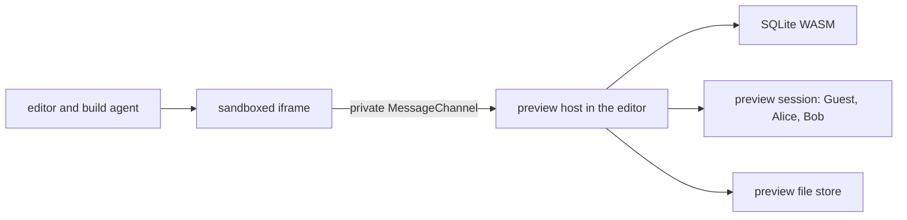
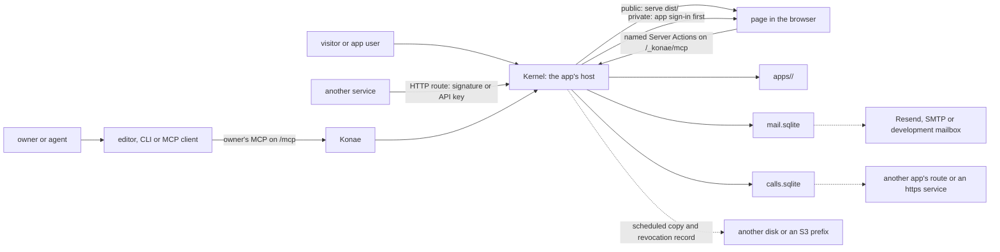

# Konae architecture

## Product rule

A new app creates no process, VM or container. It is one app folder: a static Build Artifact, a SQLite database and the declarations the Kernel runs. An idle app uses no CPU and costs only the disk its folder takes.

The Kernel decides who an actor is, whether a Deployment is public or private, and which action that actor may call. A proxy, an S3 store or a mail provider stores or carries bytes and makes no access decision.

## Two crates

`kernel-rs` is a Cargo workspace of two crates ([ADR-0001](./adr/0001-an-app-is-one-folder-that-the-kernel-serves-with-or-without-konae.md)).

```text
kernel-rs/
├── kernel/   the Kernel: a library and the `kernel` binary
└── konae/    Konae: the `konae` binary, which links the library
```

`kernel` runs apps. Its binary opens every folder under `<KONAE_DATA_DIR>/apps/`, checks each as a release, applies the schema change `app/schema.sql` asks of `data/database.sqlite`, and serves it with every primitive: Server Actions, app accounts, files, schedules, notices, HTTP routes, calls and Usage. It answers the runtime endpoint `/_konae/mcp` that the browser SDK calls. It never opens an owner's records. Its commands on one app (`users`, `invite`, `suspend`, `resume`, `signup-policy`, `api-key`, `secret`, `sql`, `events`, `maintenance`, `enter`, `import`) live in `operator.rs`, and each calls the function the matching owner tool calls. It also runs the installation commands `restore`, `reconcile`, `files-migrate` and `files-reconcile`.

`konae` is the platform. It starts the same Kernel with an `Installation` that adds its own stores, and adds the owner's MCP on `/mcp`, OAuth for MCP clients, owner accounts and their admission, optional Clerk sign-in, the `platform_guide` topics and the project list. It runs the same installation commands, and adds the `creator-*` commands that admit and suspend owners.

The editor in `src/` and the CLI in `scripts/konae.ts` talk to Konae over the owner's MCP. `konae dev` talks to neither: it builds the folder and runs the `kernel` binary on it.

### Modules of `kernel`

`lib.rs` holds the server, the Server Action parser and runner, publishing and the static file path. Each other module owns one part.

| Module | Owns |
| --- | --- |
| `layout.rs` | Every path of an app folder |
| `folder.rs` | Starting each app folder as the binary finds it |
| `main.rs` | The `kernel` binary and its commands |
| `operator.rs` | The commands on one app |
| `action_shape.rs` | The shape of `actions.json`, checked at every publish |
| `sql_rules.rs` | The statement rules both doors share |
| `schema_change.rs` | The schema change from the live database to `schema.sql` |
| `refusal.rs` | The `{ code, message, hint }` of a refusal, with `refusal-codes.json` |
| `app_db.rs` | Open connections to app databases |
| `runtime.rs` | The runtime endpoint, its tools and the host checks |
| `auth.rs` | The account core: states, passwords, sessions and challenges |
| `accounts.rs` | App account signup, verification, recovery and the pages a challenge link opens |
| `invitations.rs` | App invitations and the user tools |
| `google.rs` | Google sign-in for app accounts, with the app's own Google client |
| `enter.rs` | Entering an app as one of its users through a one-time link |
| `mail.rs` | The email queue, its worker, the Resend, SMTP and development transports, the sender preflight and the limits |
| `notify.rs` | A mutation's notice |
| `guard.rs` | A mutation's guard |
| `schedule.rs` | A mutation's schedule, the timer and the record of each run |
| `http.rs` | HTTP routes, their callers and signatures, signing secrets, API keys and `GET /_konae/files/<id>` |
| `provider.rs` | A provider's signature schemes, a route's `fields` and the memory of accepted deliveries |
| `calls.rs` | Call actions, their queue and worker, the address rules and `then` mutations |
| `usage.rs` | Usage and Signals |
| `file_store.rs` | Where file bytes live (`LocalFolder`, `S3Store`), the quotas, `files-migrate` and `files-reconcile` |
| `files.rs` | Changing a file's visibility and deleting it |
| `transfers.rs` | Chunked transfers in 64 KiB blocks and file upload receipts |
| `artifact.rs` | Which artifact file answers a path, and binary files in an artifact |
| `package.rs` | The export of one app and the import of its data |
| `import.rs` | Import into an existing app, after a backup |
| `sources.rs` | The editor's saved sources as the files of `app/` |
| `maintenance.rs` | The maintenance state and its guard |
| `hosts.rs` | The hosts an installation answers on |
| `domain.rs` | Custom domains and their TXT proof |
| `path.rs`, `path_name.rs` | Path addresses and their names |
| `security.rs` | The response headers of every host |
| `limits.rs` | Per-client limits on unauthenticated requests |
| `installation.rs` | The stores at the data root that a copy carries |
| `copies.rs` | Scheduled copies and `restore` |
| `recovery.rs` | The revocation record and `reconcile` |
| `sqlite_bench.rs` | What a Server Action costs on its database |

### Modules of `konae`

| Module | Owns |
| --- | --- |
| `main.rs` | The `konae` binary: the Kernel with the owner's side |
| `mcp.rs` | The owner's MCP on `/mcp`: the tool catalogue, permissions, the project list, release plans and the audit log |
| `oauth.rs` | OAuth discovery, registration, consent and tokens for MCP clients |
| `owners.rs` | Owner signup, verification, recovery and suspension |
| `admission.rs` | Invitation codes and the setup key's one use |
| `clerk.rs` | Optional hosted owner sign-in |
| `guide.rs` | What `platform_guide` answers |
| `state.rs` | Konae's state beside the Kernel's: the setup key, the MCP origin and the owner verification mode |

## The app folder

An app is one folder, laid out the same way on a laptop, inside a Kernel and in an export. `kernel-rs/kernel/src/layout.rs` names every path.

```text
apps/<id>/
├── konae.json          name, visibility, Signup Policy, sign-in methods, contact email, Kernel version
├── app/                the Capsule: pages, scripts, schema.sql, actions.json, package.json
├── dist/               the Build Artifact the Kernel serves
├── data/
│   ├── database.sqlite # the app's rows, in WAL mode
│   ├── identity.sqlite # app accounts, sessions, challenges, invitations, API keys, accepted route signatures
│   ├── usage.sqlite    # Usage and Signals
│   ├── files/          # index.json, and the uploads unless a bucket holds them
│   └── secrets.sqlite  # signing secrets and the Google client
├── actions.d.ts, action-contract.md, AGENTS.md, compose.yaml, .env.example, package.json
└── .konae/             this installation's part, never exported
    ├── deployment.json # hostname, release and the published actions.json
    ├── sources.json    # the editor's name, manifest and folders of app/
    ├── backups/        # snapshots before an import or on request
    ├── domain.json     # the custom domain and its proof
    ├── path.json       # the path address
    └── maintenance.json # only while the app is in maintenance
```

The `<id>` is the project's ID, and it names the Deployment too. An export hands over everything above except `.konae/` and `data/secrets.sqlite`. It carries the app's accounts and leaves its owner, sessions, email links and signing secrets behind, and its API keys arrive revoked ([ADR-0008](./adr/0008-an-app-leaves-by-export-and-returns-by-import.md)). The `kernel` binary starts an exported folder by writing its own `.konae/`.

`schema.sql` is the only model of the database. At publish, at import and when the `kernel` binary starts a folder, the Kernel compares it with the live database and derives the schema change. A new table, column or index applies. A dropped table, a dropped column or a retyped column applies only with the confirmation the plan names ([ADR-0005](./adr/0005-schema-sql-is-the-only-model-and-a-release-is-all-or-nothing.md)).

## Who owns which store

```text
<KONAE_DATA_DIR>/
├── apps/<id>/              the Kernel: one app folder per app
├── mail.sqlite             the Kernel: the email queue
├── calls.sqlite            the Kernel: the call actions' queue and outbox
├── transfers.sqlite        the Kernel: unfinished MCP transfers and upload receipts
├── transfers/              the Kernel: their bytes
├── files-store.json        the Kernel: which file store holds the bytes
├── mail-key                the Kernel: the key that seals queued email links, unless KONAE_MAIL_SECRET is set
├── mailbox.jsonl           the Kernel: the development mailbox, with KONAE_MAIL_TRANSPORT=development
├── recovery-hold.json      the Kernel: only after a restore that could not read the revocation record
├── owners.sqlite           Konae: owner accounts, sessions, challenges and invitation codes
└── mcp.sqlite              Konae: the project list, agent credentials, OAuth and the audit log
```

| Store | Owner | Leaves with an export | Leaves with a copy |
| --- | --- | --- | --- |
| `apps/<id>/data/database.sqlite`, `identity.sqlite`, `usage.sqlite`, `files/` | The app | Yes | Yes |
| `apps/<id>/data/secrets.sqlite` | The app, on this installation | No | Yes |
| `apps/<id>/.konae/` | The installation | No | Yes |
| `mail.sqlite`, `calls.sqlite`, `transfers.sqlite` | The Kernel | No | Yes |
| `owners.sqlite`, `mcp.sqlite` | Konae | No | Yes, under Konae |

A bare `kernel` keeps no owner and no audit log. Under Konae the same Kernel adds `owners.sqlite` and `mcp.sqlite` to the stores a copy carries and a restore installs.

With an S3 file store the bytes of uploads live in the data bucket, and `data/files/index.json` in the app folder still decides which files exist and who may read them ([ADR-0009](./adr/0009-file-bytes-go-through-one-store-and-the-index-stays-with-the-app.md)). With S3 configured, the Kernel also uploads each artifact to the artifact bucket and reads it back only when the local file is missing.

## Two doors, one set of refusals

A Capsule meets two checks. The Validation Gate (`src/agent/gate.ts`, with the parser in `src/kernel/actions.ts`) runs in the editor before Apply. The Kernel parses the same `actions.json` and `schema.sql` again at `release_plan`, and when the `kernel` binary starts a folder. Both refuse with the same code and sentence, and each rule has one case file in `kernel-rs/kernel/src` that both test suites run, such as `sql-rule-cases.json`, `action-cases.json`, `http-binding-cases.json`, `guard-cases.json`, `schedule-cases.json` and `call-cases.json` ([ADR-0004](./adr/0004-the-gate-and-the-kernel-refuse-with-the-same-code-and-words.md)). The query bound is `src/lib/query-bound.ts` on one side and its port in `lib.rs` on the other.

An artifact holds pages and the files they load. `src/lib/static-artifact.js` decides which Capsule files become the artifact, and the CLI, the editor and an app folder's `npm run build` all run it. `kernel-rs/kernel/src/artifact.rs` decides which file answers a path: an exact file first, then `<path>.html` for a path with no extension and `<path>/index.html` for one that ends in `/`. Under the default `pages` routing anything else answers 404 with the artifact's `404.html` or a small Kernel page. Under `spa` it serves `index.html`.

## The editor preview



The preview iframe has `allow-scripts` and `allow-forms` but no same-origin access, so generated code cannot read the editor's storage or credentials. Each preview gets one private MessageChannel and calls the same runtime tools a published app calls. The build agent edits a scratch copy of the Capsule, and its changes reach the project only through the Validation Gate and the owner's Apply ([ADR-0007](./adr/0007-the-build-agent-edits-a-scratch-copy-and-operates-through-the-owners-mcp.md)).

The preview is a development boundary, not a sandbox for hostile code. It applies no Content Security Policy and has no HTTP routes, schedule timer, notice email, Usage store or call outbox. [Named divergences](./divergences.md) lists every difference.

## A published app



Visibility and data authorization are independent.

| Deployment | Who can open the pages | Who can read data |
| --- | --- | --- |
| Public | Anyone | Only actors each Server Action allows |
| Private | App users signed in to this app | Only actors each Server Action allows |

On a public Deployment a visitor may call actions declared `anonymous`, and may list and read files marked public. On a private Deployment nothing loads or runs without an app session, except the HTTP routes of actions declared `anonymous`. A route answers the callers it declares, and `kernel-rs/kernel/src/http.rs` resolves the caller before any SQL runs ([ADR-0013](./adr/0013-http-routes-take-named-callers-and-calls-leave-through-the-kernel.md)).

| Caller | Proof | Acts as |
| --- | --- | --- |
| Another service | The route's signature, under a signing secret of the app | A visitor, with no actor ID |
| A program the owner wrote | An API key that names the action, sent as `Authorization: Bearer` | A Runtime Actor with the key's ID |
| A signed-in person | The app session cookie | The app user |

The browser never receives a database credential, the SQLite file, a generic SQL endpoint or an owner capability. A page calls named Server Actions, and the Kernel resolves the Deployment and the actor from the host and the session or key, validates the input, applies the action's access and the quotas, then runs its prepared statement. Developer tools can replay any browser request, so security never depends on hiding an SDK method or a button.

The owner side is a different trust domain. SQL on the live database, backups, export and import go through the owner's MCP, with the owner's permissions and Konae's audit log. An app session never authorizes an owner tool, and the old operation routes under `/_konae/` answer 410, except `GET /_konae/files/<id>`.

An upload is private to the app user who uploaded it unless the upload sets it public. `GET /_konae/files/<id>` serves a file to a caller allowed to read it: a signed-in app user from the app's own origin, a visitor for a public file of a public Deployment, or an API key that names the file's visibility. Only the uploader changes a file's visibility or deletes it. Nothing is served from the bucket, and no bucket URL reaches the browser.

Every verification, recovery and invitation link leaves through the queue in `mail.sqlite` ([ADR-0012](./adr/0012-email-leaves-through-one-queue-to-addresses-the-app-has-proved.md)). The transaction that issues a challenge writes its email job too, and a worker in the Kernel sends due jobs, retrying a provider outage for about two hours. While the sender preflight refuses, signup and recovery answer 503 and nothing is queued.

A scheduled copy takes each app's locks, snapshots its SQLite files with `VACUUM INTO`, copies the rest of its folder and writes a manifest of SHA-256 checksums last. `restore` installs one copy into an empty data directory, verifies every checksum, signs out every session and agent credential, and ends every open email link. Suspensions and API key revocations made after the copy are written to each copy target as they happen, and restore applies them, or starts the installation in maintenance when it cannot read them. A copy moves an installation for the same owner. An export moves one app, maybe to another owner, so an import revokes its API keys and a restore keeps them.

## Isolation of hosted code

Every app runs on its own host, `<slug>-<code>.<KONAE_HOST_SUFFIX>` under Konae and `<slug>.<KONAE_HOST_SUFFIX>` on a bare `kernel`, and the editor runs on a host no app shares (`app.<domain>` when `KONAE_DOMAIN` is set). An app may also answer on one custom domain its owner proved with a TXT record ([ADR-0014](./adr/0014-an-app-answers-on-its-hostname-a-custom-domain-or-a-path.md)). The Kernel resolves it to the same Deployment, so it is that app's origin too, and no other app or the editor can take it. `kernel-rs/kernel/src/security.rs` adds the headers below to every response, so a bare `kernel` sends them too.

`<domain>` is one origin that the installation home and every path address share. An app on a path address answers its pages, routes and runtime under `<domain>/p/<id>` or `<domain>/p/<name>`, so a script of one app can open another app's page in the same origin, read its DOM through `window.open`, and send another app's session cookie with a request to its runtime. The Kernel refuses a runtime call whose Referer names another app's path, but only when the browser sends a Referer, so that check is not a boundary. The owner accepts this sharing when turning a path address on for an app with accounts or a private app. The isolation this section describes holds for generated hostnames and custom domains only.

App hosts get this Content Security Policy:

```text
default-src 'self'; script-src 'self' 'sha256-...';
style-src 'self' 'unsafe-inline' https://fonts.googleapis.com;
font-src 'self' data: https://fonts.gstatic.com;
img-src 'self' blob: data:; media-src 'self' blob: data:;
connect-src 'self'; form-action 'self'; frame-ancestors 'none';
object-src 'none'; base-uri 'none'
```

A fragment page in a Build Artifact inlines the runtime and the compiled module. A whole-document page loads the runtime from `/runtime.js` and its modules from the app's origin. The Kernel hashes every inline `<script>` of each HTML response and lists those hashes, so exactly the scripts in the published file run. Inline event handler attributes, `eval`, Blob scripts and scripts from other origins do not run.

- Styles allow `'unsafe-inline'` because apps write `style="..."` attributes through `innerHTML` and the artifact inlines `styles.css`. Google Fonts is the only other origin, because the templates import it. Neither font host can read app data.
- Images and media accept `blob:` and `data:` because `miniapp.files.read` hands a file to the page as a Blob URL.
- `connect-src 'self'` limits `fetch` to the app's origin, plus the origins the manifest's `connects` lists, at most 10. A request that needs a secret or a key is a call action, which the Kernel sends.

Every host sends `frame-ancestors 'none'` and `X-Frame-Options: DENY`. Konae's pages on the editor host, such as owner sign-in, get `default-src 'self'` with their script hashes, and its JSON and errors get `default-src 'none'`. When `KONAE_PUBLIC_ORIGIN` or `KONAE_MCP_ORIGIN` is HTTPS, every response carries `Strict-Transport-Security: max-age=31536000; includeSubDomains`. A custom domain gets `max-age=31536000` alone, because the names under the owner's domain are not the installation's.

Neither binary serves the editor. Vite serves it in development and in the Docker stack, and a gateway that serves the built editor must send `frame-ancestors 'none'` and `X-Frame-Options: DENY`. The editor has no script policy yet, because its preview is a `srcdoc` iframe that inherits the editor's policy, and esbuild, sql.js and the model providers the agent calls need more than `'self'`.

Under HTTPS the owner cookie is `__Host-konae_owner_session` and the app cookie `__Host-konae_app_session`, both `Secure`, `Path=/` and without `Domain`. The Kernel ignores unprefixed names under HTTPS, so an app cannot plant a cookie for another. The app cookie is `SameSite=Lax` and the owner cookie `SameSite=Strict`. Over plain HTTP, as in the local stack, the cookies keep unprefixed names and no HSTS is sent.

The owner's MCP, owner sign-in and the OAuth routes refuse a request whose `Origin` is an app host before they read a credential. The runtime endpoint refuses an `Origin` that differs from its `Host`, so one app's page cannot call another app's runtime, and each app keeps its own accounts, so its session means nothing to another app.

`tests/security-http.integration.test.ts` and `tests/security-auth.integration.test.ts` check each of these against a local Kernel. `bun run examples/product-fit/smoke.ts` opens every example in Chrome and fails on a policy violation.

## Known gaps

- No per-app CPU quota. Request rates, rows, statement time, database size and file size and total have limits ([Limits](./limits.md)).
- Uploads are not checked by their magic bytes. The file path serves only raster images inline and everything else as a download.
- `"access": "granted"` is refused by both doors until the Kernel supports deployment grants.
