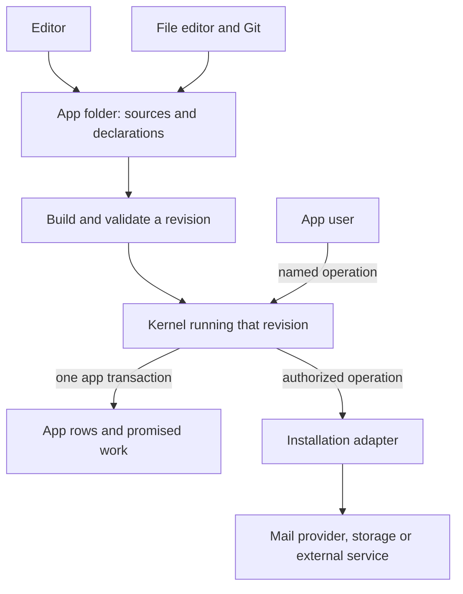

# How an app should grow in Konae

This proposal starts with a small app that two people maintain. One asks the editor for changes, the other edits files, and either may eventually run the app elsewhere. The design choices below describe how Konae should grow to support them.

The folder is the handoff between authoring and execution. A published app can run on the standalone Kernel after its original editor and agent disappear. The installation may choose a different implementation for a capability if it preserves the operation the folder declares. A proposal to split a process or add a module should identify which of these interfaces changes for the author.

## What to build first

Keep one portable app format and a shared, standalone Kernel. Generating an independent backend for every app would let each author replace the runtime outright. Each generated backend would then need to maintain its own admission rules, account handling, upgrades and export path. For the small apps Konae targets, one runtime is worth that dependency if a second operator can run the folder and its behavior examples without the original Konae installation.

Use one cooperative's receipt app to test coauthoring and moving an app. The treasurer changes how the page explains a charge in the editor. A developer changes the calculation in Git. During the next close, the treasurer sets the due date through the app. Take the accepted revision and data to another Kernel. Both people must be able to check the explanation, amount, due date and who can download the receipt. The previous receipt must keep its issued bytes. This exercise tests revision-aware edits, portable examples and Documents. Keep a static site as a check on what those capabilities cost an app that does not use them.

For product discovery, try two monthly closes before scheduling the two-machine exercise. For a release that claims portability, the move and its access checks still have to pass. Connect a building's meter source afterwards if manual intake proves to be the recurring obstacle. Use a second installation to discover which binding behavior the FTPS adapter must preserve. [Two-close pilot](#two-close-pilot)

## Author one revision in ordinary files

Have the editor and CLI propose changes against a specific revision of the Capsule sources and app settings. The editor should produce a reviewable change against the revision it opened. A visual control can edit the part of a file it understands and preserve the rest, or explain why it needs a source edit. A private editor model that regenerates whole files would make hand-written code depend on how much of the language the editor understands. Compile the release from the accepted revision. Keep live rows and sessions outside source edits.

Try a round trip with ten invoices. Ask the editor for the ten most recent, change the ordered query's limit to five in Git, then reopen it and change the page title in the editor. Both edits must survive. Preview with the same fixture and `konae dev` should show the same five invoices. [The editor's draft and Apply](../adr/0007-the-build-agent-edits-a-scratch-copy-and-operates-through-the-owners-mcp.md)

## Compose a business operation around one commit

An app author should be able to name what a person does, such as "Reserve a place", and decide what success means. Use a named mutation for a single statement. Use a Function with explicitly allowed actions when several steps must share a transaction. Keep the business name as the entry point in either case. The app owns the capacity rule. The Kernel supplies the transaction and binds the actor.

If accepting the reservation promises a confirmation by email, the proposed extension is to record that obligation in the same transaction as the seat. The provider sends it afterwards. With two people requesting the last seat, precisely one gets a reservation. If the response is lost, retrying under the same operation key must leave one reservation and one delivery intent. The caller can read the result under current access rules. A workflow interpreter would add a second execution model to an operation already expressible this way. [Transactions and retries in Functions](../functions.md)

## Carry authority through each operation

Let a module switch make an operation available. A Function must also declare which operations it may call. The entry point establishes the caller, and the operation's SQL decides which rows that caller may change. Moving a button or changing a route must preserve those rules. Extending Functions to another module should grant a named operation with bounded inputs. Direct access to the underlying bucket or an owner credential would also grant the ability to bypass the app's rules.

The editor should let an owner try the rule "People can cancel their own bookings" as Ana and Luis. Cancelling as Ana succeeds for her booking and leaves Luis's booking intact. An overnight job may release expired bookings through its own scheduled action. Its authority comes from the app's declaration and the expiry predicate. A recorded initiator can explain why work exists without granting the worker that person's session. App-specific roles stay in app data. [Runtime actors and scheduled access](../functions.md#identity-actions-and-request-rules)

## Grow the catalogue with editable recipes

Start with a one-time source copy when another app could use the same pages, schema and operations. The product-fit examples already work this way. After copying, each cooperative owns its formula and can edit it in Git or in the editor. The app must still run after the recipe publisher disappears. The cost is that each cooperative maintains its copy. Reconsider a versioned library or recipe updates if, for example, three cooperatives independently apply the same two formula corrections and keep compatible local exceptions. That gives an updater a real history of changes to handle. [Product-fit apps](../../examples/product-fit/README.md)

Move a rule into the Kernel when every entry point needs a guarantee that app code cannot enforce. Extend the module that owns the state first. In the journal, the Kernel binds the caller and the app decides which entries the caller may delete. For vecin.dad, a receipt layout and a meter's file format can be recipes. An immutable, access-checked document needs a Kernel operation. An FTPS listener that accepts transfers for several apps needs an installation adapter. A plugin runtime would make a destination reproduce code installed outside the folder. That cost only earns its place if independent implementations need to run under the same verifiable contract.

## Bind external resources at the destination

Let an app name a resource when its identity matters to the business, such as the cooperative's accounting account or the source of a building's meter readings. The declaration should say which operation it needs. The operator supplies the endpoint, transport and secret in the installation. Switching a bucket while preserving document IDs, bytes and access rules is an operator decision. Redirecting invoices to another cooperative changes who receives data and requires the owner's choice. Ordinary file storage already has local and S3 adapters and needs no new declaration per file. Documents must continue to authorize a receipt through its own operation.

At rehearsal or activation, report which required contracts the Kernel understands and which external resources still need connecting. An unsupported authorization rule prevents activation. An understood meter source can wait for its device credential while people read the readings already accepted. Show the owner that distinction and who can act on it. The same app should serve an issued receipt locally and from S3 with the same ID, bytes and row permissions. Its local run should direct email to the test mailbox. [Taking an app elsewhere](../guides/take-the-app-elsewhere.md)

## Connect independently owned apps through named operations

A shop can ask a warehouse to reserve stock. The warehouse owns its inventory, authenticates the shop for that operation and commits the reservation locally. The shop can accept a pending order while the warehouse is offline. Both use the shop's stable request ID so a repeated request can recover the earlier reservation. The shop should promise "stock reserved" only after the warehouse confirms it. Each owner can change tables and internal code while supporting the version of the operation their partner uses.

Use the existing HTTP routes, scoped keys, Calls and completion mutations. The shop must retain the business request and its status in its own rows if it promises recovery after export. The installation's outgoing call queue stays behind. On a sale, the shop can reconcile pending orders and the warehouse can choose whether to authorize the buyer. A shared database would make the sale a data extraction project. If both halves actually require one atomic commit and have one owner, put them in one app. [Routes, calls and the outbox](../reference/routes-and-calls.md)

## Let the owner take the examples with the app

An Action Contract can describe the type of a reservation ID. Only the app author can say what Luis should see after trying to cancel Ana's booking. Offer to save that example with the change. It should name the operation, fixture accounts and rows, expected refusal, and the next read showing Ana still has her place. An owner can correct that expectation in the editor. A developer can review it alongside SQL in Git.

Extend the existing local `konae test scenario` format, which today supplies replies to outgoing calls. Keep those scenarios readable. Give new behavior examples a versioned form under `tests/` and carry the accepted examples through publication and export as development files outside `dist/`. Run them on disposable data on the destination, with fresh test sessions and captured external effects. Report the revision and expected and observed results, including skipped steps. Keep `conform` for the generated interface checks. None of this should be required to serve a static page. [Local scenarios and conformance](../cli.md)

## Test the fit with a recurring job

Start with a housing cooperative whose treasurer works with a technical contributor. Our hypothesis is that they would choose Konae when their own allocation rules change and each resident still needs private access to earlier receipts. Their current spreadsheet or billing service is the comparison. Maintaining a custom formula costs the cooperative time. A group collecting registrations once has little reason to take on that cost. The journal example exercises private rows and the launch example handles registrations. Neither establishes demand for billing. [Product-fit examples](../../examples/product-fit/README.md)

**Bring one period of data.** Start with a local import recipe and three redacted receipts for two members. Keep the source's member and receipt identifiers scoped to that source. Running it twice must leave three receipts. A treasurer links an accepted app account to the correct membership before it can read any private receipt. Keep publication separate from data replacement. Use a full import at cutover when writes can pause. If acknowledgements keep arriving during monthly imports, add an app operation that reconciles incoming rows by source ID and preserves acknowledgements and issued documents. [Bring existing data](../guides/bring-existing-data.md)

**Set up the first operator.** Today the board example needs owner SQL to appoint its first administrator. Try an owner setup step that names the intended invitee and the app's own role. After that person accepts and authenticates, a one-time app operation binds their account ID and consumes the appointment in one transaction. Another member signing up first must gain no authority. Test whether an owner can set up both a club organizer and a treasurer without SQL, and whether either can do the next day's work without the project owner. Start in the recipes and promote the one-time appointment to a Kernel operation only if they cannot enforce it through existing permissions. [Club roles](../../examples/showcase/club/README.md)

**Let the treasurer prepare the next month.** Put the allocation algorithm and its access rules in source. Store the rate, due period and approval for each month in app rows. Through a named action, the treasurer can copy November into December, change ten days to fifteen and approve it. At issuance, fix the amount, due date and document for that receipt. An unpaid November receipt must keep its ten-day term. A booking app can likewise keep capacity on each event. Each app can own this form until both need the same operation for reviewing and approving future changes.

**Answer a member from inside the app.** Give the treasurer a scoped, read-only action that can distinguish an unissued receipt from an issued one whose recipient has yet to link an account. A resident asking about another household must learn nothing about its receipts. A club organizer should likewise be able to confirm a reservation even if its email failed. Keep provider logs with the operator. Consider exposing delivery status for a specific business operation only when staff repeatedly need it to answer the member. The observable result is a correct answer without owner access, SQL or an engineer.

**Hand over the job.** An in-app handover should let the incoming treasurer accept the role and remove the outgoing treasurer's approval rights in one transaction. Both can check the result at the same address. If the outgoing treasurer remains a member, their own receipts should still open. Changing who may publish the project is a separate owner operation. A proposed transfer would remove the former publisher's authority over this project, including through existing tokens. Admitting a second owner to the installation alone does not perform that transfer. Moving to another host is a third decision, with an export, fresh credentials and a check that a returning member can read an earlier receipt. [Owner admission](../guides/add-a-second-owner.md) and [moving the app](../reference/export-and-import.md)

**Keep a single place that confirms scarce resources.** A reading club can choose its next book in one action that checks whether another is current. Two disconnected warehouse devices promising the last unit pose a different problem. An offline draft can wait to confirm until it reaches the Kernel. Giving every app independent writers would force even the club to resolve conflicting confirmations. Revisit offline commitments if field observation shows that deliveries regularly cannot wait and allocating stock to each device in advance would cover the actual work.

### Two-close pilot

After the rehearsal with redacted data, invite one cooperative to try one recurring charge for two households. At the first close, record where the treasurer calculates, issues, delivers and looks up each receipt. Compare time, corrections and help needed with their usual process. Before using real receipts, verify the amount, private access and historical bytes on the candidate installation.

For the next close, leave the spreadsheet and email available. Count repeat use if the treasurer chooses Konae and issues both receipts without prompting or help from the Konae team. Record partial use by step. If they calculate in the sheet but return for private delivery and lookup, prioritize import and historical access. If they return to the old tool for everything, pause billing-specific investment and ask which step lost them. One cooperative returning earns a trial with a second group. The technical replays use fresh accounts each time and cannot answer whether anyone returns.
