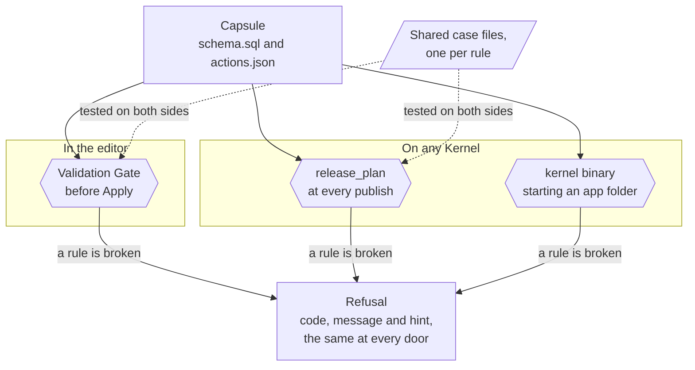

# The Gate and the Kernel

A Capsule meets two checks. The Validation Gate runs in the editor before Apply. The Kernel runs the same checks again at every release, and when the `kernel` binary starts an app folder, such as an export on another machine.



The same Capsule meets a door in three places: the Gate in the editor, `release_plan` on the Kernel that publishes it, and the `kernel` binary that starts the folder on another machine. One case file per rule feeds the tests of both sides, so a declaration one door refuses is refused by the others with the same code and sentence.

## Why two doors

The app has to leave with its rules unchanged. If the editor accepted a statement that the Kernel on another machine refused, the app could not move. So both doors refuse a declaration with the same words, and each rule has one case file that both test suites run.

| Door | Where | When |
| --- | --- | --- |
| Validation Gate | `src/agent/gate.ts`, with the parser in `src/kernel/actions.ts` | Before a change is applied to the project |
| Kernel | `kernel-rs/kernel/src/action_shape.rs`, `sql_rules.rs` and the modules beside them | At `release_plan`, and when the `kernel` binary starts an app folder |

The Gate runs three stages. `schema` runs `schema.sql` twice on a fresh database. `actions` parses `actions.json` and prepares every statement against that schema. `preview-rows` runs `schema.sql` on a copy of the preview's own rows and prepares every action against the result. When all three hold, the editor shows "Validated. Schema, preview rows and actions hold." When the preview's rows could not be read, it shows "Validated. Schema and actions hold. The preview rows were not checked."

`schema.sql` states what the database should be. At `release_plan` the Kernel loads it into a scratch database, compares tables, columns and indexes with the live database and returns the change (`kernel-rs/kernel/src/schema_change.rs`). A new table, column or index applies. A dropped table, a dropped column or a retyped column comes back as a plan with its statements and what they lose, and `release_apply` runs it only with that plan's `confirmSchema`. A table SQLite cannot change in place is rebuilt in one transaction, following the SQLite page on ALTER TABLE, and every column that still exists keeps its values. The preview keeps its own test rows and only re-runs `schema.sql`, so when it lacks a table or column the file declares, the Gate warns and passes.

## Shared case files

These files live in `kernel-rs/kernel/src`, and both sides parse the same cases. They include the following.

- `sql-rule-cases.json`, for statements
- `action-cases.json`, for an action's name, access, kind, bindings and size
- `http-binding-cases.json`, for routes and their callers
- `signal-cases.json`, for Signals
- `guard-cases.json`, for guards
- `signature-cases.json`, for route signatures
- `schedule-cases.json`, for schedules
- `call-cases.json`, for call actions and `connects`

The query bound is `src/lib/query-bound.ts` on one side and its port in `kernel-rs/kernel/src/lib.rs` on the other (ADR-0004).

## The LIMIT rule

A query that reads rows names a `LIMIT` at the top level of the statement. This is the same in the editor and on the Kernel that leaves with the app.

```
SELECT id,title FROM items WHERE user_id=?1 LIMIT 50
```

These cases need no `LIMIT`.

- A query with no `FROM`, which returns one row.
- A query whose select list holds only totals (`count`, `sum`, `avg`, `min`, `max`) and has no `GROUP BY`.

These do not satisfy the rule.

- A `LIMIT` inside a subquery, a string or a comment. It does not bound the rows the caller receives.
- `:limit`, `@limit` and `$limit`. They are named parameters, not the clause.
- A `UNION`, `EXCEPT` or `INTERSECT` with no `LIMIT` on the whole result.
- A statement that uses `OVER` and has no `LIMIT`.
- A `GROUP BY` with no `LIMIT`, since the result grows with the data.

The refusal reads `Action <name> <reason> Add a LIMIT. A total (count, sum, avg, min or max) with no GROUP BY does not need one.` The reason is one sentence from `unboundedQueryReason` in `src/lib/query-bound.ts`, such as `reads rows and has no LIMIT.` or `uses OVER, which keeps one result row per stored row, and has no LIMIT.`

## What a refusal looks like

A refused Capsule answers `{ code, message, hint }`. An MCP tool puts it under `structuredContent.error` and keeps the sentence in `content[0].text`. The editor's Gate gives the same code and sentence.

Branch on `code`, never on `message`. A code never changes once released. A sentence may.

**capsule.** An edit to the app's files clears it. Change the file the message names and check again.

**owner.** The owner clears it outside the files, with the tool the hint names, such as `secret_set`. No edit clears it.

**operator.** Only the installation can clear it.

The `refusals` topic of `platform_guide` lists every code with its fix.

## What the Gate does not check

The Gate checks the schema, `actions.json` and `manifest.fileAccess`. Of the pages, it checks only that one runs the entrypoint. When every page is a whole document that loads no script, the Gate and the build refuse with the same sentence, which names the page and the entrypoint. The Kernel's release check reads `actions.json` and `schema.sql`, never the sources of the pages, so it has no such check. A page that names a missing file fails at build or release, not at `validate_capsule`. The Gate also does not judge a Build Artifact. The builders refuse a bad reference. See [Named divergences](./divergences.md).

## Read next

- [Server Actions](./server-actions.md)
- [Limits](./limits.md)
- [Named divergences](./divergences.md)
- [MCP tools and guide topics](./mcp-tools.md)
