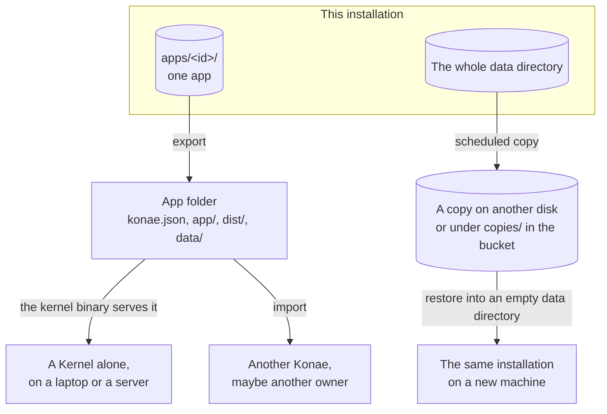

# Take the app elsewhere

Export the app folder to move one app's accounts, data and rules to another machine.

## Pick the right move

| You want | Use | Why |
| --- | --- | --- |
| A copy of one app on another machine | Export and import of the app folder | It moves one Deployment's settings, sources, built files, database, accounts, files and, when present, Usage and Signals. |
| To move a whole installation | Copy | A copy moves an installation, not one app. It is operator work, not an app feature. |



An export moves one app, and the folder runs on a Kernel alone or enters another Konae by import. A copy moves every app of an installation with its owners, and only a restore reads it.

An export never moves sessions, email links, live API keys or signing secrets. People sign in again with their passwords, each API key arrives revoked so you issue new ones, and you set each secret again on the destination.

## What the folder holds

```text
my-app/
  konae.json      name, visibility, Signup Policy, sign-in methods, contact email, Kernel version
  app/            the sources: pages, actions.json, schema.sql
  dist/           the built files the Kernel serves
  data/           database.sqlite, identity.sqlite, usage.sqlite, files/
  AGENTS.md       what a coding agent needs to work on the folder
  action-contract.md, actions.d.ts
  compose.yaml, .env.example
  package.json, scripts/    npm run build writes dist/ from app/
```

`data/` holds password hashes and uploaded files, so keep an export with data private. The folder's `.gitignore` keeps `data/` and `.env` out of Git.

## Export the app

1. Log in with `export_data`, unless the login saved in the folder already has it. `tool session_inspect` shows it in the `can` map. Only an OAuth client on this machine, such as `login --browser --export-data`, gets `export_data`. Otherwise use a password login or a token the owner creates in their browser session with that permission.

    ```sh
    KONAE_EMAIL=you@example.com KONAE_PASSWORD=... \
    bun run konae -- login --dir /tmp/my-app --url http://localhost:4173 --manage-users --export-data
    ```

2. Write the folder, with the published app's data, into an empty folder. Without `--with-data` it writes the folder without `data/` and needs no credential.

    ```sh
    bun run konae -- export --dir /tmp/my-app --out /tmp/my-app-export --with-data
    ```

3. Or, in the editor, choose Export. A published app downloads as a tar of the folder with its data; an app not published yet downloads its sources and build. When `app/actions.json` differs from the actions the published app runs, the editor says that `app/` is ahead of `dist/` and `data/`.
4. Or over MCP, call `project_export` with the `deploymentId`. It returns `folder`, a download of `konae.json`, `app/` and `dist/`, and a manifest with one download per part of `data/`: `database`, `identity`, `files` and, when the app recorded any, `usage`. `sourcesAhead` compares `app/` with the release's `sourceDigest`. Older releases without a digest compare `app/actions.json` with the actions the release runs. Read each download with `transfer_read` and its `transferId` and `offset` until `nextOffset` equals `size`. Check its SHA-256, then call `transfer_cancel`.

## Run it without Konae

The `kernel` binary serves an exported folder as it is, with its `data/`. At startup it checks the folder as Konae checks a release, applies the schema change `app/schema.sql` asks, writes its own record into the folder's `.konae/`, and prints the app's address. People sign in with the passwords they have.

### Get the binary

Each release attaches the `kernel` binary to its GitHub Release for macOS and Linux, on arm64 and x64. Download the one for this machine, check it against `SHA256SUMS` and make it executable. Replace `X.Y.Z` with the version in the exported folder's `konae.json` and `darwin-arm64` with `darwin-x64`, `linux-x64` or `linux-arm64`.

```sh
base=https://github.com/danibram/konae/releases/download/vX.Y.Z
curl -fLO "$base/kernel-X.Y.Z-darwin-arm64"
curl -fLO "$base/SHA256SUMS"
shasum -a 256 -c --ignore-missing SHA256SUMS
chmod +x kernel-X.Y.Z-darwin-arm64
```

On Linux, `sha256sum -c --ignore-missing SHA256SUMS` does the check. The binary is not signed, so a file saved from a browser may need `xattr -d com.apple.quarantine <file>` on macOS. The Linux binaries need glibc 2.36 or newer. The 0.6.0 release attached no binaries, so build from a checkout for that version.

To build it from a Konae checkout instead, which needs a Rust toolchain:

```sh
cargo build --manifest-path kernel-rs/Cargo.toml --bin kernel
```

That writes `kernel-rs/target/debug/kernel`.

### On this machine

`dev` serves the folder in place, with its `data/`, and restarts the Kernel when `app/` changes. Set `KONAE_KERNEL_BIN` to the downloaded binary and `dev` runs it and needs no Rust. Without it, the first run compiles the Kernel from the checkout.

```sh
KONAE_KERNEL_BIN="$PWD/kernel-X.Y.Z-darwin-arm64" bun run konae -- dev --dir /tmp/my-app-export
```

A server that serves several app folders with one `kernel` needs the other layout. Put the folder at `apps/<id>/` of a data directory, where `<id>` is the `id` in its `konae.json`, and start the binary. It needs no checkout:

```sh
mkdir -p /tmp/kernel-data/apps
cp -R /tmp/my-app-export "/tmp/kernel-data/apps/$(bun -e 'console.log(require("/tmp/my-app-export/konae.json").id)')"
KONAE_DATA_DIR=/tmp/kernel-data KONAE_PUBLIC_ORIGIN=http://localhost:8787 ./kernel-X.Y.Z-darwin-arm64
```

With the cargo build, the last line starts `kernel-rs/target/debug/kernel` instead.

It prints `Serving <name> at http://<slug>.localhost:8787` and `Kernel listening on 8787`. `KONAE_KERNEL_PORT` changes the port.

### In a container

1. In the exported folder, copy the example settings.

    ```sh
    cp .env.example .env
    ```

    The export fills `KONAE_KERNEL_IMAGE` with `ghcr.io/danibram/konae-kernel:<the version in konae.json>`. Add a mail transport if the app sends invitations or password resets. The Kernel seals queued email links with a key it writes to `mail-key` in its volume on the first start. To run a checkout's Kernel instead, build it from the Konae checkout, then set `KONAE_KERNEL_IMAGE=konae-kernel:local` in the exported folder's `.env`.

    ```sh
    docker build -f Dockerfile.kernel -t konae-kernel:local .
    ```

2. From the exported folder, start it and read the address it prints.

    ```sh
    docker compose up -d
    docker compose logs kernel
    ```

    With the example settings the app answers at `http://<slug>.localhost:8787`. `KONAE_PORT` and `KONAE_PUBLIC_ORIGIN` in `.env` change the port.

The Kernel runs as the person who owns the folder, so the files it writes into it stay theirs.

The Kernel refuses a folder whose routes sign with a secret it does not hold, because secrets never travel. Set each one, then restart:

```sh
printf '%s' "$SECRET" | docker compose exec -T kernel kernel secret set orders_hook
docker compose restart kernel
```

### Manage the app from the machine

Outside Konae, the `kernel` binary's commands do what Konae's editor does for app users, keys and secrets. Each one calls the function the editor's tool calls, refuses with the same words, and prints the answer as JSON. They work while the Kernel serves, and the Kernel reads the Signup Policy from `konae.json` again when a command changes it. Under Compose, run each as `docker compose exec kernel kernel <command>`. On this machine, run the binary with the same `KONAE_DATA_DIR`, such as `KONAE_DATA_DIR=/tmp/kernel-data kernel-rs/target/debug/kernel users`.

```sh
docker compose exec kernel kernel users
docker compose exec kernel kernel invite ana@example.com
docker compose exec kernel kernel suspend <user id>
docker compose exec kernel kernel resume <user id>
docker compose exec kernel kernel signup-policy invitation
docker compose exec kernel kernel api-key create billing --action orders.create
docker compose exec kernel kernel api-key revoke <key id>
docker compose exec kernel kernel sql "SELECT count(*) FROM orders LIMIT 1"
docker compose exec kernel kernel maintenance on
docker compose exec kernel kernel enter ana@example.com
```

`enter` labels the entry with the login name of whoever ran it when the shell sets `USER`, and `operator` otherwise. Inside a container that is usually `operator`, so note who ran it. The Kernel's log, `docker compose logs kernel`, records the entry when the link is used, since a Kernel without Konae keeps no audit log. The exported `AGENTS.md` lists every command with its options. An export carries each API key revoked, so issue new ones with `kernel api-key create`.

## Serve the app on its own domain

An app on an installation can answer on a domain of its own. Give the Deployment a custom domain with `bun run konae -- domain --dir /tmp/notes --deployment <id> --set notes.example.org` or `domain_set`, add the TXT record it prints, and run it again. The installation's operator routes the name to the Kernel and terminates TLS for it.

The page and its Server Actions answer from the same host. The SDK calls `/_konae/mcp` on the page's own host and the Kernel refuses an `Origin` that is not the app's, so you cannot serve the page from another host and call the Kernel across origins.

An export carries the custom hostname without its verification token, so the destination issues a new token and the name verifies again there.

## Import on the destination

Into an app that already exists on another Konae, open App settings under **More** in the editor and choose the exported tar under **Import**. It backs up what it replaces first, never merges rows, and keeps the app's Signup Policy, address, secrets, sessions and API keys. Over MCP, `project_import` does the same with `replace` set to `sources`, `data` or `both`. On a bare `kernel`, stop it and run `kernel import <folder>`.

Into a new app over MCP:

1. Run `project_create` with the same `projectId`. Then set every secret the app's routes sign with, one command each, because a release that signs with an unset secret is refused. The value takes 16 to 512 characters. `--stdin value` reads it from standard input, so it stays out of the shell history. Use a credential for the destination, in `KONAE_MCP_TOKEN` or in a folder's `.konae/` from `login` there.

    ```sh
    printf '%s' "$SECRET" | KONAE_MCP_TOKEN=<destination token> bun run konae -- tool secret_set '{"projectId":"app_...","name":"orders_hook"}' --stdin value --url <destination installation URL>
    ```

2. For each part of the data the manifest lists, call `transfer_begin` with `size`, `sha256`, `projectId` and its name as `component`. Call `transfer_write` for each block, then `transfer_complete`.
3. Upload the release JSON built from `app/` and `dist/`, with `initialPackage` holding the `manifest` and a `components` map of part name to `transferId`. Then call `release_plan` and `release_apply`. An import installs only into a project that has no Deployment yet. The same data imported again returns the first import.
4. Issue new API keys. `api_keys_list` shows each key revoked at import.

`konae pull` and `konae dev --reset` are the same export and import for a laptop. `pull` exports the published app's data into `.konae/pull/data`, and `dev --reset` imports it into the folder's `data/` with the `kernel` binary's `import` command, after a backup. `konae push` goes the other way and imports the folder's `data/` into the published app with `project_import`, after a backup. [Bring existing data](./bring-existing-data.md) shows it.

## Check it worked

- After `project_export`, the read-back is `transfer_read`. Verify the size and SHA-256 of every download.
- After `transfer_begin` or `transfer_complete`, the read-back is `transfer_status`. `transfer_write` answers `nextOffset`, the start of the next block, so it needs none. Bytes in an open transfer are not a Deployment.
- After `release_apply` on the destination, the read-back is `project_inspect`.
- On the destination, sign in with an existing password and open one row the app owned.
