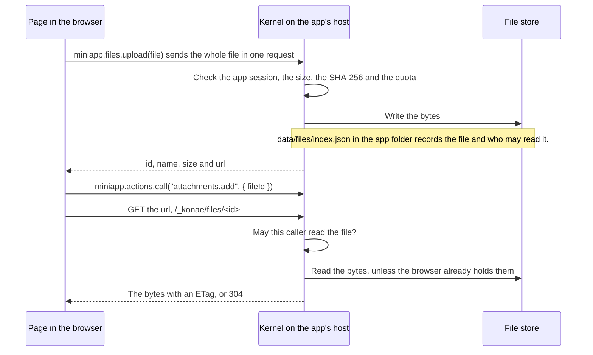

# Upload files

Use `miniapp.files` for the bytes and a mutation for the row that remembers the file's ID.

## How it works

The Kernel stores small files for one Deployment, in its file store. A file is private to the person who uploaded it unless the upload asks for `"public"`. An app that sets `manifest.fileAccess` to `"app-users"` shares every file with its signed-in users instead. Large bytes do not belong in a SQLite column. Keep the file's ID in a row and let the Kernel keep the bytes.



The page never talks to the file store. The Kernel takes the upload, checks it, and writes the bytes to the store the installation uses, the app folder or a bucket. A read comes back through the Kernel too, which checks the caller on every request, so no bucket address reaches the browser.

- 1 byte to 2 MiB per file, and 20 MiB of files per Deployment. An operator can change both with `KONAE_FILE_MAX_BYTES` and `KONAE_FILES_QUOTA_BYTES`, and each refusal names the number in force.
- An upload needs an app session. A signed-out visitor on a public Deployment can list and read public files only.
- Only the uploader changes a file's visibility or deletes it. A deleted file stops counting against the quota.

## Steps

1. Add a table that holds the file's ID. This is from the starter app.

    ```sql
    CREATE TABLE IF NOT EXISTS attachments (
      id INTEGER PRIMARY KEY AUTOINCREMENT,
      user_id TEXT NOT NULL,
      file_id TEXT NOT NULL,
      name TEXT NOT NULL,
      size INTEGER NOT NULL CHECK (size >= 0),
      public INTEGER NOT NULL DEFAULT 0 CHECK (public IN (0, 1)),
      created_at INTEGER NOT NULL
    );
    ```

2. Add a mutation that stores the ID next to the actor.

    ```json
    "attachments.add": {
      "kind": "mutation",
      "access": "authenticated",
      "statement": "INSERT INTO attachments (user_id, file_id, name, size, created_at) VALUES (?1, ?2, ?3, ?4, ?5)",
      "bindings": [
        { "source": "actor", "field": "id" },
        { "source": "input", "key": "fileId", "type": "string", "maxLength": 64 },
        { "source": "input", "key": "name", "type": "string", "maxLength": 180 },
        { "source": "input", "key": "size", "type": "number" },
        { "source": "kernel", "field": "now" }
      ]
    }
    ```

3. Upload from the page, then record the file. Attach the listener in JavaScript, because a published app refuses inline handler attributes.

    ```js
    const stored = await miniapp.files.upload(file);   // private to the signed-in user
    await miniapp.actions.call("attachments.add", { fileId: stored.id, name: stored.name, size: stored.size });
    ```

    Pass `{ visibility: "public" }` only when every visitor of a public app may read the bytes.
4. Show a file with `files.url`. It returns the path `/_konae/files/<id>` on the app's own origin, which `img`, `fetch` and a link all reach. `files.upload` returns the same path as `url`. `files.list` returns the same path as `url` for each file, without reading the bytes.

    ```js
    image.src = await miniapp.files.url(photo.file_id);
    ```

5. Publish or remove a file later with the uploader's session. The ID and the `files.url` path stay the same.

    ```js
    await miniapp.files.update(draft.id, { visibility: "public" });
    await miniapp.files.delete(note.file_id);   // { id, deleted: true }
    ```

6. If the row's mutation fails after the upload, delete the file so it does not keep counting against the quota.

    ```js
    try {
      await miniapp.actions.call("attachments.add", { fileId: stored.id, name: stored.name, size: stored.size });
    } catch (error) {
      await miniapp.files.delete(stored.id).catch(() => {});
      throw error;
    }
    ```

## Share every file with the app's users

`manifest.fileAccess` decides who reads files across the whole app. It has one value, `"app-users"`. Leave it out to keep each file's own visibility. A release with any other value is refused with `manifest.fileAccess must be "app-users" when set.`, in the editor and on the Kernel.

```json
{ "manifest": { "fileAccess": "app-users" } }
```

Put it in `konae.json`, or pick "All signed-in app users" under "Who can read uploaded files" in the editor's Users view. It takes effect at the next publish.

- Every person signed in to this app lists and reads every file, including files uploaded before the policy. A signed-out visitor reads none, even on a public app.
- An API key reads no file of the app.
- An upload may omit `visibility` or pass `"app-users"`. `"private"` or `"public"` is refused with `File visibility is fixed to app-users by this app.`
- Only the uploader still deletes a file.
- Files list with `visibility: "app-users"`. Each file keeps the visibility it was stored with, and a file uploaded under the policy is stored as private. Removing the policy and publishing again gives every file that stored visibility back, so files uploaded under the policy become private to their uploader.
- An app with this policy has accounts, so its path address needs `acceptSharedOrigin`.

## Refusals you may meet

- `authentication-required` when nobody is signed in.
- `Files must be between 1 byte and 2 MiB.` when the file is empty or too large.
- `This deployment has reached its 20 MiB file quota.`
- `Only the person who uploaded this file may change or delete it.`
- `File visibility is fixed to app-users by this app.` when the app sets `fileAccess` and the upload or change asks for `"private"` or `"public"`.
- `File visibility must be private or public.` when the visibility is unknown, or asks for `"app-users"` in an app without the policy.

## Check it worked

- After `files_upload`, `files_update` or `files_delete`, read the files back with `files_list`. In the page, that is `miniapp.files.list()`.
- Open the `files.url` path in the app and check the file loads. A visitor without a session on a private Deployment gets 401 `authentication-required`. Anyone else who may not read the file gets 404 `File not found.`
- Query the row from step 2 to confirm the ID was stored.

The editor preview keeps files in browser storage, refuses a file over 2 MiB and never reaches the 20 MiB quota. A published app sends each file to the Kernel in one request with its SHA-256, so try a real upload on `konae dev` or a Deployment. `konae dev` allows 1 TiB per file and per app unless `KONAE_FILE_MAX_BYTES` or `KONAE_FILES_QUOTA_BYTES` names a lower limit, so try the size refusal on a Deployment. An export carries the files when the app moves.

## Read next

- [Add a Server Action](./add-a-server-action.md)
- [Take the app elsewhere](./take-the-app-elsewhere.md)
- [Limits](../limits.md)
- [Examples](../examples.md)
