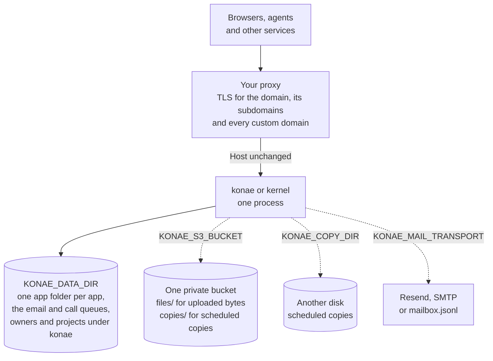

# Operate an installation

An installation is one running Kernel and its data directory. It runs as one of two binaries, both built from `kernel-rs`:

- `konae` is Konae, the Kernel with owner accounts, the owner's MCP on `/mcp`, OAuth and the project list. `bun run dev:local`, `bun run kernel` and `Dockerfile.konae` run it. It prints `Konae listening on <port>`.
- `kernel` is the Kernel alone. It serves the app folders under `apps/` of its data directory and reads no owner, credential or project list. `konae dev`, `Dockerfile.kernel` and an exported folder's `compose.yaml` run it. It prints `Kernel listening on <port>`.

This page is for the operator of either one. It covers the settings each reads, where the data lives, copies and restores, email, the file store, and how owners are admitted to Konae.

The operator commands on this page, such as `owner-code-create` and `restore`, are commands of these binaries. `bun run konae --` is another program, the TypeScript CLI an app's author uses, and it directs operator commands to the server binary. Under `bun run dev:local` the `konae` binary is `kernel-rs/target/debug/konae`, run with `KONAE_DATA_DIR=data/kernel-local`, the running server's data directory. Under Compose it is `/usr/local/bin/konae` in the service named `kernel`, whose environment sets `KONAE_DATA_DIR=/data`, so a command runs as `docker compose exec --user konae kernel konae <command>`. The commands and the mail limit name an owner `creator`, as in `owner-code-create` and `KONAE_MAIL_LIMIT_OWNER_PER_DAY`.



One process answers every host of the installation. Every installation has the solid arrows, a proxy in front and the data directory, which is the authority for every app. The dashed arrows are settings an operator may add: a bucket for file bytes and copies, another disk for copies, and a mail transport.

## The local stack

`bun run dev:local` starts Konae on port `8790` and the editor on port `4173`, without Docker, with its data in `data/kernel-local`. It sets `KONAE_MAIL_TRANSPORT=development`, so account and invitation email lands in `data/kernel-local/mailbox.jsonl`. The [README](../README.md#run-it-locally) has the first steps.

| Mode | Process | Listens on |
| --- | --- | --- |
| `bun run dev:local` | Konae | `127.0.0.1:8790` |
| `bun run dev:local`, `bun run dev` | The editor, Vite | `127.0.0.1:4173` |
| `bun run kernel` | Konae | `127.0.0.1:8787` |
| Compose | The gateway, the only published address of the editor and the apps | `127.0.0.1:8080` |
| Compose | The S3 store, RustFS | `127.0.0.1:9000` |
| Compose | `kernel` and `builder`, inside the Compose network only | `8787` and `4173` |
| `konae dev` | The Kernel | `127.0.0.1:8796` |
| `konae dev` | The events page | `127.0.0.1:8797` |
| An exported folder's `compose.yaml` | The Kernel | `127.0.0.1:8787`, or `KONAE_PORT` |
| `bun run test:e2e:local` | The editor, then Konae | `127.0.0.1:4176`, then `127.0.0.1:8794` |

`bun run dev` alone starts only the editor, which proxies `/mcp` to `http://127.0.0.1:8787` unless `KONAE_KERNEL_URL` says otherwise. `konae dev` takes `--port` and `--events-port`, and the end-to-end suite reads `KONAE_EDITOR_URL` and `KONAE_TEST_KERNEL_PORT`.

The complete stack, with an Nginx gateway and an S3 store, runs under Compose:

```bash
docker compose up --build
```

Open [http://app.localhost:8080](http://app.localhost:8080). Published apps get addresses such as `http://tiny-tasks.localhost:8080` (or `http://tiny-tasks-a1b2c3.localhost:8080` when that slug is already taken), and `*.localhost` resolves to this machine in current browsers without editing `/etc/hosts`.

Compose publishes the gateway and the S3 API on `127.0.0.1` only. The Konae container binds `0.0.0.0` inside the Compose network with the development setup key, so the Compose file sets `KONAE_ALLOW_DEFAULT_KEY=1`. Do not copy that setting to a reachable installation.

The S3 store is RustFS, in the Compose service named `minio`. Its API answers at [http://localhost:9000](http://localhost:9000) with the development credentials `konae` and `konae-secret`. Compose creates one private `konae` bucket and names it in `KONAE_S3_BUCKET`, so file bytes go under `files/`. Set `KONAE_COPY_S3=1` to send copies under `copies/` as well. The bucket must exist before the Kernel starts. `docker compose down -v` starts the stack with empty volumes.

The Kernel's volume stays the authority. Every app folder lives there, and mutations run against the live database. A Kernel started on an empty volume serves nothing until `restore` installs a copy. See [Data directory and copies](#data-directory-and-copies).

## The kernel binary on its own

`kernel` serves every folder under `<KONAE_DATA_DIR>/apps/<id>/`. At startup it checks each folder as Konae checks a release: `konae.json`, `app/` and `dist/`. It applies the schema change `app/schema.sql` asks of `data/database.sqlite`, writes the folder's `.konae/`, and prints `Serving <name> at <url>`. A folder that fails a check is not served. The Kernel prints why as `Not serving apps/<id>: ...` and serves the others. A schema change that loses data needs `KONAE_CONFIRM_SCHEMA` set to the confirmation it prints. A folder that has no `.konae/` record yet answers at `<slug>.<KONAE_HOST_SUFFIX>`, or at `<slug>-<six random characters>.<KONAE_HOST_SUFFIX>` when another app holds that address. While it serves, the Kernel reads an app's `konae.json` again when the file changes.

`kernel` also runs commands on one app instead of serving: `users`, `invite`, `suspend`, `resume`, `signup-policy`, `api-key`, `secret`, `sql`, `events`, `maintenance`, `enter` and `import`. Each calls the function Konae's owner tool calls, refuses with the same words and prints its answer as JSON. Add `--app <id>` when the data directory holds more than one app. All of them work beside a serving Kernel except `import`, which replaces the app's data with the `data/` of an exported folder after a backup and needs the Kernel stopped. `kernel help` lists them with their options, and so does an exported folder's `AGENTS.md`. Both binaries also run the installation commands `restore`, `reconcile`, `files-migrate` and `files-reconcile`.

`Dockerfile.kernel` builds an image that holds only `kernel`, with `KONAE_DATA_DIR=/kernel`. An exported folder's `compose.yaml` mounts the folder at `/kernel/apps/<id>` and runs the image that `KONAE_KERNEL_IMAGE` names in the folder's `.env`. The image runs the Kernel and each command as the owner of the app folder, so the files it writes there stay that person's. Each release publishes it as `ghcr.io/danibram/konae-kernel:<version>`, and Konae itself as `ghcr.io/danibram/konae:<version>`. The `konae` image also holds the built editor and serves it on the editor host, so one container answers the editor, the owner's MCP and the apps. [Releasing](./releasing.md) covers the tag and the Changelog. To build locally, `docker build -f Dockerfile.kernel -t <name>:<version> .`. Under Compose, run a command as `docker compose exec kernel kernel <command>`.

`konae dev` runs `kernel` on one app folder for its author. It builds the binary unless `KONAE_KERNEL_BIN` names one, and drops every other `KONAE_` and `VITE_` variable from the shell except `KONAE_SCHEDULE_MIN_SECONDS`. It binds `127.0.0.1` on port `8796`, keeps its data directory at `<folder>/.konae/kernel`, where `apps/<id>` links back to the folder, and uses the folder's own `data/`. Email goes to `<folder>/.konae/kernel/mailbox.jsonl`. It sets a local value for each signing secret `actions.json` names and prints it, prints a `kernel invite` command for a test account, and serves a page of the email, calls, scheduled runs and Signals the app produced on port `8797`.

## Before a Kernel is reachable

The defaults suit one machine. Before another machine can reach the installation:

- On `konae`, set `KONAE_SETUP_KEY` to a long random value. It creates the first owner and nothing else. Konae refuses to start on a non-loopback address while the setup key is unset or the development default. The `kernel` binary has no setup key.
- Set `KONAE_DOMAIN` to the installation's domain, such as `example.com`. Both binaries read it. Apps then answer under `example.com`, at `<slug>.example.com`, or `<slug>-<six random characters>.example.com` when another app holds the slug, and path addresses at `example.com/p/<name>`. On `konae`, the editor and the owner's MCP answer at `app.example.com`.
- Put a proxy in front that terminates TLS for the domain, for `*.<domain>` and for every custom domain, and forwards `Host` unchanged. The Kernel issues no certificate. `ops/nginx.local.conf` is the local stack's proxy, without TLS.
- List the proxy's address in `KONAE_TRUSTED_PROXIES`, or every visitor shares one rate-limit bucket.
- Set `KONAE_ACCOUNT_VERIFICATION=required` and a mail transport, so nobody holds an account for an email they did not prove. On `konae`, set `KONAE_MAIL_SECRET` as well.
- Set `KONAE_COPY_DIR` or `KONAE_COPY_S3=1`, with `KONAE_COPY_SECRET` for S3. The data directory is the only place the apps live.
- To serve an app at the domain's root, give its path address the name `konae-home`. Without an app on that name, the root answers not found. [`examples/home`](../examples/home/README.md) is a home ready to publish.

## Environment variables

Both binaries read these at startup unless a row says otherwise. Defaults are the values in `kernel-rs/kernel/src` and `kernel-rs/konae/src`.

| Variable | Default | Meaning |
| --- | --- | --- |
| `KONAE_KERNEL_PORT` | `8787` (`8790` under `bun run dev:local`, `8796` under `konae dev`) | Port the Kernel listens on. |
| `KONAE_BIND` | `127.0.0.1` (`0.0.0.0` in both images) | Address the Kernel listens on. |
| `KONAE_DATA_DIR` | `/data` (`/kernel` in the `kernel` image, `data/kernel-local` under `bun run dev:local` and `bun run kernel`) | Data directory. See [Data directory and copies](#data-directory-and-copies). |
| `KONAE_SETUP_KEY` | `local-development-key` | `konae` only. The setup key that creates the first owner. `konae login` reads the same variable on the machine that runs it. Later owners need an invitation code; see [Owner admission](#owner-admission). An empty value counts as unset. |
| `KONAE_EDITOR_DIR` | unset (`/usr/local/share/konae/editor` in the `konae` image) | `konae` only. Folder that `bun run build` writes. Konae answers every GET and HEAD on the host of `KONAE_PUBLIC_ORIGIN` with it, except `/mcp`, `/_konae`, `/oauth` and `/.well-known`. A folder without `index.html` stops Konae at startup. An empty value serves no editor. |
| `KONAE_ALLOW_DEFAULT_KEY` | unset | `konae` only. Set to `1` to let Konae start on a non-loopback address with the development setup key. Compose sets it for the local stack. |
| `KONAE_CONFIRM_SCHEMA` | unset | `kernel` only. The confirmation of a schema change that loses data, as the Kernel printed it, for the app folder it opens at startup. It fits only the plan it came from. |
| `KONAE_ACCOUNT_VERIFICATION` | `local` | `required` makes new owner and app accounts prove their email before they are active, and moves accounts that never verified to pending with their sessions revoked. `local` keeps unverified signup for development. See [Verified accounts](#verified-accounts). |
| `KONAE_MAIL_TRANSPORT` | unset (`development` under `bun run dev:local` and `konae dev`) | How email leaves: `resend`, `smtp` or `development`. Every transport sends through the queue in `mail.sqlite`. `development` appends each message to `mailbox.jsonl` in the data directory. Unset means no email, so signup under required verification, recovery and invitations are refused. See [Account email](#account-email). |
| `KONAE_MAIL_FROM` | `Konae <konae@localhost>` for `development`; required otherwise | Sender address, such as `Konae <no-reply@mail.example.com>`. The sender preflight checks its domain. |
| `KONAE_MAIL_SECRET` | unset | Secret of at least 32 characters from which the Kernel derives the key that encrypts queued links. When it is unset, `konae` derives the key from `KONAE_SETUP_KEY` and refuses to start `resend` or `smtp` while that is the development default. `kernel` writes a random key to `mail-key` in the data directory on its first start, readable by its owner alone, and every later start and command reads it. |
| `KONAE_RESEND_API_KEY` | unset | Resend API key for `resend`. A sending-only key is enough to send. |
| `KONAE_RESEND_DOMAINS_KEY` | `KONAE_RESEND_API_KEY` | Resend key that can list domains, for the sender preflight. Set it when the sending key has `sending_access` only. |
| `KONAE_RESEND_WEBHOOK_SECRET` | unset | The `whsec_` signing secret of the Resend webhook that posts to `/_konae/mail/resend-events`. Unset means the route answers 404 and jobs stop at accepted. |
| `KONAE_RESEND_API_URL` | `https://api.resend.com` | Resend API base URL. Tests point it at a local server. |
| `KONAE_SMTP_HOST` | unset | SMTP server for `smtp`. |
| `KONAE_SMTP_PORT` | `587`; `465` with `implicit`; `25` with `none` | SMTP port. |
| `KONAE_SMTP_TLS` | `starttls` | `starttls` requires STARTTLS on a plain connection, and `implicit` uses TLS from the first byte. `none` is accepted only for a loopback host. |
| `KONAE_SMTP_USERNAME`, `KONAE_SMTP_PASSWORD` | unset | SMTP credentials. Set both or neither. |
| `KONAE_MAIL_LIMIT_RECIPIENT_PER_MINUTE` | `3` | Account email requests one address may receive per minute. |
| `KONAE_MAIL_LIMIT_RECIPIENT_PER_DAY` | `10` | Account email requests one address may receive per 24 hours. |
| `KONAE_MAIL_LIMIT_OWNER_PER_DAY` | `100` | Account emails the apps of one owner may queue per 24 hours. `kernel` has no owners and does not apply it. |
| `KONAE_MAIL_LIMIT_APP_PER_DAY` | `100` | Account emails one Deployment may queue per 24 hours. |
| `KONAE_MAIL_LIMIT_INSTALLATION_PER_DAY` | `1000` | Emails of every kind, account email and notices, the installation may queue per 24 hours. Keep it at or below the provider's contracted limit. |
| `KONAE_MAIL_LIMIT_CLIENT_PER_HOUR` | `20` | Account email requests one client address may make per hour. |
| `KONAE_MAIL_LIMIT_NOTIFY_APP_PER_DAY` | `200` | Notices one Deployment may queue per 24 hours. |
| `KONAE_MAIL_LIMIT_NOTIFY_OWNER_PER_DAY` | `500` | Notices the apps of one owner may queue per 24 hours. `kernel` does not apply it. |
| `KONAE_MAIL_LIMIT_NOTIFY_RECIPIENT_PER_DAY` | `50` | Notices one address may receive from one Deployment per 24 hours. |
| `KONAE_MAIL_WORKER_INTERVAL_MS` | `5000` | How often the mail worker looks for due jobs. A new job also wakes it. |
| `KONAE_CALLS_PER_MINUTE` | `20` | Calls one app's call actions may queue in any 60 seconds, from 1 to 10000. The Kernel sends them from `calls.sqlite`; see [Calls between apps](./reference/routes-and-calls.md#calls-between-apps). |
| `KONAE_FILES_QUOTA_BYTES` | `20971520` (20 MiB) | Bytes the files of one Deployment may hold together. An upload past it is refused with the configured number, and so is an import whose files exceed it. |
| `KONAE_FILE_MAX_BYTES` | `2097152` (2 MiB) | Bytes one file may hold. It must not exceed `KONAE_FILES_QUOTA_BYTES`, or the Kernel refuses to start. A browser upload sends the file in one request. Exports and copies read in 64 KiB MCP blocks, so a larger file takes more calls there. |
| `KONAE_SQLITE_HEAP_BYTES` | Half of available memory, including Linux cgroup limits; 256 MiB when unknown | Ceiling on the memory SQLite may hold across every app of the process. A statement that passes it fails with SQLite's out-of-memory error, and the process keeps running. The Kernel refuses to start on a value that is not a whole number of bytes above 0. |
| `KONAE_S3_BUCKET` | unset | The installation's private bucket. File bytes go under `files/` as `files/<app id>/<file id>`, and copies under `copies/` with `KONAE_COPY_S3=1`. Unset keeps file bytes in each app folder's `data/files/`. The index, databases, accounts, sources and `dist/` stay in the data directory either way. See [File bytes in a bucket](#file-bytes-in-a-bucket). |
| `KONAE_S3_ENDPOINT` | unset | S3 endpoint URL of `KONAE_S3_BUCKET`. |
| `KONAE_S3_REGION` | `us-east-1` | S3 region. |
| `KONAE_S3_ACCESS_KEY`, `KONAE_S3_SECRET_KEY` | required with `KONAE_S3_BUCKET` | The key pair for the bucket. |
| `KONAE_S3_PATH_STYLE` | `1` | `1` addresses the bucket as `<endpoint>/<bucket>`, `0` as `<bucket>.<endpoint host>`. |
| `KONAE_COPY_DIR` | unset | Directory, on another disk, that receives scheduled copies of the data directory. It must be outside `KONAE_DATA_DIR`. |
| `KONAE_COPY_S3` | unset | `1` sends scheduled copies to `copies/` in `KONAE_S3_BUCKET`. |
| `KONAE_COPY_INTERVAL_SECONDS` | `3600` | Seconds between copies when a copy target is set. The first copy runs at startup. |
| `KONAE_COPY_SECRET` | unset | Secret of at least 32 characters that encrypts every file of a copy sent to S3 with AES-256-GCM. `restore` needs the same secret to open such a copy. The secret also signs each copy's manifest and each revocation entry sent to S3, and `restore` from S3 refuses a copy or an entry whose signature is missing or wrong. Directory copies stay unencrypted and unsigned. |
| `KONAE_TRUSTED_PROXIES` | unset | Comma-separated proxy IP addresses whose `X-Forwarded-For` header the Kernel trusts for rate limiting. CIDR ranges are refused. |
| `KONAE_DOMAIN` | unset | Derives the installation's hosts from one domain (ADR-0014). The public origin, and on `konae` the MCP origin, become `<scheme>://app.<domain>`, and the app suffix becomes `<domain>`. Each of `KONAE_PUBLIC_ORIGIN`, `KONAE_MCP_ORIGIN` and `KONAE_HOST_SUFFIX` still wins when it is set. The Kernel refuses to start when `KONAE_PUBLIC_ORIGIN` or `KONAE_MCP_ORIGIN` has the bare domain as its host, because the home and path addresses answer there. The local stack sets `localhost` with port `8080`. |
| `KONAE_SCHEME` | `http` for `localhost`, `https` otherwise | Scheme of the derived origins, `http` or `https`. Read only with `KONAE_DOMAIN`. Any other value stops the Kernel. |
| `KONAE_PUBLIC_PORT` | unset | Port appended to the derived origins, such as `8080`. Read only with `KONAE_DOMAIN`. A value that is not a port number stops the Kernel. |
| `KONAE_PUBLIC_ORIGIN` | `http://localhost:8080`, or `<scheme>://app.<domain>` with `KONAE_DOMAIN` | Origin used to build app addresses. Its scheme and port are copied onto each app hostname, and an `https://` origin makes OAuth metadata use HTTPS. `bun run dev:local` and `konae dev` set `http://localhost:<port>`. |
| `KONAE_HOST_SUFFIX` | `localhost`, or `<domain>` with `KONAE_DOMAIN` | Domain appended to new app hostnames, as in `<slug>.localhost`, or `<slug>-a1b2c3.localhost` when the slug is taken. |
| `KONAE_MCP_ORIGIN` | unset, or the public origin with `KONAE_DOMAIN` | `konae` only. Public origin of the owner's MCP, without a path, when it differs from the hosting origin. OAuth discovery advertises it. |
| `KONAE_DNS_RESOLVER` | the first `nameserver` in `/etc/resolv.conf` | The resolver, as an IP address with an optional port, that the Kernel asks for a custom domain's TXT record `_konae.<hostname>` (ADR-0014). |
| `KONAE_SCHEDULE_MIN_SECONDS` | unset | For tests only. Runs every scheduled action once every this many seconds, 1 to 300, instead of at its declared times, so a test can watch a run. The Kernel refuses to start with it unless `KONAE_BIND` is a loopback address. |
| `KONAE_CLERK_ISSUER`, `KONAE_CLERK_JWKS_FILE`, `KONAE_CLERK_AUTHORIZED_ORIGINS`, `KONAE_CLERK_BETA_SUBJECTS`, `KONAE_CLERK_PUBLISHABLE_KEY` | unset | `konae` only. The optional Clerk sign-in for owners. Unset keeps it off. [Owner sign-in with Clerk](./clerk-owner-access.md) describes each. |
| `KONAE_GOOGLE_CLIENT_ID`, `KONAE_GOOGLE_CLIENT_SECRET` | unset | Not read. A Kernel that finds either set prints a warning and starts. Each app's owner sets the app's own Google client in Auth > Users or with `secret_set` and `use: "google"`. |
| `KONAE_GOOGLE_TEST_ISSUER` | unset | Points Google sign-in at a local fake issuer (`<base>/authorize`, `/token`, `/jwks`) for development; `bun run scripts/fake-google.ts` is one. Only a development build with a local HTTP public origin reads it, and a release build refuses to start with it set. |

Konae refuses to start when `KONAE_SETUP_KEY` is unset or equal to `local-development-key` and either `KONAE_BIND` is not a loopback address (`localhost`, `127.0.0.1`, `::1` or another loopback IP) or the host in `KONAE_PUBLIC_ORIGIN` or `KONAE_MCP_ORIGIN` is not `localhost`, a `*.localhost` name or a loopback IP, unless `KONAE_ALLOW_DEFAULT_KEY=1`.

The editor, the `konae` CLI, the test configurations and an exported folder read these:

| Variable | Read by | Default | Meaning |
| --- | --- | --- | --- |
| `KONAE_EDITOR_PORT` | `dev:local` | `4173` | Port of the Vite editor. |
| `KONAE_KERNEL_URL` | `dev:local`, `vite.config.ts` | `http://127.0.0.1:<kernel port>` under `dev:local`, `http://127.0.0.1:8787` for plain `bun run dev` | The Konae the editor proxies `/mcp`, `/_konae`, `/oauth` and `/.well-known` to. |
| `KONAE_MCP_TOKEN` | `konae` CLI | unset | Bearer token for every command that needs a credential. When unset, the CLI reads `<folder>/.konae/credentials.json`. |
| `KONAE_KERNEL_BIN` | `konae dev`, `sql`, `events` | unset | A `kernel` binary built from this checkout. `dev` runs it instead of compiling one with `cargo`. |
| `KONAE_URL` | `konae login`, `konae domain` | `http://localhost:4173` | Konae installation to talk to. `--url` overrides it. |
| `KONAE_EMAIL`, `KONAE_PASSWORD` | `konae login` | unset | Owner credentials exchanged for a 24-hour MCP token. |
| `KONAE_SETUP_KEY` | `konae login` | unset | The setup key, needed only to create an installation's first owner. |
| `KONAE_INVITATION_CODE` | `konae login` | unset | Invitation code that creates the owner account when it does not exist yet. Under required verification, add `--verify-from <data folder>/mailbox.jsonl` on a local Konae to answer the emailed link in the same run. |
| `KONAE_EDITOR_URL` | `playwright.local.config.ts` | `http://127.0.0.1:4176` | Editor the local end-to-end suite opens. When set outside CI, the suite reuses a server that is already running. |
| `KONAE_TEST_KERNEL_PORT` | `playwright.local.config.ts` | `8794` | Kernel port for the local end-to-end suite. |
| `KONAE_PORT` | an exported folder's `compose.yaml` | `8787` | Port on `127.0.0.1` the folder's Kernel publishes, read from its `.env`. |
| `KONAE_KERNEL_IMAGE` | an exported folder's `compose.yaml` | unset | The Kernel image to run, such as `ghcr.io/danibram/konae-kernel:<version>`. Compose refuses to start without it. |

## Data directory and copies

Each app is one app folder in the data directory. `kernel-rs/kernel/src/layout.rs` names every path, and [the architecture](./architecture.md#the-app-folder) describes each file.

```text
<KONAE_DATA_DIR>/
├── mail.sqlite             # the email queue
├── calls.sqlite            # the call actions' queue and outbox
├── transfers.sqlite        # unfinished MCP transfers and the receipts of file uploads
├── transfers/              # the bytes of unfinished MCP uploads and downloads
├── owners.sqlite           # konae only: owner accounts, sessions and invitation codes
├── mcp.sqlite              # konae only: projects, agent credentials, OAuth and the audit log
├── mail-key                # kernel only, without KONAE_MAIL_SECRET: the key that seals queued links
└── apps/<id>/              # one app folder (ADR-0001)
    ├── konae.json          # name, visibility, Signup Policy, sign-in methods, contact email
    ├── app/                # the Capsule
    ├── dist/               # the Build Artifact the Deployment serves
    ├── data/               # database.sqlite, identity.sqlite, usage.sqlite, files/, secrets.sqlite
    └── .konae/             # the installation's part: the Deployment record, addresses, maintenance and backups
```

The data root may also hold `mailbox.jsonl` with the development transport, `files-store.json` once the file store is recorded, `kernel.lock` while a Kernel serves, and `.copy-staging/` while a copy runs. [Who owns which store](./architecture.md#who-owns-which-store) says which of them an export carries.

Set `KONAE_COPY_DIR`, `KONAE_COPY_S3=1` or both to copy the data directory off the volume, every hour by default. Each copy takes every app's data and identity locks in turn, snapshots its SQLite files with `VACUUM INTO`, copies its folder, then writes `manifest.json` with the size and SHA-256 of every file. A directory copy appears under its final name only when it is complete, and an S3 copy is complete once its manifest is uploaded. The Kernel keeps the 24 newest copies and the newest copy of each day for 30 days on each target. It stages each copy under `.copy-staging/` in the data directory, so the volume needs room for one more copy.

A failed copy never stops the Kernel from serving. The Kernel logs it, and `/_konae/health` reports it under `copies`: each target's `lastAttemptAt`, `lastSuccessAt`, `lastCopyId` and `lastError`, and an `alert` message while any target's last attempt failed. `copies.targets` is empty when no target is set.

A copy moves an installation. To move one app, export it and import it ([Export and import an app](./reference/export-and-import.md#export-and-import-an-app)).

### Restore

To move to a new volume or machine, restore a copy into an empty data directory, then start the Kernel:

```sh
KONAE_DATA_DIR=/data konae restore --from /mnt/copies
KONAE_DATA_DIR=/data konae restore --from s3://konae/copies/ --copy 2026-11-06T14-00-00.000Z
```

Run `kernel restore` the same way on an installation of the `kernel` binary. Restoring from `s3://` reads `KONAE_S3_ENDPOINT`, `KONAE_S3_REGION`, `KONAE_S3_ACCESS_KEY` and `KONAE_S3_SECRET_KEY` from the same shell, and `KONAE_COPY_SECRET` when the copies are encrypted. Without `--copy`, restore takes the newest complete copy.

Restore installs nothing when the data directory holds anything besides `lost+found`, when the copy has no manifest, when any file's size or checksum differs from the manifest, or when an encrypted copy arrives without its secret or with another one, when `KONAE_COPY_SECRET` is set and the copy on S3 is not encrypted, or when the manifest's signature is wrong or missing. A revocation entry on S3 without a valid signature leaves the installation in maintenance, as an unreadable record does. It runs SQLite's integrity check on every database. After installing, it signs everyone out: owner and app sessions, Clerk owner sessions, agent credentials, OAuth tokens and codes, open verification, recovery and invitation links, and unfinished transfers and release plans. Owners create new agent credentials after a restore.

The signatures detect forged or altered manifests and revocation entries. They do not detect removal of a signed entry or replay of a complete older signed copy. Keep the copy bucket and its revocation record protected against deletion and rollback.

A copy can be up to an hour old, so each copy target also keeps a revocation record. The Kernel writes every suspension of an app account or an owner, and every API key revocation, to `revocations/` on each target before the tool answers. Restore applies the available record before installing, so recorded suspensions and revocations survive the restore. If the record cannot be read, because the target is unreachable or has no `revocations/started.json`, restore still installs, but every app starts in maintenance: each shows its maintenance page and owner changes are refused. Then either apply the record once it is reachable, or reopen without it after checking suspensions and keys by hand:

```sh
KONAE_DATA_DIR=/data konae reconcile --from /mnt/copies
KONAE_DATA_DIR=/data konae reconcile --without-record
```

Run `reconcile` with the Kernel stopped, or restart it afterwards, because a running Kernel keeps the maintenance it read at startup. An app that was in maintenance before the copy stays in maintenance after a restore, because its state travels in the copy.

### File bytes in a bucket

With `KONAE_S3_BUCKET` set, the installation keeps file bytes under `files/` in that bucket, and copies under `copies/` when `KONAE_COPY_S3=1`. One key pair reaches both. Each app's `data/files/index.json` stays in its folder and still decides which files exist and who may read them ([ADR-0009](./adr/0009-file-bytes-go-through-one-store-and-the-index-stays-with-the-app.md)). The Kernel sends only `PutObject`, `GetObject` with a range, `DeleteObject` and `ListObjectsV2`, and every byte passes through it. The browser never gets a bucket URL.

`files-store.json` in the data directory records which store holds the bytes, and a Kernel whose settings name another store refuses to start. `files-migrate` moves the bytes between the data directory and the bucket the settings name:

```sh
KONAE_DATA_DIR=/data konae files-migrate --to s3
KONAE_DATA_DIR=/data konae files-migrate --to local
```

It copies every indexed file, reads each back and compares its SHA-256, records the new store, and only then removes the old copies. A missing file or a mismatch stops it before anything switches. An upload writes its bytes before its index entry and a delete removes the entry first, so a crash can leave bytes no index names. `files-reconcile` removes those once they are an hour old, and `--dry-run` only counts them. A serving Kernel holds `kernel.lock` in the data directory, so both commands refuse while it runs, and a Kernel started while `files-migrate` runs refuses to start.

A copy carries the file bytes, read from the bucket after the app's locks are released, so a restore needs no bucket and lands the bytes in each folder. Run `files-migrate --to s3` after a restore to put them back in the bucket.

## Verified accounts

Owner accounts and app accounts share one account core in the Kernel. An account is pending, active or suspended, and only an active account gets a session. Every session check reads the state, so suspension ends the sessions an account already holds.

`KONAE_ACCOUNT_VERIFICATION` chooses the mode for the whole installation:

- `local`, the default, creates an active, unverified account at signup and signs it in, so local development works without email.
- `required` creates a pending account with no password at signup and sends a verification link. The person opens the link, chooses the password and becomes active. Recovery sends a 30-minute link that sets a new password and ends every earlier session.

Switching an installation to `required` moves every account that never verified, owners and app users alike, to pending and revokes its sessions. IDs, rows and file owners stay. Those people enter again through **Forgot your password?**, which sends them a verification link. The Kernel makes the switch the first time it opens each identity database in the new mode, so no account whose email nobody proved stays active. Switching back to `local` and later to `required` again moves the accounts created unverified in between.

`required` needs a mail transport. Without one, signup and recovery answer 503 with an explanation, and active accounts still sign in. `KONAE_MAIL_TRANSPORT=development` writes each link to `mailbox.jsonl` in the data directory with `0600` permissions. That file holds live links, so use it only on a machine you control.

## Account email

Signup, recovery and invitation links, and notices, leave through a queue in `mail.sqlite` in the data directory. The Kernel stores the job in the same transaction as the link's challenge, so a request stores both or neither. A worker inside the Kernel sends due jobs every few seconds and whenever a job arrives, and a request never waits for the provider.

Choose a transport with `KONAE_MAIL_TRANSPORT`:

- `resend` sends through Resend's HTTP API. Set `KONAE_RESEND_API_KEY` and a `KONAE_MAIL_FROM` on a domain verified in Resend. Each request carries the job ID as its `Idempotency-Key`, so a retry after a restart is the same email to Resend.
- `smtp` sends through any SMTP server with STARTTLS, the default, or implicit TLS. Set `KONAE_SMTP_HOST`, the credentials and `KONAE_MAIL_FROM`. SMTP has no idempotency key, so a Kernel stopped between the server's answer and the queue's record sends that one email twice.
- `development` writes to `mailbox.jsonl`, as above.

Before it sends anything, the Kernel runs the sender preflight. For Resend the sender's domain must be `verified` in the account. A key with `sending_access` cannot read domains, so set `KONAE_RESEND_DOMAINS_KEY` to a full-access key or the preflight refuses. For SMTP the preflight connects, negotiates TLS and authenticates. Whether the server lets that account send as the sender address is the provider's rule, and a refusal there shows as failed jobs. While the preflight refuses, signup and recovery answer 503 and nothing is queued. A refused preflight runs again every 10 minutes, and on Konae the owner tool `mail_status` with `refresh: true` runs it at once. `/_konae/health` reports the transport, whether it is sending, the queue depth and the kind of the last failure.

A job is `pending` until the provider takes it, then `accepted`, then `delivered` when the provider reports delivery to the recipient's server, or `failed`. A provider outage keeps jobs pending, with up to nine attempts that wait 30 seconds at first and double up to an hour. A job whose link was replaced, used or expired before sending fails without being sent. Delivery says the recipient's server took the email, not that a person read it, and it never activates an account.

The Kernel encrypts each queued link with AES-256-GCM under a key derived from `KONAE_MAIL_SECRET`, or, when that is unset, from `KONAE_SETUP_KEY` on `konae` and from `mail-key` on `kernel`. It deletes the link once the provider accepts the email. Changing the secret leaves pending links unreadable, so those jobs fail and people ask for a new link.

To record delivery, add a webhook in Resend that posts `email.sent`, `email.delivered`, `email.bounced`, `email.failed` and `email.suppressed` to `<KONAE_PUBLIC_ORIGIN>/_konae/mail/resend-events`, and set `KONAE_RESEND_WEBHOOK_SECRET` to its signing secret. The Kernel rejects an event without a valid signature, records each event ID once, and only moves a job forward.

The limits refuse a request with 429 and queue nothing. Each address takes at most 3 account emails a minute and 10 a day, one client address may ask for 20 an hour, the apps of one owner 100 a day, one app 100 a day and the installation 1,000 a day. Notices from a mutation's `notify` count apart: 200 a day per app, 500 per owner and 50 per address from one app, so a busy app never uses up the account email that signup and recovery need. Every email counts toward the installation's 1,000. The address and client limits count requests, including those for addresses with no account, so a refusal never tells who has one. The `KONAE_MAIL_LIMIT_*` variables change them.

`mail.sqlite` travels in copies with its links still encrypted. A restore ends every pending job, because the restore invalidates the challenges their links carry. An export does not carry the queue.

### The first email

To send the first real email through Resend, do these in order:

1. Verify the sender's domain in Resend, and set `KONAE_MAIL_FROM` to an address on it.
2. Set `KONAE_MAIL_TRANSPORT=resend` and `KONAE_RESEND_API_KEY`. When that key has `sending_access` only, also set `KONAE_RESEND_DOMAINS_KEY` to a key that can list domains.
3. On `konae`, set `KONAE_MAIL_SECRET` to 32 or more characters, and keep it. A new value leaves pending links unreadable.
4. Set `KONAE_ACCOUNT_VERIFICATION=required`.
5. In Resend, add a webhook to `<KONAE_PUBLIC_ORIGIN>/_konae/mail/resend-events` and set `KONAE_RESEND_WEBHOOK_SECRET` to its signing secret, so jobs move past `accepted`.
6. Start the Kernel. While the sender preflight fails, signup and recovery answer 503.
7. Call `mail_status` with `refresh: true`, for example `bun run konae -- tool mail_status '{"refresh":true}' --dir ./my-app`. `sending: true` means the preflight passed.

### Suspending an owner

The operator suspends or resumes an owner account from the server:

```sh
konae owner-account-suspend owner@example.com
konae owner-account-resume owner@example.com
```

Suspension ends the owner's sessions, open links, agent credentials and OAuth codes. Projects and app accounts stay. A resumed account is active if it ever verified, and pending otherwise. [Verified accounts in the reference](./reference/accounts.md#verified-accounts) lists the routes and tools.

## Owner admission

This section applies to `konae`. A new owner account needs an invitation code the operator issues on the server. The setup key creates only the first owner.

Run these with the same `KONAE_DATA_DIR` as Konae. They work while it runs. [Add a second owner](./guides/add-a-second-owner.md) walks through them under `bun run dev:local` and Compose.

```sh
konae owner-code-create --expires-in 14d --note "For Ada"
konae owner-code-list
konae owner-code-revoke code_1a2b3c4d5e6f
```

`owner-code-create` prints the code once, with its ID and expiry. Konae stores only a SHA-256 hash of it in `owners.sqlite`. A code has 25 characters from Crockford's base32 alphabet, about 125 random bits, and case, dashes and spaces do not matter. It expires after 14 days by default, and `--expires-in` takes hours or days from `1h` to `90d`. `owner-code-list` shows every code with its state (open, used, revoked or expired), its note and the owner it produced with that account's state. `owner-code-revoke` stops an open code. A used code cannot be revoked, so suspend its owner instead.

The person enters the code on the owner sign-in page under **Create owner account**. One transaction consumes the code and creates the account, so two people racing with one code produce one account. Under `KONAE_ACCOUNT_VERIFICATION=required` that account is pending until its email is verified, as in [Verified accounts](#verified-accounts). In `local` mode it is active at once. A code presented for an email whose account is active or suspended is consumed and creates nothing, with the same answer as for a new email, so a code holder cannot test which owners exist. A signup that started from an MCP client's OAuth consent carries the consent path in the verification link and returns there after the password is set.

The setup key creates an account only while `owners.sqlite` holds no account and no code has ever been issued. A first owner whose verification link was lost can sign up again with the key for a new link, or use **Forgot your password?**. Once a second account exists or the first code is issued, the key creates no account, and revoking every code does not bring it back, so a leaked key does not open owner signup. Local development keeps one allowance. With the default `local-development-key`, which Konae accepts only on loopback unless `KONAE_ALLOW_DEFAULT_KEY=1`, the key keeps creating owners until the first code is issued. The owner sign-in page asks for the key only while it can still create an account, and asks for a code otherwise.

## Rate limits and trusted proxies

Signed-out visitors may call anonymous actions 30 times per 10 seconds per client address and Deployment, and further calls return `rate-limited` until the bucket refills. Each signed-in app user may call actions 120 times per 10 seconds. IPv6 clients share one bucket per /64. App login and signup allow 10 attempts per minute per client address and 5 per minute for one email address from one client address, counted separately for each Deployment. After 100 wrong passwords for one email in an hour, logins for that email wait, correct ones included. Each client address adds at most 20 failures per hour to that count, so it takes at least five addresses to pause an account. Owner login and signup have the same limits. Further attempts get HTTP 429 with `Retry-After`.

The Kernel counts the socket peer address. It reads `X-Forwarded-For` only when the peer is listed in `KONAE_TRUSTED_PROXIES`, and then takes the rightmost entry that is not itself a listed proxy. A trusted proxy must append the address it received the request from to `X-Forwarded-For` and never pass the client's header through unchanged, or clients choose their own bucket. The bundled Nginx configuration appends it with `$proxy_add_x_forwarded_for`. List the Nginx address in `KONAE_TRUSTED_PROXIES` to count visitors separately behind it.

Each app database is capped at 256 MiB and each identity database at 64 MiB. Writes past that fail with "database or disk is full".

## Security status

- The Kernel binds each runtime request to the Deployment its hostname resolves to, and the browser cannot select another database.
- A Private Deployment requires an app session before it serves the shell. The Signup Policy decides who can create that account.
- Set `manifest.fileAccess` to `"app-users"` in the app folder's `konae.json` to share all uploads, including existing files, with signed-in users of that app. The Kernel checks the session on each file read. This policy rejects public visibility and keeps deletion with the uploader.
- By default a file is private to its uploader unless it is made public, and only the uploader changes its visibility or deletes it. Uploads need an app session. A signed-out visitor of a Public Deployment may read public files, and an API key reads only the visibilities it names.
- Public HTML is readable by anyone. Data is reachable only through declared actions, and a signed-out visitor reaches only the actions declared `anonymous`. An HTTP route answers only the callers it takes, and an action whose route does not answer anyone is not callable through the runtime endpoint.
- The Kernel stores API keys as hashes. A key names the actions and file visibilities it may use, and the runtime endpoint refuses it. Route signatures cover the method, path, query string, body, time and a nonce, and the Kernel refuses a replay across restarts.
- Sessions are opaque, and only token hashes are stored. Cookies are `HttpOnly` and host-only. Under HTTPS the owner and app cookies carry the `__Host-` prefix, so a cookie an app sets with `Domain=<suffix>` never authenticates the editor or another app.
- Every app response carries a Content Security Policy. Scripts run only from the app's origin or as the exact inline scripts of each HTML page, matched by SHA-256 hash, so inline event handler attributes and foreign scripts do not run. Requests reach only the app's own origin and the origins its `connects` lists. No host can be framed by another origin, and every host sends HSTS when the public origin is HTTPS. The owner's MCP and owner sign-in refuse a request whose `Origin` is an app host before they read any credential. [Isolation of hosted code](./architecture.md#isolation-of-hosted-code) lists the policy.
- Pending and suspended accounts get no session. Verification and recovery links are single use, expire, answer only their own purpose and scope, and are stored as hashes. Opening a link changes nothing until the person posts the form.
- Every Deployment has its own SQLite files. The Kernel writes mutations in transactions, and keeps a backup in `.konae/backups` on request, before an import and before it restores an earlier backup.
- Action inputs are typed, parameterized and limited in size, and runtime actions cannot run `CREATE`, `ALTER` or `DROP`.
- Owners use first-party sessions and delegated credentials. `KONAE_SETUP_KEY` creates the first owner and never enters the editor bundle, and later owners need an operator-issued invitation code. The Kernel binds to `127.0.0.1` by default. A reachable installation needs its public origin, TLS and, on `konae`, a setup key of its own.
- Both Docker images run the Kernel as an unprivileged user.
