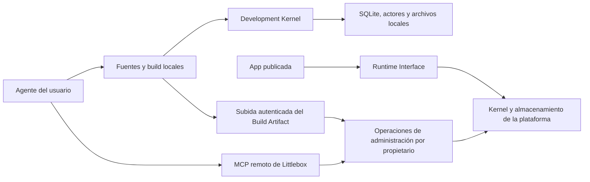

# MCP para desarrollo local con Littlebox

Estado de propuesta para discusión. 21 de octubre de 2026.

## Resultado buscado

Una persona conecta su agente a Littlebox, describe una app, obtiene un proyecto local que usa las capacidades de la plataforma, lo prueba y publica un Build Artifact. La persona elige el agente y paga su modelo por separado. Littlebox aporta identidad, Server Actions, SQLite, archivos y hosting.

El usuario ha confirmado que el código vive en una carpeta o repositorio propio y que Littlebox ofrece los servicios y el despliegue. Ese código es la fuente principal del Project. La edición de fuentes gestionadas en Littlebox queda fuera del primer alcance. Esta propuesta no cambia los ADR aceptados.

Esta decisión no fija dónde viven los datos durante el desarrollo. Sigue pendiente elegir si el primer flujo conecta el frontend local a un entorno de desarrollo alojado en Littlebox o arranca un Development Kernel local. En ambos casos, producción conserva sus propios datos y permisos.

## Punto de partida comprobado

| Área | Implementación actual | Trabajo para este flujo |
| --- | --- | --- |
| Proyectos | `src/lib/workspace.ts` guarda el índice y las fuentes en `localStorage` | Registro remoto de identidad, pertenencia y modo del Project |
| Publicación | El Kernel Rust recibe un Build Artifact y sirve archivos estáticos | Publicación por propietario, revisión, idempotencia y recibo persistente |
| Acceso administrativo | `src/deployments/client.ts` usa una clave de desarrollo compartida | Identidad de propietario y permisos limitados por proyecto |
| Desarrollo local | `scripts/dev-local.ts` arranca Kernel y editor; la exportación incluye scripts de build y deploy | Distribución de herramientas para una app externa sin instalar el editor completo |
| Runtime | La app usa `miniapp.actions`, `miniapp.auth` y `miniapp.files` | SDK distribuible y contrato de compatibilidad para proyectos locales |
| Agente integrado | Trabaja sobre una copia de las fuentes y pasa por el Validation Gate | Reusar comportamiento de dominio, sin depender de su proveedor o bucle de agente |
| Datos | Existe `database-lifecycle` y administración por Deployment | Acordar la vida de los datos respecto a versiones y entornos |

ADR-0005 acepta builds externos y Eject. ADR-0006 establece desarrollo local aislado de producción y Preview remoto opcional. ADR-0007 mantiene el build gestionado en el navegador y prohíbe evaluar las fuentes de la app en el proceso del Kernel.

El tipo actual `MiniAppProject` todavía no expresa autoridad Managed o External. El Kernel reutiliza el Deployment del proyecto al publicar. La historia de releases inmutables de los ADR no debe darse por implementada.

## Experiencia propuesta

1. El usuario añade el endpoint MCP de Littlebox y autoriza su Workspace.
2. El agente consulta capacidades, restricciones, versiones y ejemplos.
3. El agente crea un Project External y recibe identificadores, contrato del SDK y una plantilla versionada. Crear directamente un External Project es una decisión de producto propuesta.
4. El agente escribe la plantilla en una carpeta usando sus herramientas locales. Modifica frontend, Database Model y Server Actions.
5. El frontend usa el Runtime Interface de un destino de desarrollo separado de producción. ADR-0006 establece un Development Kernel local como opción por defecto y un Preview remoto opcional. Elegir el entorno remoto como primer flujo exigiría revisar esa preferencia. El código local sigue siendo la fuente principal en ambos casos.
6. El agente prueba permisos y acciones, corrige errores y genera el Build Artifact en el equipo del usuario.
7. El agente sube el artefacto, solicita un plan de publicación y recibe validaciones, cambios de esquema e impacto sobre datos y visibilidad.
8. El usuario puede revisar ese plan. La plataforma publica conforme a los permisos concedidos y devuelve URL, revisión y resultado verificable.

El MCP remoto no puede leer una ruta local ni arrancar procesos en el equipo del usuario. Un agente con filesystem y shell realiza esas operaciones. Otros clientes necesitarían un complemento local; su compatibilidad se evaluará por separado. Una ruta como `/home/user/app/dist` nunca será un parámetro que el servidor remoto intente abrir.

## Arquitectura propuesta

El MCP es un Adapter sobre operaciones de administración compartidas con el editor y las herramientas locales. El Kernel decide quién puede crear, inspeccionar, migrar y publicar. El MCP traduce entradas, resultados y errores sin mantener otra implementación de permisos o migraciones.

El acceso del agente representa a un Project Owner. El acceso de la app representa a un Runtime Actor. Las credenciales administrativas permanecen en las herramientas de desarrollo y nunca entran en el artefacto del frontend.

El diagrama muestra la variante con Development Kernel local. Para usar servicios de desarrollo alojados, las herramientas locales necesitan un gateway que derive las peticiones relativas del frontend al entorno remoto. Ese gateway conserva las credenciales de conexión; las sesiones de Runtime Actor siguen teniendo permisos propios. El MCP crea e inspecciona el entorno, mientras las llamadas de la app pasan por el Runtime Interface.

El Development Kernel debe compartir parser de acciones, validación y políticas con el Kernel alojado. Hoy hay implementaciones TypeScript y Rust; habrá que decidir cómo distribuir o reutilizar la implementación canónica y comprobar paridad. No basta con añadir mocks al SDK.

## Contrato MCP inicial

Los nombres siguientes son propuestas, no herramientas existentes.

| Operación | Resultado esperado |
| --- | --- |
| `platform_describe` | Capacidades disponibles, límites, versiones y enlaces de documentación |
| `projects_list` | Proyectos accesibles, Workspace y autoridad de fuentes |
| `project_create` | Identidad del proyecto, modo y plantilla compatible |
| `project_inspect` | Configuración, revisión y estado remoto, sin descargar datos por defecto |
| `artifact_upload_prepare` | Referencia y destino de subida, vinculados al proyecto y con caducidad |
| `release_plan` | Plan inmutable sobre un artefacto subido, acciones, esquema y revisión de origen |
| `release_apply` | Aplicación de un plan vigente con autorización e idempotencia |
| `operation_get` | Estado, diagnósticos y recibo de una operación larga |

El SDK, ejemplos, formatos y guía de errores se publicarán como documentos versionados accesibles por URL. Resources MCP podrá facilitar su lectura, pero el flujo básico no dependerá de que todos los clientes admitan Resources o Prompts. `platform_describe` ofrecerá la información mínima para empezar.

La subida usa HTTPS autenticado o una URL firmada corta. El servidor verifica bytes, hashes, tamaños, rutas y tipos antes de aceptar el artefacto. El agente envía referencias al artefacto en llamadas posteriores, no el bundle completo en cada conversación.

Las herramientas locales resuelven inicialización, build, desarrollo, seed y pruebas del Runtime Interface. No se añade una herramienta de shell remota. La consola SQL administrativa no es necesaria para completar la primera app.

Cada escritura remota indica proyecto y revisión esperada. Cada operación que afecta datos indica también su destino. Los permisos se comprueban sobre los identificadores recibidos; conocer un `projectId` no concede acceso. Los reintentos usan claves de idempotencia y los errores distinguen permiso denegado, conflicto de revisión, validación y fallo de ejecución.

## Identidad y conexión

Se propone un endpoint remoto por instalación, con Streamable HTTP. La autorización HTTP seguirá el modelo OAuth de MCP, con descubrimiento del servidor de autorización, tokens destinados al MCP y permisos por Workspace y Project. Un token de acceso nunca sustituye la comprobación de pertenencia en el Kernel.

Los permisos separarán lectura, creación, publicación y administración de datos. El usuario podrá revocar el acceso de un agente. El servidor registrará actor, cliente, proyecto, destino, operación y resultado sin guardar secretos.

Un piloto en localhost puede usar una credencial local. Exponer el servicio a varios usuarios exige sustituir la clave administrativa compartida antes de habilitar escrituras remotas.

Se fijarán versiones de protocolo y SDK tras probar los clientes objetivo. La revisión MCP 2026-07-28 cambió Streamable HTTP y eliminó las sesiones del protocolo; no se asumirá compatibilidad con clientes anteriores. Las sesiones de cuenta y los planes de Littlebox siguen teniendo su propia persistencia.

## Autoridad de fuentes y datos

Para un proyecto External nuevo, la carpeta o repositorio del usuario es la fuente de código y esquema. Littlebox conserva identidad, permisos, recursos y publicaciones. El editor muestra ese estado sin permitir otra edición independiente de la misma fuente.

Un Managed Project existente conserva el contrato de Eject de ADR-0005. Conectar MCP no ejecuta Eject automáticamente. La edición externa gestionada queda fuera del primer alcance; requeriría propuestas con revisión base que pasen por el mismo Validation Gate y conserven la autoridad en Littlebox.

Con Development Kernel, el ciclo usa datos locales. Con servicios alojados, usa un entorno remoto de desarrollo creado para el Project, con su propio ciclo de vida y límites. Copiar datos de producción al entorno de desarrollo requiere una operación independiente.

Antes de diseñar publicación con migraciones y versiones debe acordarse si los recursos persistentes pertenecen a un Project Environment o a un Deployment. El plan Drizzle ya identifica esta decisión pendiente. Un rollback del frontend no implica que pueda revertirse una migración de datos.

## Entregas y aceptación

1. **Cerrar el contrato de producto.** La autoridad del código local está confirmada. Acordar creación directa de External Projects, destino de desarrollo, vida de los datos y clientes iniciales. Actualizar los ADR afectados solo después de acordarlo.
2. **Preparar operaciones remotas de administración.** Añadir identidad de propietario, registro persistente de proyectos, permisos e idempotencia. Dos usuarios no pueden acceder a proyectos ajenos cambiando identificadores.
3. **Distribuir el ciclo de desarrollo.** Proporcionar plantilla, SDK, builder y conexión al destino de desarrollo elegido sin exigir el editor. La variante local incluye Development Kernel; la alojada incluye gateway y aprovisionamiento del entorno. Una app con login, acciones y archivos funciona sin conexión a producción y conserva sus datos tras reiniciar.
4. **Completar una publicación por MCP.** Descubrir, crear proyecto, subir artefacto, planificar, aplicar y consultar resultado. Un cliente real completa el flujo sin abrir el editor; repetir una solicitud no duplica el proyecto o la publicación.
5. **Validar acceso público y compatibilidad.** Probar OAuth y revocación en dos clientes objetivo, conflictos de revisión, artefactos inválidos, aislamiento entre proyectos y fallos durante migración o publicación. Un build de app nunca se ejecuta dentro del Kernel compartido.

La primera app de aceptación tendrá usuarios con datos separados, una lista editable y un archivo adjunto. Los ensayos comprobarán qué actor puede leer y modificar cada recurso. El piloto puede empezar con visibilidad privada para ajustarse a la política actual de archivos.

Si el primer flujo usa Development Kernel local, los Preview remotos pueden entregarse después. Si usa servicios de desarrollo alojados, su aprovisionamiento, aislamiento y ciclo de vida entran en la primera entrega. El seguimiento de errores del navegador y la edición gestionada por MCP quedan para después. Se estimará el trabajo cuando estén cerradas las decisiones de datos y clientes.

## Referencias

- [ADR-0005, Build Artifacts y proyectos External](../adr/0005-build-artifacts-separate-managed-and-external-projects.md)
- [ADR-0006, Development Kernel local](../adr/0006-external-projects-use-a-local-development-kernel.md)
- [ADR-0007, ubicación del build](../adr/0007-managed-builds-run-in-the-browser.md)
- [Plan Drizzle y decisión pendiente sobre datos](adr-0004-drizzle-database-model.md)
- [MCP, autorización HTTP](https://modelcontextprotocol.io/specification/2026-07-28/basic/authorization)
- [MCP, Streamable HTTP](https://modelcontextprotocol.io/specification/2026-07-28/basic/transports/streamable-http)
- [MCP, herramientas](https://modelcontextprotocol.io/specification/2026-07-28/server/tools)
