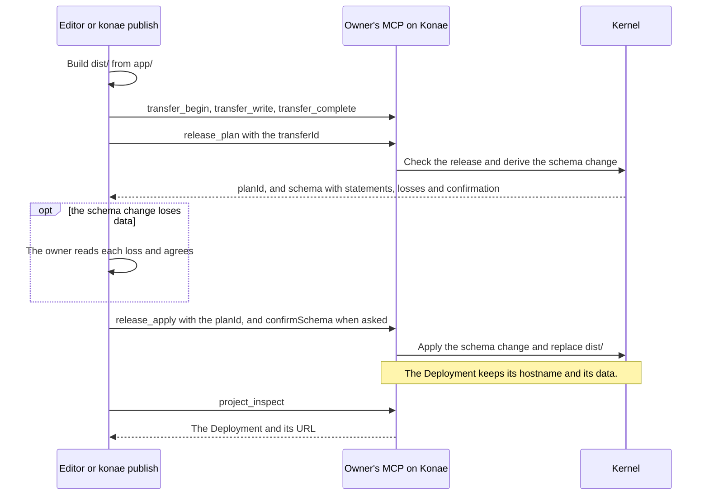

# Projects and releases

A project holds an app's sources, and a release publishes them as the Deployment, with its contract, contact email, maintenance state and transfers.

## Projects

`project_create { name, projectId?, slug?, manifest?, template?, sourcesTransferId? }` needs `write`. It registers a project and returns a template's files, the ones `konae init` writes, because both read `kernel-rs/konae/src/project-templates.json`. The template is `tasks`, `notes` (the default), `members`, `form`, `webhook`, `digest` or `gallery`. Without a `manifest` the project takes the template's visibility. `project_inspect` returns the project, its Deployment and `sourcesRevision`, the number of times the editor saved its sources.

The editor uploads a new app's sources without a `projectId`, then calls `project_create` with `sourcesTransferId`. Konae checks the files and saves the project and its sources in one transaction, answering `sourcesRevision: 1`. A failed upload leaves no project. Repeating the same files returns the saved revision, and other files cannot replace a save through `project_create`. `project_inspect` returns the project, its Deployment, `sourcesRevision`, the number of times the editor saved its sources, and `sourcesDiffer`. `sourcesDiffer` is true when the running release came with an `app/actions.json` other than the one the editor saved, as after `konae publish` from an app folder. The Kernel decides it when it applies each release, and `project_import` with `replace` set to `sources` or `both` sets it back to false.

`project_sources_save { projectId, transferId, expectedRevision }` saves the sources the editor opens when the revision still matches. The transfer holds this JSON, and an agent that saves sources sends the same:

```json
{ "id": "app_notes", "name": "Notes", "slug": "notes", "updatedAt": 1762430000000,
  "files": { "index.html": "<main id=app></main>", "app.js": "...", "schema.sql": "...", "actions.json": "..." },
  "directories": [],
  "manifest": { "version": 1, "visibility": "private",
    "runtime": { "database": { "mode": "declared-actions", "actions": [{ "name": "notes.list", "kind": "query", "access": "authenticated" }] },
      "auth": { "mode": "optional" }, "files": { "access": "deployment" } } } }
```

A save without one of these parts is refused with the part and its shape, such as `Invalid project manifest. Send { version: 1, visibility, runtime: … }`. A publish from a folder does not change the sources the editor saved.

`project_delete { projectId, name }` needs `write` and deletes a project for good. `name` must equal the project's name, or the call answers `The name does not match this project. Type the project's name exactly to delete it.` The address stops answering at once. Konae deletes the app folder (database, app accounts, uploaded files, backups, custom domain), the stored artifacts, the saved sources and the signing secrets, and answers with the deleted Deployment IDs. Read back with `projects_list`. An app in maintenance refuses it. Export the app first to keep its data. The build agent does not get this tool.

## Build and publish

```sh
bun run konae -- build --dir /tmp/my-app
bun run konae -- publish --dir /tmp/my-app
```



`publish` sends `dist/` and the text files of `app/` over MCP. It uploads a transfer, calls `release_plan`, which checks the release against the project's revision, then `release_apply`, and saves the plan and the receipt in `.konae/`. A stale plan is refused, and repeating an applied plan returns its receipt. A republish keeps the address and the database and stops serving files the new artifact lacks. [The CLI](../cli.md#publish) has the flags, and the `publishing` topic of `platform_guide` the same steps as tool calls.

A published app runs under the Kernel's Content Security Policy ([the architecture](../architecture.md#isolation-of-hosted-code)). The inline scripts of each HTML page run because the Kernel allows each by its hash. Inline event handler attributes, scripts from other origins and requests to other origins do not.

`signupPolicy` in `konae.json` names who may create an app account when the first release goes out, and `publish` sends it as `initialSignupPolicy`. `init` writes the template's visibility, which is private except for `tasks`, `form` and `gallery`, and `{ "mode": "invitation" }`. On a later release `publish` sends no policy; when the app's policy differs from the file, it prints one warning and still publishes, such as `konae.json asks for signup Open, but this app has Invitation only. A publish sets the policy only on the first release and never changes who may join afterwards. Change it in the editor's Auth > Users view, or call signup_policy_set with a credential that holds manage_users.`

### The schema change

`release_plan` loads `schema.sql` into a scratch database, compares tables, columns and indexes with a copy of the live database, and answers the schema change under `schema`:

```json
{ "statements": ["DROP TABLE \"notes\""],
  "losses": [{ "table": "notes", "column": null, "sentence": "Drops table notes and its 2 rows." }],
  "confirmation": "<64 hex characters>" }
```

A new table, column or index applies and keeps every row, with `losses` empty and `confirmation` null. A dropped table, a dropped column or a changed column type fills `losses`, and `release_apply` runs it only with `confirmSchema` set to that `confirmation`. Without it, or with another plan's, `release_apply` refuses with `schema.confirmation-required` and changes nothing. Where SQLite cannot change a table in place, the Kernel rebuilds it in one transaction, copying every column that still exists, and checks that no row breaks a foreign key. A copy that a new constraint refuses, such as a NOT NULL column without a default on a table with rows, stops the release. A renamed column is a dropped column and a new one. The editor shows the losses before it publishes, and `publish` and `dev` print them and ask.

`schema.sql` may only create tables and indexes and must be safe to run twice. A CHECK constraint, an expression or partial index and a generated column may call SQL functions except `load_extension`, `readfile`, `writefile`, `edit` and `fts3_tokenizer`. Applying it caps each value at 2 MiB and the whole schema at 30 seconds.

### What the build publishes

`konae build`, the editor's Publish and an app folder's `npm run build` run one set of rules, `src/lib/static-artifact.js`, so the same Capsule gives the same artifact from every door.

- An npm package is imported by name once `package.json` lists it under `dependencies` with an exact version, such as `"preact": "10.24.3"`. The editor's build fetches it from esm.sh; `konae build` and `npm run build` read it from `node_modules`, so run `npm install` first. The package goes into the bundle, and the published app loads nothing from another origin. A version range, a `node:` module or a bare import the list lacks fails the build with a sentence that names the fix.
- A page is every `.html` file at the Capsule root and under `pages/`. `pages/guide/install.html` answers at `/guide/install.html` and `/guide/install`.
- Every file under `public/` is served as it is, without the prefix: `public/robots.txt` answers at `/robots.txt`.
- Any other Capsule file ships only when a page, or a stylesheet a page loads, names it: `<script src>`, `<link href>` with rel `stylesheet`, `icon`, `apple-touch-icon`, `mask-icon`, `manifest`, `preload`, `modulepreload` or `prefetch`, `src`, `srcset` and `poster` on media elements, and `url()` and `@import` in CSS. Links, other origins, `data:` URLs and paths under `/_konae` are not followed. `schema.sql`, `actions.json` and every file no page names stay out.
- A page with no doctype and no `<html>` is a fragment, which the build puts in the Capsule document with `styles.css`, the app bundled from `src/main.ts` or `app.js`, and the SDK. A page that is a whole document keeps its own head, and the build loads `/runtime.js` first in it. A `<script type="module" src>` is bundled with its imports.
- A fragment page names its title and icon by opening with a `<title>` and any icon `<link>`, which the build moves into the head.
- A Capsule without `index.html` gets the fragment `<main id=app></main>`.
- The same Capsule built from two folders gives byte-identical files, because the build drops the comments that name the build folder.
- A binary file travels as base64 and the artifact names it in `encodings`, such as `"encodings": { "logo.png": "base64" }`. The editor's saved sources hold text files only, so an icon that must work from every door is SVG, as a file or a `data:` URL.

| Refusal | When |
| --- | --- |
| `about.html references /team.jpg, but the Capsule holds no team.jpg.` | A page or stylesheet names a file the Capsule lacks |
| `guide/a.html references ../../x.js, which leaves the Capsule.` | A reference climbs above the Capsule root |
| `about.html and pages/about.html would both publish at /about.html. Keep one.` | Two files land on one path |
| `public/_konae/x.txt would publish at /_konae/x.txt, under /_konae, which the Kernel keeps.` | A file lands under `/_konae`, `/oauth`, `/.well-known` or `/mcp` |
| `The Capsule holds runtime.js, the name the build gives the Konae SDK. Rename it.` | The Capsule has its own `runtime.js` |
| `index.html loads /src/main.ts as a module. A page loads JavaScript, so name a .js or .mjs file and let the build compile it.` | A module script names a file that is not `.js` or `.mjs` |
| `app.js imports CSS. Link the stylesheet from the page instead.` | A document page's module imports a stylesheet |
| `Routing must be "pages" or "spa".` | `routing` has another value. `release_plan` refuses it with the same words |

### How the Kernel answers a path

`manifest.routing` in `konae.json` chooses how a path the artifact does not hold is answered. It is `"pages"` when absent; use `"spa"` for an app that routes in the browser.

| Request | `"pages"` | `"spa"` |
| --- | --- | --- |
| A file the artifact holds | The file with its content type | The same |
| `/about`, with no extension | `about.html` when the artifact holds it | `index.html` |
| `/guide/` | `guide/index.html` when the artifact holds it | `index.html` |
| Anything else | 404 with the artifact's `404.html`, or a small Kernel page | `index.html` with 200 |
| A path under `/_konae` | Never an app file | Never an app file |

An HTTP route wins over an artifact file at its path for its method. A file the Kernel does not know the type of is `application/octet-stream`, and every file carries `X-Content-Type-Options: nosniff`. A file sent with 200 carries `Cache-Control: public, no-cache` on a public Deployment and `private, no-cache` on a private one, with an `ETag` of the artifact version, so the Kernel answers 304 until the next publish. Every HTML page gets the Content Security Policy with the hashes of its own inline scripts. The artifact limit counts the bytes stored after base64 is decoded.

## Action Contract

```sh
bun run konae -- contract --dir /tmp/my-app
bun run konae -- conform --url http://my-app.localhost:8796 --contract /tmp/my-app/action-contract.json --token <app session token>
```

`contract` reads `app/actions.json` and `app/schema.sql` and writes `action-contract.json`, its JSON Schema, `action-contract.md` and `actions.d.ts` beside `konae.json`, or into `--out`. `dev` writes `actions.d.ts` on every start and change, and the editor shows `action-contract.md` in Files, read-only. `actions.d.ts` types `miniapp.actions.call` by action name, input and returned columns, and leaves out actions a page cannot call: scheduled mutations, `then` mutations and actions whose route is their only door.

For each Server Action the contract states:

| Field | What it holds |
| --- | --- |
| `kind`, `access`, `actorBound` | The kind, the access, and whether a binding passes the caller's ID |
| `inputs` | Each input with its type, whether it is required or nullable, and a string's `maxLength` |
| `output` | The columns a query returns with their SQLite affinity, nullability and source column, or `changes` for a mutation |
| `signal` | The Signal's name and the input keys in its properties |
| `guard` | The refusal it answers when its statement changes no row |
| `runtime` | The endpoint, `/_konae/mcp`, the `actions_invoke` tool and the callers it accepts |
| `http` | The route's method, path, input reading, signature, callers and `onlyDoor` |
| `errors` | The exact messages the Kernel answers for this action, and the HTTP status on a route |
| `limits` | The top-level `LIMIT`, the 1000-row and 2 MiB cap, the 2-second deadline, the rate limits and a route's 64 KiB body |
| `statement`, `bindings` | The SQL and its binding order, so the contract converts back to the same `actions.json` |

An expression column without `AS`, such as `count(*)`, is listed under `unnamed`, and `contract` and the Gate warn about it. Types come from `schema.sql`, which SQLite does not enforce.

`conform` is what a replacement backend runs. It calls every action through the runtime endpoint with generated inputs and checks the answer's shape, then probes each refusal the contract lists: undeclared actions and inputs, missing, mistyped, empty or overlong inputs, callers without a session, and on a route every signature, key and body refusal. A guarded mutation must answer its guard when its statement changes no row. A refusal passes only when the contract lists the message and the backend answers with it. `--token` carries an app session token, or `KONAE_APP_EMAIL` and `KONAE_APP_PASSWORD` sign in for one. `--secret <name>=<value>` signs a route and may repeat. `--key` sends an API key. `--inputs <file>` gives real inputs keyed by action name, such as `{ "items.jsonin": { "ids": "[1, 2]" } }`, for a statement that reads a string as more than text. A check that needs a credential it was not given is reported as skipped. `conform` runs every mutation once, so point it at a test Deployment. It exits with 1 when any check fails.

## Contact email

`"notify": { "to": "owner" }` sends to the app's contact email, `contactEmail` in `konae.json`, so an export carries it and a `kernel` binary sends there too. A first publish from Konae fills it with the owner's email when Konae knows it; an owner who signs in through Clerk has none in Konae and sets it. `konae publish` sends the one `konae.json` names.

`contact_email_set { deploymentId, email }` sets it, or clears it with `email: null`, and needs `publish`. `contact_email_read { deploymentId }` answers `{ deploymentId, contactEmail, ownerNotices }`, where `ownerNotices` names the actions that send to it. With `contactEmail` null and `ownerNotices` listed, those notices are not sent and Usage counts each as `owner-has-no-email`. App settings in the editor has the same field.

## Maintenance

An app in maintenance takes no writes. Its host answers a page request, or any `GET` outside `/_konae/`, with a 503 maintenance page, and every other request with 503, `Retry-After: 300` and:

```json
{ "error": "This app is in maintenance. It accepts no writes, signups, recovery, administrative changes or email until it comes out of maintenance.", "maintenance": true }
```

That covers actions, uploads, file reads, signup, sign-in, recovery, invitations, HTTP routes and the runtime endpoint. Owner tools that would change the app answer with the same message. Tools ending in `_list` or `_read`, `project_export`, `release_plan`, `database_execute` with `inspect`, `browse` or `list-backups`, `project_import` and `maintenance_set` keep working. The app's email, calls and schedules wait.

`maintenance_set { deploymentId, on }` needs `publish`. `maintenance_read { deploymentId }` answers `{ maintenance, since, unreadable, installation }`, where `installation` names a hold on the whole installation after a restore, which taking the app out does not lift. The state is `apps/<id>/.konae/maintenance.json`, which a restart and a copy keep. App settings in the editor has the same switch.

An owner moves an app with no lost write in three steps: put it in maintenance, export it, and import the folder on the other installation.

`app_user_suspend`, `api_keys_revoke` and `konae owner-account-suspend` write each change to every copy target before they answer, so a restore cannot bring back what was revoked. When a target cannot be written the tool answers `The change holds on this server, but it could not be recorded at the copy target, so a restore could undo it …`, and repeating the request records it. [Operate an installation](../operate.md#data-directory-and-copies) covers copies and restore.

## Transfers

A client starts a transfer by declaring the size and SHA-256, writes chunks of at most 64 KiB in base64, and completes it, which checks the size and hash and freezes the bytes. On an app's host, a signed-in app user may instead send the whole file as the body of `PUT /_konae/transfers/<transferId>`, with the page's own origin and session cookie. The Kernel writes it from byte 0, checks the size and SHA-256 and answers `{ "result": { "transferId", "complete": true, "sha256" } }`, or 400 with the reason, and the transfer stays open for a retry. `miniapp.files.upload` uses it. The server accepts an identical retry at the same offset and refuses different content. `transfer_status` lets a client resume from the last offset. Cancel transfers you no longer need. [The limits page](../limits.md#transfers-and-publishing) lists how many a caller holds, how long they last and how large they may be.

The audit log in Konae's `mcp.sqlite` records each owner tool call with its project or Deployment, and never an email, a token or a secret's value. An export download or a component upload writes one row at its first block, not one per chunk. The log keeps the newest 10,000 rows per owner and drops rows older than 30 days. For app users the Kernel records only an upload that stores a new file and a delete that removes one.

## Read next

- [Make your first app from the editor](../guides/first-app-from-the-editor.md)
- [Edit the app's files with the CLI](../guides/edit-files-with-the-cli.md)
- [Take the app elsewhere](../guides/take-the-app-elsewhere.md)
- [The CLI](../cli.md)
- [Limits](../limits.md)
