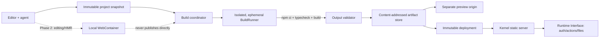

# Full frontend environment for Konae: npm, TypeScript, Vite, esbuild and static output

**Date:** 2026-08-15  
**Status:** research and architecture proposal  
**Sources:** official documentation, specifications and repositories

## Executive recommendation

Yes, this fits Konae well, on one condition. **Node must exist in the development and build plane, never in the published runtime of each mini-app**. A Project can look like a normal frontend project, with a file tree, `package.json`, lockfile, TypeScript, Vite, esbuild and npm dependencies, get compiled in an ephemeral environment and produce a static artifact. The Deployment stays an immutable bundle served by the Kernel, with no process, VM or container per application. This keeps the cost rule from `docs/architecture.md`, where an idle app has a near-zero marginal compute cost.

I would not implement a rigid "compiler = Vite/esbuild" selector. I would model a small build contract:

```ts
type StaticBuildSpec = {
  runtime: "node";
  runtimeVersion: string;       // version pinned by the build image
  packageManager: "npm";       // npm first; pnpm/Bun later
  installCommand: "npm ci";
  buildCommand: "npm run build";
  outputDirectory: "dist";
  spaFallback: boolean;
};
```

Vite, esbuild, React, Vue, Svelte, Astro in static mode and similar tools become dependencies and presets of the Project. The platform only requires the command to finish successfully and leave valid static files in the declared directory. Vite uses `index.html` as its entry and by default generates a bundle ready for static hosting in `dist`, which is exactly the contract we need ([Vite: production build](https://vite.dev/guide/build)).

The architecture I recommend is:

1. **Canonical server build inside a strong sandbox** for the stable Preview and the Deployment. It is the only output allowed to publish.
2. **Initial MVP Preview from the last built artifact**, with short, debounced builds. This avoids building a remote IDE before the product is validated.
3. **Optional in-browser WebContainer in a second phase** for a terminal, `npm install`, the Vite dev server and instant HMR, but never as the only source of the published artifact.
4. **Sandpack or `esbuild-wasm` only as restricted accelerators or presets**, never as the base of the "almost Node" environment.
5. **Cloudflare Sandbox SDK as a managed candidate that fits the current direction of the repo well**, behind a portable `BuildRunner`. Its documentation targets untrusted code, IDEs and CI/builds explicitly, and each sandbox runs in its own VM with isolated filesystem, processes, network and quotas ([overview](https://developers.cloudflare.com/sandbox/), [security model](https://developers.cloudflare.com/sandbox/concepts/security/)). For self-hosting, gVisor/`runsc` offers an OCI boundary that intercepts syscalls and shrinks the direct surface against the host kernel, at the price of some incompatibility and overhead ([gVisor overview](https://gvisor.dev/docs/), [security model](https://gvisor.dev/docs/architecture_guide/security/)).

## What exists today and what is missing

The repo already uses TypeScript, React and Vite to build **the editor** (`package.json`, `vite.config.ts`), but the generated mini-apps are not Vite projects:

- `src/lib/types.ts` limits `ProjectFile` to `index.html`, `styles.css`, `app.js`, `schema.sql` and `actions.json`.
- `src/lib/workspace.ts` stores the whole Project in `localStorage`.
- `src/runtime/preview.ts` concatenates HTML, CSS, the SDK and `app.js` into a `srcdoc`. It does not resolve imports or assets.
- The former Bun kernel server, since replaced by the Rust Kernel in `kernel-rs/`, repeated that concatenation at publish time and persisted sources in `deployment.json`. There was no build artifact and no static route server.
- The current Deployment only serves `/`. It cannot serve hashed chunks, images, fonts, sourcemaps or multi-page routes.
- The Validation Gate and the agent tools know a closed list of files. They cannot create `src/App.tsx`, `package.json`, `tsconfig.json` or an arbitrary tree.

The good news is that the security boundaries already point the right way, with the preview in a sandboxed iframe, a private channel, a Kernel that owns auth/data/actions, and an immutable Deployment. The main change is to insert a **Build Plane** between sources and Preview/Deployment. The Runtime Interface does not need a redesign.

## Architecture comparison

| Alternative | Frontend compatibility | Real npm/lockfile | Vite/plugins/HMR | Canonical build | Platform cost | Deciding limit |
| --- | --- | --- | --- | --- | --- | --- |
| Node/Bun in a server sandbox | Very high | Yes | Yes | Yes | Medium/high during build | Isolation, quotas, egress and caches must be operated |
| StackBlitz WebContainers | High for JS/WASM frontend | Yes; npm, pnpm and yarn | Yes | Not on its own | Client-side compute | Browser requirements, dependency on the hosted engine, no native addons |
| CodeSandbox Sandpack | Good for supported templates | npm dependencies, but not a general Node workspace | Bundler preview/HMR; no general equivalence with Vite | No | Low | It is a bundler/preview, not a full Node machine |
| Own `esbuild-wasm` | Good for simple TS/JS/CSS | No; a resolver/registry/VFS must be built | Does not run Vite or its plugins | Only for an in-house preset | Low | A lot of in-house infrastructure and lower compatibility |

### 1. Isolated build host/server

This is the most compatible option and the one that can produce a repeatable, auditable result. An ephemeral Linux runner can run the real package manager, `tsc`, Vite, esbuild, PostCSS and plugins. Vite also offers a programmatic JavaScript API, but it is better to invoke the Project's normal script so the contract stays the same as outside Konae ([Vite JavaScript API](https://vite.dev/guide/api-javascript.html)).

Advantages:

- The same snapshot produces the stable Preview and the Deployment.
- We can pin the image, Node, npm, architecture, variables and limits.
- It supports packages that use the filesystem, child processes or native binaries, as long as the image and the policy allow them.
- The browser does not need to download all of `node_modules` or compile anything.
- Logs and errors stay attached to an auditable `Build`.

Costs and risks:

- `npm ci` and `npm run build` execute code. Restricting the command name does not make the build safe, because the Project script, the Vite config, the plugins and the lifecycle scripts are all arbitrary code. npm can disable scripts with `ignore-scripts`, and recent versions support an allowlist of install scripts, but that is an extra defense layer, not an isolation boundary ([npm ci](https://docs.npmjs.com/cli/v11/commands/npm-ci/), [npm scripts](https://docs.npmjs.com/cli/v11/using-npm/scripts/)).
- A plain Docker container is not enough without hardening. By default it has no resource limits and can consume whatever the host scheduler allows ([Docker resource constraints](https://docs.docker.com/engine/containers/resource_constraints/)). The image must run unprivileged, with CPU, memory, PID, disk and time limits, without the Docker socket or host mounts, plus seccomp and a boundary such as a VM or gVisor. Docker describes its seccomp profile as a moderately protective allowlist, not as full isolation from hostile code ([Docker seccomp](https://docs.docker.com/engine/security/seccomp/)).
- It needs a queue, cancellation, observability, GC and concurrency control.

This must be the publishing authority. For the managed path, Cloudflare Sandbox is today a concrete and well-aligned option, with full Linux, Node execution, service previews and per-VM isolation ([Sandbox overview](https://developers.cloudflare.com/sandbox/), [expose services](https://developers.cloudflare.com/sandbox/guides/expose-services/)). It is a recent product and its API has already changed, so it must not leak into the domain. The Kernel talks to `BuildRunner`, and the adapter decides whether to use Cloudflare, gVisor/Kubernetes or microVMs. Firecracker is another reference for multi-tenant isolation with lightweight KVM microVMs, but operating it directly takes considerably more infrastructure ([Firecracker](https://firecracker-microvm.github.io/)).

### 2. WebContainers / StackBlitz

WebContainers runs a Node runtime inside the browser tab. Its API exposes a filesystem, processes, `spawn`, preview ports and filesystem export. The documentation literally shows `npm install`, `npm run dev` and exporting `dist` as a ZIP ([API](https://webcontainers.io/api), [quickstart](https://webcontainers.io/guides/quickstart)). It is the closest experience to "a local VS Code on the web" without paying for server compute.

Advantages:

- A real terminal, package managers and Vite dev server in the browser.
- Excellent HMR and edit latency after boot.
- The generated code does not run on our infrastructure.
- The same API can mount the snapshot, run install/build and export `dist`.

Limits:

- It requires `SharedArrayBuffer`, HTTPS and cross-origin isolation with COOP/COEP in production ([quickstart](https://webcontainers.io/guides/quickstart)). This is a header decision for the whole editor and can block cross-origin resources that do not send compatible policies.
- Only one concurrent instance can boot, and booting is expensive ([API](https://webcontainers.io/api)).
- Third-party cookies/storage, Service Workers and browser settings can stop it from working. StackBlitz documents those dependencies and the differences between Chromium, Firefox and Safari ([browser configuration](https://webcontainers.io/guides/browser-config), [browser support](https://webcontainers.io/guides/browser-support)).
- It can exhaust the tab's memory and does not support native C/C++ addons unless a WebAssembly alternative exists ([troubleshooting](https://webcontainers.io/guides/troubleshooting)). This affects packages such as image transformers or native modules, although typical frontend code usually has JS/WASM alternatives.
- It creates a vendor dependency. StackBlitz hosts the runtime implementation and versions it separately from the client. Commercial production use requires reviewing its license/plan, and the API lets you configure the matching key ([API support](https://webcontainers.io/guides/api-support), [commercial usage](https://webcontainers.io/enterprise), [API](https://webcontainers.io/api)).
- A build made only on the user's laptop is not a trustworthy authority for deploy. The tab can close, the artifact can be altered or the browser can vary. The server must rebuild, or at least verify inside a trusted boundary.

This is an excellent Phase 2 for interactive development and a poor sole publishing infrastructure. It must fall back to remote build/preview.

### 3. Sandpack / CodeSandbox bundler

Sandpack is an interface over the CodeSandbox bundler. It receives files, a template and npm/GitHub dependencies, runs transpilation and evaluation in an iframe and hot-updates the preview ([Sandpack Client](https://sandpack.codesandbox.io/docs/advanced-usage/client), [usage](https://sandpack.codesandbox.io/docs/getting-started/usage)). The implementation distinguishes a bundler runtime, a Nodebox mode and a static server, but its main contract is still a sandbox experience. It does not aim to run any Vite project without adaptation ([Sandpack Client](https://sandpack.codesandbox.io/docs/advanced-usage/client)).

Advantages:

- Very fast React integration with the editor/preview UI already built.
- Templates for React, Vue, Svelte, Angular, Solid and vanilla.
- Declarative dependencies and hot updates.
- The bundler can be self-hosted. CodeSandbox explains that putting it on a separate subdomain keeps evaluated code away from the host's cookies and enables workers, code splitting and offline caching ([hosting the bundler](https://sandpack.codesandbox.io/docs/guides/hosting-the-bundler)).

Limits:

- It does not promise equivalence with the Vite CLI, its plugin graph or arbitrary npm scripts.
- Its normal API accepts a `dependency -> version` map. That is not a frozen build governed by the Project's lockfile.
- Private packages need an extra proxy/registry, and CodeSandbox warns that their tokens must stay out of the client ([hosting the bundler](https://sandpack.codesandbox.io/docs/guides/hosting-the-bundler)).
- It adds another preview implementation that can diverge from production.
- Nodebox uses polyfills and lacks full parity with Node. It does not support native N-API addons except through WASM alternatives, native sockets or several APIs, and its documentation notes commercial restrictions for templates that use it ([Sandpack FAQ](https://sandpack.codesandbox.io/docs/resources/faq)).

It is useful if Konae decides to offer a separate "curated playground" mode. I would not choose it as the core of a Vite-compatible environment.

### 4. `esbuild-wasm` in the browser

The official esbuild API works in the browser through `esbuild-wasm`, after `initialize()` with the URL of the WASM binary, and runs asynchronous operations in a Web Worker ([esbuild browser API](https://esbuild.github.io/api/#running-in-the-browser)). It can transpile TypeScript/JSX and produce bundles with far less infrastructure than a virtual Node.

But esbuild does not install packages. To support `import "react"` we would have to implement:

- a virtual filesystem;
- resolution compatible with `package.json`/`exports`;
- downloads from a registry/CDN;
- lockfile and integrity;
- CSS/asset loaders;
- caching and deduplication;
- plugins and error messages;
- safe execution of the result.

The documentation itself says the WASM version can be an order of magnitude slower than the native binary and leaves out some features, such as the local server. It is intended mainly for the browser when there is no other option ([esbuild getting started](https://esbuild.github.io/getting-started/#wasm)). It also does not run the Vite plugin ecosystem or turn the browser into Node.

It is very good for local syntax/transpilation feedback or an ultra-fast preset without complex packages. I would not build the Konae package manager on top of it.

## Target architecture



### New entities

**ProjectSource**  
Editable, versioned file tree. It must stop being `Record<ProjectFile, string>` and accept normalized paths, text and references to binary blobs. `node_modules`, `dist` and caches are never part of the source.

**ProjectSnapshot**  
Immutable copy handed to the Validation Gate/build. It includes a hash of each file, the manifest, the build spec and the actor. The agent edits a disposable workspace, and applying it creates a new reversible snapshot, keeping the model in `CONTEXT.md`.

**Build**  
An attempt on a specific snapshot, with its state, runner/toolchain, timestamps, bounded logs, exit code, diagnostics, metrics and resulting artifact. A failed Build never changes the previous good Preview or a Deployment.

**BuildArtifact**  
Manifest of static files, hashes, sizes, MIME types, entry HTML and toolchain metadata. The bytes can live compressed in object storage or deduplicated by hash.

```ts
type BuildArtifact = {
  id: string;                 // sha256 of the canonical manifest
  sourceSnapshotId: string;
  toolchainImageDigest: string;
  files: Array<{
    path: string;
    sha256: string;
    bytes: number;
    contentType: string;
  }>;
  entrypoint: "index.html";
  spaFallback: boolean;
};
```

**Deployment**  
Immutable reference to an `artifactId` plus the schema/actions/capability manifest. It no longer contains the frontend source as an executable file. The source can be kept in the Admin plane for export/eject, but it is not served to visitors.

### Proposed Capsule v2

```text
project/
├── konae.manifest.json
├── package.json
├── package-lock.json
├── tsconfig.json
├── index.html
├── src/
│   ├── main.tsx
│   ├── App.tsx
│   └── styles.css
├── public/
└── konae/
    ├── schema.sql
    └── actions.json
```

`konae/` is control/capability source and is always excluded from the public directory. The frontend imports a typed `@konae/sdk` package or uses a virtual module provided by the preset. The build generates calls to the Runtime Interface on the same hostname, but never includes SQL, credentials or Admin capabilities.

The manifest can declare:

```json
{
  "version": 2,
  "visibility": "public",
  "build": {
    "preset": "vite-static",
    "packageManager": "npm",
    "command": "npm run build",
    "outputDirectory": "dist",
    "spaFallback": true
  }
}
```

The preset creates starters and defaults, and it must not hide the contract. An exported Project has to compile outside Konae with the same commands.

## Canonical build pipeline

1. **Freeze the snapshot.** Normalize Unicode paths, separators and permissions. Reject absolute paths, `..`, NUL, symlinks, sockets and device files. Apply limits on file count, individual size and total size.
2. **Validate the manifest/package.** Only one package manager and one lockfile. In the MVP, require `package-lock.json`, `packageManager: npm@<pinned version>` if that field is used, and the known scripts `build`/`typecheck`.
3. **Resolve the cache key.** Hash of the snapshot, lockfile, BuildSpec, image by digest, SDK/preset version and environment policy. Do not use moving tags such as `node:latest`.
4. **Create an ephemeral sandbox.** Non-root user, read-only root filesystem, workspace and tmp with quotas, limited CPU/memory/PIDs/disk, no host mounts, no privileged sockets, no secrets and a hard timeout.
5. **Install.** `npm ci` requires a lockfile, fails if it does not match `package.json`, does not rewrite it and performs a clean install ([npm ci](https://docs.npmjs.com/cli/v11/commands/npm-ci/)). The lockfile describes the exact tree and contains the resolved URL and integrity of each artifact, so it must be versioned with the source ([package-lock.json](https://docs.npmjs.com/cli/v11/configuring-npm/package-lock-json/)).
6. **Check types.** Run `npm run typecheck`, usually `tsc --noEmit`. Vite transpiles `.ts` but does not type check, and its documentation recommends separating `tsc --noEmit` from the production build ([Vite TypeScript](https://vite.dev/guide/features#typescript)).
7. **Build.** `npm run build`. Capture stdout/stderr with limits and separate structured diagnostics from logs.
8. **Validate `dist`.** Resolve each path physically. Reject symlinks, escapes, the reserved `/_konae` names, disallowed hidden files, oversized HTML/JS, file count or total size over quota and dangerous MIME types. Require `index.html`.
9. **Generate the artifact manifest.** Hash per file, sizes, MIME types, entrypoint and minimal provenance. Upload the blobs first and commit the manifest last so a partial build is never visible.
10. **Destroy the sandbox.** Also on cancellation or timeout. Cloudflare warns that an `exec()` timeout cuts the connection but does not kill the process, so the sandbox must be destroyed or the session deleted explicitly ([execute commands](https://developers.cloudflare.com/sandbox/guides/execute-commands/)).
11. **Promote.** Update the Preview alias only after validation. Deploy creates an immutable reference to the artifact.

### Two compatibility levels

It is worth offering them explicitly:

- With a supported preset, Konae controls the Vite/esbuild configuration, disables `configFile`, pins plugins and generates the scripts. It is the most predictable path for starters and for the agent.
- Advanced mode accepts `vite.config.*`, custom plugins and custom scripts. Vite transforms and loads its config file as code, and plugins are installed as Project dependencies, so this mode needs the strong sandbox and can fail for legitimate incompatibilities ([Vite config](https://vite.dev/config/), [Vite plugins](https://vite.dev/guide/using-plugins.html)).

Both produce exactly the same `BuildArtifact`. "Supported" describes the level of guarantee and assistance, not a different Deployment format.

## npm dependencies, lockfiles and other package managers

### Reproducibility rule

`package.json` expresses intent. The lockfile is part of the source and expresses resolution. A lockfile lets you reinstall the same tree, but **it does not by itself guarantee a bit-for-bit identical bundle**, because install/build scripts can read the time, network, architecture or variables. That is why the cache key also includes the image, runtime, manager, configuration and policy, and why the build must lose network access after install.

MVP:

- npm only;
- `package-lock.json` required and in sync;
- exact versions in the starters for Vite, TypeScript and plugins;
- dependencies only from the HTTPS npm registry; initially reject `git:`, `github:`, `file:`, directories and arbitrary tarballs;
- public packages; private registry later;
- install scripts disabled by default, or a reviewed allowlist for the few packages that really need them. npm documents both `ignore-scripts` and the `allowScripts`/`strict-allow-scripts` policies ([npm ci options](https://docs.npmjs.com/cli/v11/commands/npm-ci/)). Even with an allowlist, the sandbox is still mandatory because `npm run build` is user code.

Later phase:

- a `PackageManager` adapter for `pnpm install --frozen-lockfile` and `bun install --frozen-lockfile`/`bun ci`;
- require exactly one lockfile consistent with the declared manager;
- pin the manager version too. The `packageManager` field identifies the manager and version, but its historical support through Corepack has been experimental. It is safer for the build image to ship the allowed versions explicitly ([Node Corepack docs](https://nodejs.org/download/release/latest-v20.x/docs/api/corepack.html)).
- Bun uses `bun.lock`, recommends versioning it and offers `--frozen-lockfile`/`bun ci`. By default it does not run arbitrary dependency lifecycle scripts except for trusted packages, which can be an interesting option that still does not replace the sandbox ([Bun lockfile](https://bun.sh/docs/pm/lockfile), [Bun install](https://bun.sh/docs/pm/cli/install)).

I would not silently migrate one lockfile to another during deploy. The output must match the manager the Project declares, and export must keep it.

### Three cache levels

**1. Package manager tarball/metadata cache**  
Shared between runners, content-addressed and free of credentials. npm uses `_cacache`, verifies integrity on insert and extract, and re-downloads corrupt content ([npm cache](https://docs.npmjs.com/cli/v8/commands/npm-cache/)). It can be mounted as a performance cache, never as an authoritative source.

**2. Per-lockfile dependency cache**  
The key is `manager version + runtime + OS/arch + lock hash + install policy`. Reusing layers or cache mounts is fine, but a writable `node_modules` shared between tenants is not. Docker recommends separating package files from source and using cache mounts so that a code-only change does not reinstall everything ([Docker build cache](https://docs.docker.com/build/cache/optimize/)). For hostile code, the final tree must be copied or rebuilt inside that build's sandbox.

**3. Full artifact cache**  
Exact Build key. A hit avoids creating a sandbox. Only validated artifacts get promoted. Failures can be cached for a few minutes to avoid agent loops, never indefinitely.

For published static files:

- hashed-name assets get `Cache-Control: public, max-age=31536000, immutable` and a content ETag;
- HTML on an immutable Deployment hostname can also be cached aggressively, while a mutable Preview alias must use `no-cache` or a short TTL;
- `/_konae/*` never shares the asset cache and keeps the Kernel's private policies.

Vite already uses the lockfile and config to invalidate its development prebundle and serves dependencies with versioned immutable HTTP caching ([Vite dependency pre-bundling](https://vite.dev/guide/dep-pre-bundling.html)). That cache belongs to a development session, not to the Artifact Store.

## TypeScript and IDE experience

There are three separate levels that must not be confused:

1. Fast transpilation, where Vite/esbuild convert TS/TSX to JS.
2. Canonical type checking, with `tsc --noEmit` in the Build.
3. Interactive intelligence, meaning completions, hover, go-to-definition and diagnostics in the editor.

The MVP can deliver 1 and 2 and paint the build diagnostics over CodeMirror. Later, the TypeScript Language Service can run in an editor Worker, fed by the Project tree and the dependencies' `.d.ts` files. The official Language Service is designed as a long-lived, incremental, on-demand program, and the host supplies the file set and snapshots/versions ([TypeScript Language Service API](https://github.com/microsoft/TypeScript/wiki/Using-the-Language-Service-API)). Switching to Monaco is not required, since CodeMirror can consume custom diagnostics/completions. Monaco already ships TypeScript/JavaScript workers if a fuller integration is preferred, but it would grow the bundle and the complexity ([Monaco ESM integration](https://github.com/microsoft/monaco-editor/blob/main/docs/integrate-esm.md)).

`@konae/sdk` must include types and be part of the starter, for example:

```ts
import { actions, auth, files } from "@konae/sdk";

const tasks = await actions.call("tasks.list");
```

Ideally the `actions.call` types are generated from `konae/actions.json`, so renaming an action breaks typecheck before deploy. The compiled SDK only knows public names and contracts. SQL stays server-side.

## Vite, esbuild and static generation

### Vite as the main preset

Vite fits as a starter because:

- `index.html` is part of the graph and references modules/styles naturally ([Vite getting started](https://vite.dev/guide/));
- `vite build` produces a bundle for static hosting in `dist` ([production build](https://vite.dev/guide/build));
- it resolves assets, CSS, imports, chunks and base paths;
- it offers HMR and framework plugins during development.

Do not assume that "supporting Vite" means coupling to esbuild. The repo uses Vite 6 today, while current Vite versions have changed internal parts of the pipeline. Konae must treat `vite` as a dependency versioned by the Project and the static output as the stable interface. `esbuild` is also supported as an independent tool/preset.

Specifically, Vite 8 replaced the previous internal pipeline with Rolldown/Oxc. This confirms that Konae must not depend on bundler internals or install a moving global version ([Vite 8 announcement](https://vite.dev/blog/announcing-vite8)).

Recommended starter configuration:

- `base: "/"`, because each Deployment owns the root of its hostname; or `base: "./"` if the exported ZIP should open from any prefix. Vite rewrites asset URLs according to `base` ([Vite public base path](https://vite.dev/guide/build#public-base-path)).
- `build.outDir: "dist"`.
- sourcemaps disabled in public by default; store them as a private Admin artifact if stack traces are wanted.
- `tsc --noEmit && vite build`, or separate `typecheck`/`build` scripts that the runner executes both of.
- a **platform-owned** plugin or post-process that ensures the `/_konae/runtime.js` client is in the HTML without inline secrets.

### esbuild as a small preset

For mini-apps that do not need Vite, a starter can use the native esbuild API/CLI with `bundle`, `platform: "browser"`, `format: "esm"`, `sourcemap` in preview and `minify` in production. The bundler produces browser output by default and supports TS/JSX/loaders/plugins ([esbuild getting started](https://esbuild.github.io/getting-started/), [API](https://esbuild.github.io/api/)). It is simpler and faster, but Konae would have to generate/copy `index.html` and assets. I would not try to emulate Vite on top of it.

### What "static" means

Any framework is accepted if its command ends in a closed directory of HTML/CSS/JS/assets:

- Vite SPA;
- multi-page;
- SSG that runs Node only during build and emits static files;
- web workers and WASM as assets, subject to CSP/MIME/quotas.

The static runtime does not accept:

- SSR that needs a Node process per request;
- arbitrary API routes;
- framework cron/background workers;
- direct filesystem/database access from generated server code.

Those capabilities must map to Server Actions/Kernel, or go to the Railway/Docker escape hatch adapter described in the hosting research. `vite preview` is not a production server either. Vite documents it only for checking the build locally ([static deploy guide](https://vite.dev/guide/static-deploy.html)).

## Security: non-negotiable requirements

### Build sandbox

- A boundary per Build or tenant, never execution inside the Kernel process.
- Image by digest, non-root user, dropped capabilities, read-only base filesystem.
- A fresh temporary workspace; no `/var/run/docker.sock`, host home directory, control plane repository or cloud metadata.
- Limited CPU, memory, PIDs, disk, log bytes, wall clock and process count. Docker does not apply those limits by default ([resource constraints](https://docs.docker.com/engine/containers/resource_constraints/)).
- Cancel and destroy; do not rely only on the connection timeout.
- No control plane variables or npm token. For private packages, an external proxy injects upstream credentials without handing them to the sandbox. Cloudflare Sandbox can block the Internet, allowlist by hostname and inject auth from a trusted outbound handler ([outbound traffic](https://developers.cloudflare.com/sandbox/guides/outbound-traffic/)).
- Two-phase egress, where install only reaches the allowed registry/proxy and typecheck/build run without network. DNS, private IPs, loopback, metadata endpoints and non-HTTP protocols are blocked.
- The Node Permission Model does not replace this boundary. The official documentation calls it a "seat belt" for trusted code and says explicitly that malicious code can bypass it ([Node permissions](https://nodejs.org/api/permissions.html)).

### Supply chain

- Mandatory lockfile, verified integrity and pinned toolchain.
- Reject dependencies from Git/URL/file in the MVP.
- Allowlist for lifecycle scripts and a visible report when one is skipped.
- `npm audit`/signatures/provenance as a signal and a configurable policy, not as a false guarantee. npm can verify signatures and attestations with `npm audit signatures` ([npm provenance](https://docs.npmjs.com/viewing-package-provenance/)).
- Record the dependency tree, licenses and SBOM in the Build for export and incident response.
- Never trust a package just because it is cached or signed. A signature proves origin and integrity, not behavior.

### Preview and browser

- Serve the compiled preview from an origin separate from the editor, ideally `preview-token.preview.konae.test/app/`, never from the same origin with Admin credentials.
- Iframe with minimal permissions. The HTML Standard explains that `sandbox` creates an opaque origin by default and that combining `allow-scripts` + `allow-same-origin` on same-origin content lets the content remove the sandbox. The preview must be cross-origin and only regain the capabilities it truly needs ([HTML Standard](https://html.spec.whatwg.org/multipage/iframe-embed-object.html#attr-iframe-sandbox)).
- An authenticated channel/runtime bound to `projectId + snapshotId + previewId`; do not accept supplied IDs as authority.
- A short, revocable preview URL with a TTL. A random URL is a bearer capability and can leak through logs/referrers.
- Host-only cookies and no editor cookie on the preview domain.
- CSP, `Permissions-Policy`, `nosniff`, `Referrer-Policy` and limits on navigation/downloads/popups. Dependencies that require `unsafe-eval`, WebAssembly or workers must declare it and pass an explicit policy; do not relax the editor globally.

### Artifact and static server

- Canonicalize and check that every path stays inside `dist`; do not follow symlinks.
- MIME type from the extension or a trusted list, never from user metadata.
- `index.html` cannot overwrite `/_konae/*`.
- Limits on file count, total size, HTML/JS size and route depth.
- HTML is served as HTML. User uploads stay in the Blob Interface with the current restrictive policy, separate from build assets.
- For SPAs, fall back to `index.html` only on `GET/HEAD` navigation requests that accept HTML. A missing asset must return 404.
- Runtime SDK as an external first-party file with a hash/version, not concatenated into arbitrary JS. The SDK calls actions/auth/files on the same Deployment hostname.

## Recommended phases

### Phase 0, contract and data model

- ADR for a Build Plane separate from the Kernel Runtime.
- `ProjectSource` as a file tree, snapshots and path-based agent operations.
- Capsule v2, `BuildSpec`, `Build`, `BuildArtifact` and `artifactId` in the Deployment.
- Persistence outside `localStorage` for large sources, with IndexedDB as a local cache and the Admin API/object storage as the authority. Never persist `node_modules`.
- A Capsule v1 → v2 migrator that generates a vanilla Vite starter without changing schema/actions.

The phase is done when a v2 Project can be exported, run outside Konae and imported again without loss.

### Phase 1, canonical static MVP

- npm only; `package-lock.json` required.
- Two starters, `vite-vanilla-ts` and `vite-react-ts`, with an optional `esbuild-vanilla-ts`.
- Ephemeral runner with `npm ci`, `tsc --noEmit`, `npm run build` and a validated `dist`.
- Preview of the last good build on a separate origin; a Build button and auto-build with debounce/cancellation.
- Logs, diagnostics clickable by file/line and a clear "source dirty / build running / preview at snapshot X" state.
- The Kernel serves static trees and the SPA fallback; the Deployment references an artifact.
- Conservative quotas, with short builds, a few hundred MiB, source/output/log limits and low per-user concurrency.
- A local Docker adapter only for in-house development and trusted code. Do not expose that basic runner to public builds. For multi-tenant use, adopt Cloudflare Sandbox, gVisor or microVMs before opening the product.

The phase is done when React+TS with one npm dependency can be edited, typechecked, previewed, published and exported, and the Deployment still has no process of its own.

### Phase 2, near-IDE experience

- TypeScript Language Service in a Worker, with dependency/SDK types.
- A remote dev session with Vite HMR **or** a local WebContainer with remote fallback.
- A terminal restricted to the Project session, a file tree, rename/delete, search and a preview console.
- Incremental source sync to the dev session; Deploy still rebuilds canonically.
- Dependency/artifact caches and measured warm workers.
- If the session is remote, an owner-only gateway publishes the Vite port and its HMR WebSocket on an ephemeral hostname. The container port is never exposed directly. When the session sleeps or is destroyed, the URL is revoked. Cloudflare Sandbox supports services/preview URLs and documents that they behave as shareable capabilities ([expose services](https://developers.cloudflare.com/sandbox/guides/expose-services/), [security model](https://developers.cloudflare.com/sandbox/concepts/security/)).

The phase is done when edit feedback is sub-second on the normal path and the canonical build is identical to the exported contract.

### Phase 3, ecosystem

- pnpm and Bun as adapters with a frozen lockfile; no silent conversion.
- More static presets, such as Vue, Svelte, Preact and Astro static.
- Private packages through a registry proxy with credentials kept outside the sandbox.
- Optional tests/lint, private sourcemaps, SBOM/licenses, a dependency UI and organization policies.
- Multi-page, workers/WASM and CSP driven by declared capabilities.

### Phase 4, complete without breaking the product

- Collaboration, snapshots/branches, a distributed remote cache, parallel builds and shareable previews with ACLs.
- Monorepo support only if there is a real need, since it can easily multiply cost and the agent's surface.
- A server runtime escape hatch behind another `DeployTarget`, clearly separate from the "static mini-app" category and with its own pricing/quotas.

## Risks and open decisions

| Risk | Impact | Mitigation/decision |
| --- | --- | --- |
| Supply chain and npm scripts | arbitrary execution and exfiltration | strong sandbox, no secrets, egress allowlist, lockfile, approved scripts |
| Cost/latency of `npm ci` | slow and expensive preview | tarball/deps cache, warm runners, artifact cache, optional WebContainer |
| Dev/deploy divergence | "works in preview" but not when published | same snapshot/BuildSpec; server build always authoritative |
| Cloudflare/StackBlitz lock-in | migration or pricing | portable `BuildRunner`; optional WebContainer; standard artifact |
| Unbounded Vite plugins/config | incompatibility/abuse | sandbox; supported presets; clear logs; do not promise every plugin |
| Browser WebContainer | users blocked by COOP/COEP/cookies/memory | feature detection and remote fallback |
| `localStorage` | limits/size/corruption for npm projects | versioned source store + IndexedDB cache; exclude deps/output |
| Malicious artifact | XSS against the editor/users | separate origin, iframe/CSP, separate cookies, output validation |
| Static-only vs full-stack frameworks | wrong expectations | explicit contract: SSG yes, SSR/Node API no; Server Actions as the backend |
| Young Sandbox SDK product | operational churn | adapter, pinned version, integration tests, gVisor/microVM alternative |

## Proposed decision

I would first build **a static, authoritative Build Plane**, not a full IDE. The right sequence is to make a Vite+TypeScript+npm Project produce a safe, versioned, deployable artifact, and then improve latency with HMR, WebContainers or remote sessions.

The conceptual boundary stays clean:

```text
Project source + lockfile
        ↓ isolated ephemeral build
Static Artifact + manifest
        ↓ immutable reference
Deployment + Kernel capabilities
```

This makes it possible to offer a frontend experience very close to Node without turning each mini-app into a Node service. Vite would be the recommended preset; esbuild, a small preset and a direct tool; WebContainers, the DX accelerator; Sandpack, a restricted playground option. The sandboxed server would remain the source of truth for publishing.

My assessment is that this is a natural evolution of the product and widens the range of apps an agent can generate a great deal. Adding a compiler is the small part. The value lies in introducing **snapshot → isolated build → validated artifact → static deployment** correctly, while keeping the security separation Konae already has.
