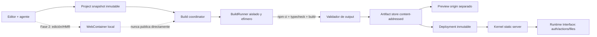

# Entorno frontend completo para Littlebox: npm, TypeScript, Vite, esbuild y estáticos

**Fecha:** 2026-08-15  
**Estado:** investigación y propuesta de arquitectura  
**Fuentes:** documentación, especificaciones y repositorios oficiales

## Recomendación ejecutiva

Sí, encaja muy bien con Littlebox, con una condición: **Node debe existir en el plano de desarrollo y build, no en el runtime publicado de cada mini-app**. Un Project puede parecer un proyecto frontend normal —árbol de ficheros, `package.json`, lockfile, TypeScript, Vite, esbuild y dependencias npm—, compilarse en un entorno efímero y producir un artefacto estático. El Deployment sigue siendo un bundle inmutable servido por el Kernel, sin proceso, VM o contenedor por aplicación. Esto conserva la regla económica de `docs/architecture.md`: coste marginal de compute prácticamente nulo cuando la app está ociosa.

No implementaría un selector rígido «compilador = Vite/esbuild». Modelaría un contrato de build pequeño:

```ts
type StaticBuildSpec = {
  runtime: "node";
  runtimeVersion: string;       // versión fijada por la imagen de build
  packageManager: "npm";       // npm primero; pnpm/Bun después
  installCommand: "npm ci";
  buildCommand: "npm run build";
  outputDirectory: "dist";
  spaFallback: boolean;
};
```

Vite, esbuild, React, Vue, Svelte, Astro en modo estático, etc. pasan a ser dependencias y presets del Project. La plataforma solo exige que el comando termine correctamente y deje estáticos válidos en el directorio declarado. Vite usa `index.html` como entrada y genera por defecto un bundle apto para hosting estático en `dist`, justo el contrato que necesitamos ([Vite: production build](https://vite.dev/guide/build)).

La arquitectura que recomiendo es:

1. **Build canónico en servidor dentro de un sandbox fuerte** para Preview estable y Deployment. Es la única salida autorizada para publicar.
2. **Preview inicial del MVP desde el último artefacto construido**, con builds cortos y debounced; evita construir un IDE remoto antes de validar el producto.
3. **WebContainer opcional en el navegador en una segunda fase** para terminal, `npm install`, Vite dev server y HMR instantáneo, pero nunca como única fuente del artefacto publicado.
4. **Sandpack o `esbuild-wasm` solo como aceleradores/presets restringidos**, no como base del entorno «casi Node».
5. **Cloudflare Sandbox SDK como candidato managed especialmente coherente con la dirección actual del repo**, detrás de un `BuildRunner` portable. Su documentación lo plantea expresamente para código no confiable, IDEs y CI/builds; cada sandbox corre en su propia VM con filesystem, procesos, red y cuotas aislados ([overview](https://developers.cloudflare.com/sandbox/), [security model](https://developers.cloudflare.com/sandbox/concepts/security/)). Para self-hosting, gVisor/`runsc` ofrece una frontera OCI que intercepta syscalls y reduce la superficie directa sobre el kernel host, a cambio de cierta incompatibilidad y overhead ([gVisor overview](https://gvisor.dev/docs/), [security model](https://gvisor.dev/docs/architecture_guide/security/)).

## Qué existe hoy y qué falta

El repo ya usa TypeScript, React y Vite para construir **el editor** (`package.json`, `vite.config.ts`), pero las mini-apps generadas no son proyectos Vite:

- `src/lib/types.ts` limita `ProjectFile` a `index.html`, `styles.css`, `app.js`, `schema.sql` y `actions.json`.
- `src/lib/workspace.ts` guarda el Project completo en `localStorage`.
- `src/runtime/preview.ts` concatena HTML, CSS, el SDK y `app.js` en un `srcdoc`; no resuelve imports ni assets.
- `kernel-server/html.ts` repite esa concatenación al publicar.
- `kernel-server/store.ts` persiste fuentes en `deployment.json`; no hay artefacto de build ni servidor de rutas estáticas.
- El Deployment actual solo sirve `/`; no puede servir chunks con hash, imágenes, fuentes, sourcemaps ni rutas multipágina.
- El Validation Gate y las herramientas del agente conocen una lista cerrada de ficheros. No pueden crear `src/App.tsx`, `package.json`, `tsconfig.json` o un árbol arbitrario.

La buena noticia es que los límites de seguridad ya están bien orientados: preview en iframe sandboxed, canal privado, Kernel propietario de auth/data/actions, y Deployment inmutable. El cambio principal es insertar un **Build Plane** entre fuentes y Preview/Deployment, no rediseñar el Runtime Interface.

## Comparación de arquitecturas

| Alternativa | Compatibilidad frontend | npm/lockfile real | Vite/plugins/HMR | Build canónico | Coste de plataforma | Límite decisivo |
| --- | --- | --- | --- | --- | --- | --- |
| Node/Bun en sandbox servidor | Muy alta | Sí | Sí | Sí | Medio/alto durante build | Hay que operar aislamiento, cuotas, egress y caches |
| StackBlitz WebContainers | Alta para frontend JS/WASM | Sí; npm, pnpm y yarn | Sí | No por sí solo | Compute en cliente | Requisitos de navegador, dependencia del engine alojado, sin addons nativos |
| CodeSandbox Sandpack | Buena para templates soportados | Dependencias npm, pero no un workspace Node general | Preview/HMR del bundler; no equivalencia general con Vite | No | Bajo | Es un bundler/preview, no una máquina Node completa |
| `esbuild-wasm` propio | Buena para TS/JS/CSS simples | No; hay que construir resolver/registry/VFS | No ejecuta Vite ni sus plugins | Solo para un preset propio | Bajo | Mucha infraestructura propia y menor compatibilidad |

### 1. Build host/server aislado

Es la opción más compatible y la que puede producir un resultado repetible y auditable. Un runner Linux efímero puede ejecutar el package manager real, `tsc`, Vite, esbuild, PostCSS y plugins. Vite también ofrece API JavaScript programática, aunque conviene invocar el script normal del Project para conservar el mismo contrato que fuera de Littlebox ([Vite JavaScript API](https://vite.dev/guide/api-javascript.html)).

Ventajas:

- La misma snapshot produce Preview estable y Deployment.
- Podemos fijar imagen, Node, npm, arquitectura, variables y límites.
- Soporta paquetes que usan filesystem, procesos hijos o binarios nativos, siempre que la imagen y la política los permitan.
- El navegador no necesita descargar todo `node_modules` ni compilar.
- Los logs y errores quedan asociados a un `Build` auditable.

Costes y riesgos:

- `npm ci` y `npm run build` ejecutan código. Limitar el nombre del comando no convierte el build en seguro: el script del Project, la configuración Vite, los plugins y los lifecycle scripts son código arbitrario. npm permite desactivar scripts con `ignore-scripts` y las versiones recientes permiten una allowlist de install scripts, pero eso es defensa adicional, no una frontera de aislamiento ([npm ci](https://docs.npmjs.com/cli/v11/commands/npm-ci/), [npm scripts](https://docs.npmjs.com/cli/v11/using-npm/scripts/)).
- Un contenedor Docker normal no basta sin endurecimiento: por defecto no tiene límites de recursos y puede consumir lo que el scheduler del host permita ([Docker resource constraints](https://docs.docker.com/engine/containers/resource_constraints/)). La imagen debe ejecutarse sin privilegios, con límites de CPU, memoria, PIDs, disco y tiempo, sin Docker socket ni mounts host, más seccomp y una frontera como VM/gVisor. Docker describe su perfil seccomp como una allowlist moderadamente protectora, no como aislamiento total de código hostil ([Docker seccomp](https://docs.docker.com/engine/security/seccomp/)).
- Hace falta cola, cancelación, observabilidad, GC y control de concurrencia.

**Veredicto:** debe ser la autoridad de publicación. Para el camino managed, Cloudflare Sandbox es hoy una opción concreta muy alineada: full Linux, ejecución de Node, preview de servicios y aislamiento por VM ([Sandbox overview](https://developers.cloudflare.com/sandbox/), [expose services](https://developers.cloudflare.com/sandbox/guides/expose-services/)). Es un producto reciente y ya ha tenido cambios de API, por lo que no debe filtrarse al dominio: el Kernel habla con `BuildRunner`, y el adapter decide si usa Cloudflare, gVisor/Kubernetes o microVMs. Firecracker es otra referencia de aislamiento multi-tenant mediante microVMs KVM ligeras, pero operarla directamente es bastante más infraestructura ([Firecracker](https://firecracker-microvm.github.io/)).

### 2. WebContainers / StackBlitz

WebContainers ejecuta un runtime Node dentro de la pestaña. Su API expone filesystem, procesos, `spawn`, puertos de preview y export del filesystem; la documentación muestra literalmente `npm install`, `npm run dev` y la exportación de `dist` como ZIP ([API](https://webcontainers.io/api), [quickstart](https://webcontainers.io/guides/quickstart)). Es la experiencia que más se aproxima a «un VS Code web local» sin pagar compute de servidor.

Ventajas:

- Terminal, package managers y Vite dev server reales en el navegador.
- HMR y latencia de edición excelentes tras el arranque.
- El código generado no se ejecuta en nuestra infraestructura.
- La misma API puede montar la snapshot, ejecutar install/build y exportar `dist`.

Límites:

- Requiere `SharedArrayBuffer`, HTTPS y aislamiento cross-origin con COOP/COEP en producción ([quickstart](https://webcontainers.io/guides/quickstart)). Esto es una decisión de cabeceras para todo el editor y puede bloquear recursos cross-origin que no envíen políticas compatibles.
- Solo se puede bootear una instancia concurrente y el arranque es costoso ([API](https://webcontainers.io/api)).
- Cookies/storage de terceros, Service Workers y configuración del navegador pueden impedir que funcione; StackBlitz documenta esas dependencias y diferencias entre Chromium, Firefox y Safari ([browser configuration](https://webcontainers.io/guides/browser-config), [browser support](https://webcontainers.io/guides/browser-support)).
- Puede agotar la memoria de la pestaña y no admite addons nativos C/C++ salvo que exista alternativa WebAssembly ([troubleshooting](https://webcontainers.io/guides/troubleshooting)). Esto afecta a paquetes como transformadores de imagen o módulos nativos, aunque el frontend habitual suele tener alternativas JS/WASM.
- Hay dependencia de proveedor: la implementación del runtime se aloja en StackBlitz y está versionada separadamente del cliente; el uso comercial productivo requiere revisar su licencia/plan y el API permite configurar la clave correspondiente ([API support](https://webcontainers.io/guides/api-support), [commercial usage](https://webcontainers.io/enterprise), [API](https://webcontainers.io/api)).
- Un build hecho únicamente en el portátil del usuario no es una autoridad fiable para deploy: puede cerrarse la pestaña, alterarse el artefacto o variar el navegador. El servidor debe volver a construir, o como mínimo verificar dentro de una frontera confiable.

**Veredicto:** excelente Fase 2 para desarrollo interactivo; mala única infraestructura de publicación. Debe tener fallback a remote build/preview.

### 3. Sandpack / bundler de CodeSandbox

Sandpack es una interfaz sobre el bundler de CodeSandbox. Recibe ficheros, template y dependencias npm/GitHub, ejecuta la transpilación/evaluación en un iframe y actualiza el preview en caliente ([Sandpack Client](https://sandpack.codesandbox.io/docs/advanced-usage/client), [usage](https://sandpack.codesandbox.io/docs/getting-started/usage)). La implementación distingue un runtime de bundler, un modo Nodebox y un servidor estático, pero su contrato principal sigue siendo una experiencia de sandbox, no ejecutar cualquier proyecto Vite sin adaptación ([Sandpack Client](https://sandpack.codesandbox.io/docs/advanced-usage/client)).

Ventajas:

- Integración React muy rápida y UI de editor/preview ya resuelta.
- Templates para React, Vue, Svelte, Angular, Solid y vanilla.
- Dependencias declarativas y hot update.
- El bundler puede self-hostearse; CodeSandbox explica que separarlo en otro subdominio evita que el código evaluado toque las cookies del host y permite workers, code splitting y cache offline ([hosting the bundler](https://sandpack.codesandbox.io/docs/guides/hosting-the-bundler)).

Límites:

- No promete equivalencia con CLI Vite, su grafo de plugins ni cualquier script npm.
- Su API normal acepta un mapa `dependency -> version`; no es un build congelado gobernado por el lockfile del Project.
- Los paquetes privados requieren proxy/registry adicional y CodeSandbox advierte que sus tokens deben permanecer fuera del cliente ([hosting the bundler](https://sandpack.codesandbox.io/docs/guides/hosting-the-bundler)).
- Añade otra implementación de preview que puede divergir de producción.
- Nodebox usa polyfills y no tiene paridad completa con Node: no admite addons N-API nativos salvo alternativas WASM, sockets nativos ni varias APIs, y su documentación señala restricciones comerciales para templates que lo usan ([Sandpack FAQ](https://sandpack.codesandbox.io/docs/resources/faq)).

**Veredicto:** útil si Littlebox decide ofrecer un modo «playground curado» separado. No lo elegiría como núcleo de un entorno compatible con Vite.

### 4. `esbuild-wasm` en navegador

La API oficial de esbuild funciona en el navegador mediante `esbuild-wasm`, tras `initialize()` con la URL del binario WASM, y ejecuta las operaciones asíncronas en un Web Worker ([esbuild browser API](https://esbuild.github.io/api/#running-in-the-browser)). Puede transpilar TypeScript/JSX y hacer bundles con mucha menos infraestructura que un Node virtual.

Pero esbuild no instala paquetes. Para soportar `import "react"` tendríamos que implementar:

- filesystem virtual;
- resolución compatible con `package.json`/`exports`;
- descarga desde registry/CDN;
- lockfile e integridad;
- loaders de CSS/assets;
- caché y deduplicación;
- plugins y mensajes de error;
- ejecución segura del resultado.

La propia documentación dice que la versión WASM puede ser un orden de magnitud más lenta que el binario nativo y excluye algunas funciones, como el servidor local; está pensada principalmente para el navegador cuando no hay otra opción ([esbuild getting started](https://esbuild.github.io/getting-started/#wasm)). Tampoco ejecuta el ecosistema de plugins Vite ni convierte el browser en Node.

**Veredicto:** muy bueno para feedback local de sintaxis/transpilación o un preset ultrarrápido sin paquetes complejos. No construiría sobre él el package manager de Littlebox.

## Arquitectura objetivo



### Nuevas entidades

**ProjectSource**  
Árbol de ficheros editable y versionado. Debe dejar de ser `Record<ProjectFile, string>` y aceptar rutas normalizadas, texto y referencias a blobs binarios. `node_modules`, `dist` y caches nunca forman parte de la fuente.

**ProjectSnapshot**  
Copia inmutable entregada al Validation Gate/build. Incluye hash de cada fichero, manifest, build spec y actor. El agente edita un workspace desechable; aplicar genera una nueva snapshot reversible, preservando el modelo de `CONTEXT.md`.

**Build**  
Intento sobre una snapshot concreta: estado, runner/toolchain, timestamps, logs acotados, exit code, diagnósticos, métricas y artifact resultante. Un Build fallido nunca cambia el Preview bueno anterior ni un Deployment.

**BuildArtifact**  
Manifest de ficheros estáticos, hashes, tamaños, MIME, entry HTML y metadata de toolchain. Los bytes pueden vivir comprimidos en object storage o desduplicados por hash.

```ts
type BuildArtifact = {
  id: string;                 // sha256 del manifest canónico
  sourceSnapshotId: string;
  toolchainImageDigest: string;
  files: Array<{
    path: string;
    sha256: string;
    bytes: number;
    contentType: string;
  }>;
  entrypoint: "index.html";
  spaFallback: boolean;
};
```

**Deployment**  
Referencia inmutable a `artifactId` más schema/actions/manifest de capacidades. Ya no contiene el source frontend como fichero ejecutable. El source puede conservarse en el plano Admin para export/eject, pero no se sirve al visitante.

### Capsule v2 propuesta

```text
project/
├── littlebox.manifest.json
├── package.json
├── package-lock.json
├── tsconfig.json
├── index.html
├── src/
│   ├── main.tsx
│   ├── App.tsx
│   └── styles.css
├── public/
└── littlebox/
    ├── schema.sql
    └── actions.json
```

`littlebox/` es control/capability source y se excluye siempre del directorio público. El frontend importa un paquete tipado `@littlebox/sdk` o usa un módulo virtual proporcionado por el preset. El build genera llamadas al Runtime Interface del mismo hostname, pero jamás incluye SQL, credenciales o capacidades Admin.

El manifest puede declarar:

```json
{
  "version": 2,
  "visibility": "public",
  "build": {
    "preset": "vite-static",
    "packageManager": "npm",
    "command": "npm run build",
    "outputDirectory": "dist",
    "spaFallback": true
  }
}
```

El preset crea starters y defaults; no debe esconder el contrato. Un Project exportado tiene que poder compilar fuera de Littlebox con los mismos comandos.

## Pipeline de build canónico

1. **Congelar snapshot.** Normalizar rutas Unicode, separadores y permisos; rechazar rutas absolutas, `..`, NUL, symlinks, sockets y device files. Aplicar límites de número de ficheros, tamaño individual y tamaño total.
2. **Validar manifest/package.** Solo un package manager y un lockfile. En MVP, exigir `package-lock.json`, `packageManager: npm@<versión fijada>` si se usa ese campo, y scripts conocidos `build`/`typecheck`.
3. **Resolver cache key.** Hash de snapshot, lockfile, BuildSpec, imagen por digest, versión del SDK/preset y política de entorno. No usar tags móviles como `node:latest`.
4. **Crear sandbox efímero.** Usuario no root, root filesystem read-only, workspace y tmp con cuota, CPU/memoria/PIDs/disco limitados, sin mounts del host, sin sockets privilegiados, sin secretos y con timeout duro.
5. **Instalar.** `npm ci` exige lockfile, falla si no coincide con `package.json`, no lo reescribe y realiza una instalación limpia ([npm ci](https://docs.npmjs.com/cli/v11/commands/npm-ci/)). El lockfile describe el árbol exacto y contiene URL resuelta e integridad del artefacto, por lo que debe versionarse con la fuente ([package-lock.json](https://docs.npmjs.com/cli/v11/configuring-npm/package-lock-json/)).
6. **Comprobar tipos.** Ejecutar `npm run typecheck`, normalmente `tsc --noEmit`. Vite transpila `.ts` pero no hace type checking; su documentación recomienda separar `tsc --noEmit` del build de producción ([Vite TypeScript](https://vite.dev/guide/features#typescript)).
7. **Construir.** `npm run build`. Capturar stdout/stderr con límites y separar diagnósticos estructurables de logs.
8. **Validar `dist`.** Resolver físicamente cada ruta; rechazar symlinks, escapes, nombres reservados `/_littlebox`, archivos ocultos no permitidos, HTML/JS excesivos, cantidad/tamaño total fuera de cuota y MIME peligroso. Requerir `index.html`.
9. **Generar artifact manifest.** Hash por fichero, tamaños, MIME, entrypoint y provenance mínima. Subir primero los blobs y confirmar el manifest al final para que un build parcial nunca sea visible.
10. **Destruir sandbox.** También en cancelación/timeout. Cloudflare advierte que un timeout de `exec()` corta la conexión pero no mata el proceso; hay que destruir el sandbox o borrar la sesión explícitamente ([execute commands](https://developers.cloudflare.com/sandbox/guides/execute-commands/)).
11. **Promover.** Actualizar el alias de Preview únicamente tras validación; Deploy crea una referencia inmutable al artifact.

### Dos niveles de compatibilidad

Conviene ofrecerlos de forma explícita:

- **Preset soportado:** Littlebox controla la configuración Vite/esbuild, desactiva `configFile`, fija plugins y genera los scripts. Es el camino más predecible para starters y para el agente.
- **Modo avanzado:** se acepta `vite.config.*`, plugins y scripts propios. Vite transforma y carga su fichero de configuración como código y los plugins se instalan como dependencias del Project, de modo que este modo necesita el sandbox fuerte y puede fallar por incompatibilidades legítimas ([Vite config](https://vite.dev/config/), [Vite plugins](https://vite.dev/guide/using-plugins.html)).

Ambos producen exactamente el mismo `BuildArtifact`. «Soportado» describe el nivel de garantía y asistencia, no un formato de Deployment distinto.

## Dependencias npm, lockfiles y otros package managers

### Regla de reproducibilidad

`package.json` expresa intención; el lockfile es parte de la fuente y expresa resolución. Un lockfile permite reinstalar el mismo árbol, pero **no garantiza por sí solo un bundle bit a bit idéntico**: install/build scripts pueden leer hora, red, arquitectura o variables. Por eso la cache key también incluye imagen, runtime, manager, configuración y política, y el build debe quedarse sin red después de instalar.

MVP:

- npm únicamente;
- `package-lock.json` obligatorio y en sync;
- versiones exactas en los starters para Vite, TypeScript y plugins;
- dependencias solo del registry npm HTTPS; rechazar inicialmente `git:`, `github:`, `file:`, directorios y tarballs arbitrarios;
- paquetes públicos; private registry después;
- install scripts deshabilitados por defecto o allowlist revisada para los pocos paquetes que realmente los necesiten. npm documenta tanto `ignore-scripts` como políticas `allowScripts`/`strict-allow-scripts` ([npm ci options](https://docs.npmjs.com/cli/v11/commands/npm-ci/)). Incluso con allowlist, el sandbox sigue siendo obligatorio porque `npm run build` es código del usuario.

Fase posterior:

- adapter `PackageManager` para `pnpm install --frozen-lockfile` y `bun install --frozen-lockfile`/`bun ci`;
- exigir exactamente un lockfile coherente con el manager declarado;
- fijar también la versión del manager. El campo `packageManager` identifica manager y versión, pero su soporte histórico mediante Corepack ha sido experimental; es más seguro que la imagen de build lleve explícitamente las versiones admitidas ([Node Corepack docs](https://nodejs.org/download/release/latest-v20.x/docs/api/corepack.html)).
- Bun usa `bun.lock`, recomienda versionarlo y ofrece `--frozen-lockfile`/`bun ci`; por defecto no ejecuta lifecycle scripts arbitrarios de dependencias salvo paquetes de confianza, lo que puede ser una opción interesante sin sustituir el sandbox ([Bun lockfile](https://bun.sh/docs/pm/lockfile), [Bun install](https://bun.sh/docs/pm/cli/install)).

No migraría silenciosamente un lockfile a otro durante deploy. La salida debe corresponder al manager que el Project declara y el export debe conservarlo.

### Cache en tres niveles

**1. Cache de tarballs/metadata del package manager**  
Compartida entre runners, content-addressed y sin credenciales. npm usa `_cacache`, verifica integridad al insertar y extraer, y vuelve a descargar contenido corrupto ([npm cache](https://docs.npmjs.com/cli/v8/commands/npm-cache/)). Puede montarse como cache de rendimiento; nunca como fuente autoritativa.

**2. Cache de dependencias por lockfile**  
Clave: `manager version + runtime + OS/arch + lock hash + install policy`. Es válido reutilizar capas o cache mounts, pero no un `node_modules` escribible compartido entre tenants. Docker recomienda separar package files de source y usar cache mounts para no reinstalar todo cuando solo cambia código ([Docker build cache](https://docs.docker.com/build/cache/optimize/)). Para código hostil, el árbol final debe copiarse o reconstruirse dentro del sandbox de ese build.

**3. Cache de artifact completo**  
Clave exacta del Build. Un hit evita crear sandbox. Solo se promueven artifacts ya validados; los fallos pueden cachearse pocos minutos para evitar loops del agente, nunca indefinidamente.

En estáticos publicados:

- assets con nombre hash: `Cache-Control: public, max-age=31536000, immutable` y ETag por contenido;
- HTML de un hostname de Deployment inmutable también puede cachearse agresivamente; un alias mutable de Preview debe usar `no-cache` o TTL corto;
- `/_littlebox/*` nunca comparte la cache de assets y conserva las políticas privadas del Kernel.

Vite ya usa el lockfile y configuración para invalidar su prebundle de desarrollo y sirve dependencias con cache HTTP inmutable versionada ([Vite dependency pre-bundling](https://vite.dev/guide/dep-pre-bundling.html)). Ese cache pertenece a una sesión de desarrollo, no al Artifact Store.

## TypeScript y experiencia de IDE

Hay tres niveles distintos que no deben confundirse:

1. **Transpilación rápida:** Vite/esbuild convierten TS/TSX a JS.
2. **Type checking canónico:** `tsc --noEmit` en el Build.
3. **Inteligencia interactiva:** completions, hover, definición y diagnósticos en el editor.

El MVP puede entregar 1 y 2 y pintar los diagnósticos del build sobre CodeMirror. Después se puede ejecutar el TypeScript Language Service en un Worker del editor, alimentado por el Project tree y los `.d.ts` de las dependencias. El Language Service oficial está diseñado como un programa longevo, incremental y bajo demanda; el host aporta el conjunto de ficheros y snapshots/versiones ([TypeScript Language Service API](https://github.com/microsoft/TypeScript/wiki/Using-the-Language-Service-API)). No es obligatorio cambiar a Monaco: CodeMirror puede consumir diagnósticos/completions propios. Monaco ya trae workers de TypeScript/JavaScript si se prefiere una integración más completa, pero aumentaría bundle y complejidad ([Monaco ESM integration](https://github.com/microsoft/monaco-editor/blob/main/docs/integrate-esm.md)).

`@littlebox/sdk` debe incluir tipos y ser parte del starter, por ejemplo:

```ts
import { actions, auth, files } from "@littlebox/sdk";

const tasks = await actions.call("tasks.list");
```

Idealmente los tipos de `actions.call` se generan de `littlebox/actions.json`, de modo que renombrar una acción rompa typecheck antes de deploy. El SDK compilado solo conoce nombres y contratos públicos; SQL continúa server-side.

## Vite, esbuild y generación estática

### Vite como preset principal

Vite encaja como starter porque:

- `index.html` forma parte del grafo y referencia módulos/estilos de forma natural ([Vite getting started](https://vite.dev/guide/));
- `vite build` produce un bundle para hosting estático en `dist` ([production build](https://vite.dev/guide/build));
- resuelve assets, CSS, imports, chunks y rutas base;
- ofrece HMR y plugins de framework durante desarrollo.

No se debe asumir que «soportar Vite» significa acoplarse a esbuild. El repo usa Vite 6 hoy, mientras que las versiones actuales de Vite han cambiado piezas internas del pipeline. Littlebox debe tratar `vite` como dependencia versionada por el Project y el output estático como interfaz estable. `esbuild` se soporta además como herramienta/preset independiente.

En concreto, Vite 8 sustituyó el pipeline interno anterior por Rolldown/Oxc; esto refuerza que Littlebox no debe depender de las tripas del bundler ni instalar una versión global móvil ([Vite 8 announcement](https://vite.dev/blog/announcing-vite8)).

Configuración recomendada para starter:

- `base: "/"`, porque cada Deployment ocupa la raíz de su hostname; o `base: "./"` si se quiere que el ZIP exportado abra desde cualquier prefijo. Vite reescribe las URLs de assets según `base` ([Vite public base path](https://vite.dev/guide/build#public-base-path)).
- `build.outDir: "dist"`.
- sourcemaps desactivados en público por defecto; guardarlos como artifact Admin privado si se quieren stack traces.
- `tsc --noEmit && vite build` o scripts separados `typecheck`/`build` ejecutados ambos por el runner.
- un plugin o post-proceso **propiedad de la plataforma** que asegure el cliente `/_littlebox/runtime.js` en HTML sin inline secrets.

### esbuild como preset pequeño

Para mini-apps que no necesitan Vite, un starter puede usar la API/CLI nativa de esbuild con `bundle`, `platform: "browser"`, `format: "esm"`, `sourcemap` en preview y `minify` en producción. El bundler produce browser output por defecto y soporta TS/JSX/loaders/plugins ([esbuild getting started](https://esbuild.github.io/getting-started/), [API](https://esbuild.github.io/api/)). Es más simple y rápido, pero Littlebox tendría que generar/copiar `index.html` y assets. No intentaría emular Vite encima.

### Qué significa «estático»

Se admite cualquier framework cuyo comando termine en un directorio de HTML/CSS/JS/assets cerrado:

- SPA Vite;
- multipágina;
- SSG que ejecuta Node solo durante build y emite estáticos;
- web workers y WASM como assets, sujetos a CSP/MIME/cuotas.

No se admite en el runtime estático:

- SSR que necesita un proceso Node por request;
- API routes arbitrarias;
- cron/background workers del framework;
- acceso directo a filesystem/database desde server code generado.

Esas capacidades deben mapearse a Server Actions/Kernel, o ir al adapter de escape hatch Railway/Docker descrito en la investigación de hosting. `vite preview` tampoco es servidor de producción; Vite lo documenta solo para comprobar localmente el build ([static deploy guide](https://vite.dev/guide/static-deploy.html)).

## Seguridad: requisitos no negociables

### Build sandbox

- Frontera por Build o tenant, no ejecución dentro del proceso del Kernel.
- Imagen por digest, usuario no root, capabilities eliminadas, filesystem base read-only.
- Workspace temporal nuevo; sin `/var/run/docker.sock`, home del host, repositorio del control plane ni metadata cloud.
- CPU, memoria, PIDs, disco, bytes de logs, wall clock y número de procesos limitados. Docker no aplica esos límites por defecto ([resource constraints](https://docs.docker.com/engine/containers/resource_constraints/)).
- Cancelar y destruir; no confiar solo en timeout de la conexión.
- Sin variables del control plane ni token npm. Para private packages, un proxy externo inyecta credenciales upstream sin entregarlas al sandbox. Cloudflare Sandbox permite bloquear Internet, allowlisting por hostname e inyectar auth desde un outbound handler confiable ([outbound traffic](https://developers.cloudflare.com/sandbox/guides/outbound-traffic/)).
- Egress en dos fases: install solo a registry/proxy permitido; typecheck/build sin red. DNS, IPs privadas, loopback, metadata endpoints y protocolos no HTTP bloqueados.
- Node Permission Model no sustituye esta frontera: la documentación oficial lo llama un «seat belt» para código confiable y dice explícitamente que código malicioso puede eludirlo ([Node permissions](https://nodejs.org/api/permissions.html)).

### Supply chain

- Lockfile obligatorio, integridad verificada y toolchain fijado.
- Rechazar dependencias desde Git/URL/file en MVP.
- Allowlist de lifecycle scripts y reporte visible cuando alguno se omite.
- `npm audit`/firmas/provenance como señal y política configurable, no como falsa garantía. npm permite verificar firmas y attestations con `npm audit signatures` ([npm provenance](https://docs.npmjs.com/viewing-package-provenance/)).
- Registrar árbol de dependencias/licencias/SBOM en el Build para export y respuesta a incidentes.
- Nunca confiar en que un paquete es seguro solo porque está cacheado o firmado; la firma prueba origen/integridad, no comportamiento.

### Preview y navegador

- Servir el preview compilado desde un origen separado del editor, idealmente `preview-token.preview.littlebox.test/app/`, nunca desde el mismo origen con credenciales Admin.
- Iframe con permisos mínimos. El estándar HTML explica que `sandbox` crea un origen opaco por defecto y que combinar `allow-scripts` + `allow-same-origin` en contenido same-origin permite retirar el sandbox; el preview debe ser cross-origin y solo recuperar capacidades imprescindibles ([HTML Standard](https://html.spec.whatwg.org/multipage/iframe-embed-object.html#attr-iframe-sandbox)).
- Canal/runtime autenticado y ligado a `projectId + snapshotId + previewId`; no aceptar IDs suministrados como autoridad.
- URL de preview corta, revocable y con TTL. Una URL aleatoria es una bearer capability y puede filtrarse en logs/referrers.
- Host-only cookies y ninguna cookie del editor en el dominio de preview.
- CSP, `Permissions-Policy`, `nosniff`, `Referrer-Policy` y límites de navegación/download/popups. Las dependencias que exijan `unsafe-eval`, WebAssembly o workers deben declararlo y pasar una política explícita; no relajar globalmente el editor.

### Artifact y static server

- Canonicalizar y comprobar que cada path queda dentro de `dist`; no seguir symlinks.
- MIME desde extensión/lista confiable, nunca desde metadata del usuario.
- `index.html` no puede sobrescribir `/_littlebox/*`.
- Límite de archivos, tamaño total, tamaño HTML/JS y profundidad de rutas.
- HTML se sirve como HTML; uploads de usuario siguen en el Blob Interface con la política restrictiva actual, no mezclados con assets de build.
- Para SPA, fallback a `index.html` solo en requests de navegación `GET/HEAD` que acepten HTML; un asset inexistente debe devolver 404.
- Runtime SDK como fichero externo first-party con hash/version, no concatenado dentro de JS arbitrario. El SDK llama a actions/auth/files del mismo Deployment hostname.

## Fases recomendadas

### Fase 0 — contrato y modelo de datos

- ADR: Build Plane separado del Kernel Runtime.
- `ProjectSource` como file tree, snapshots y operaciones de agente por path.
- Capsule v2, `BuildSpec`, `Build`, `BuildArtifact` y `artifactId` en Deployment.
- Persistencia fuera de `localStorage` para fuentes grandes: IndexedDB como cache local y Admin API/object storage como autoridad. Nunca persistir `node_modules`.
- Migrador Capsule v1 → v2 que genere un starter vanilla Vite sin cambiar schema/actions.

**Criterio de salida:** un Project v2 se puede exportar, ejecutar fuera de Littlebox y volver a importar sin pérdida.

### Fase 1 — MVP estático canónico

- npm únicamente; `package-lock.json` obligatorio.
- Dos starters: `vite-vanilla-ts` y `vite-react-ts`; opcional `esbuild-vanilla-ts`.
- Runner efímero con `npm ci`, `tsc --noEmit`, `npm run build` y `dist` validado.
- Preview del último build bueno en origen separado; botón Build y auto-build con debounce/cancelación.
- Logs, diagnósticos clicables por fichero/línea y estado claro «source dirty / build running / preview at snapshot X».
- Kernel sirve árboles estáticos y SPA fallback; Deployment referencia artifact.
- Cuotas conservadoras: build corto, pocos cientos de MiB, límites de source/output/log y baja concurrencia por usuario.
- Adapter local Docker solo para desarrollo propio/trusted code; no exponer ese runner básico a builds públicos. Para multi-tenant, usar Cloudflare Sandbox, gVisor o microVM antes de abrir el producto.

**Criterio de salida:** React+TS con una dependencia npm se edita, typecheckea, previsualiza, publica y exporta; el Deployment sigue sin proceso propio.

### Fase 2 — experiencia casi IDE

- TypeScript Language Service en Worker y tipos de dependencias/SDK.
- Sesión de dev remota con Vite HMR **o** WebContainer local con fallback remoto.
- Terminal restringida a sesión de Project, árbol de ficheros, rename/delete, búsqueda y consola de preview.
- Sincronización incremental de fuentes al dev session; el Deploy aún reconstruye canónicamente.
- Caches de dependency/artifact y workers calientes medidos.
- Si la sesión es remota, un gateway owner-only publica el puerto Vite y su WebSocket HMR en un hostname efímero; nunca se expone directamente el puerto del contenedor. Al dormir o destruir la sesión, se revoca la URL. Cloudflare Sandbox soporta servicios/preview URLs y documenta su carácter de capability compartible ([expose services](https://developers.cloudflare.com/sandbox/guides/expose-services/), [security model](https://developers.cloudflare.com/sandbox/concepts/security/)).

**Criterio de salida:** feedback de edición subsegundo en el camino normal y build canónico idéntico al contrato exportado.

### Fase 3 — ecosistema

- pnpm y Bun como adapters con lockfile frozen; no conversión silenciosa.
- Más presets estáticos: Vue, Svelte, Preact, Astro static.
- Private packages mediante registry proxy y credenciales fuera del sandbox.
- Tests/lint opcionales, sourcemaps privados, SBOM/licencias, dependency UI y políticas de organización.
- Multipágina, workers/WASM y CSP por capabilities declaradas.

### Fase 4 — completo sin romper el producto

- Colaboración, snapshots/branches, remote cache distribuido, builds paralelos y preview shareable con ACL.
- Compatibilidad con monorepos solo si existe una necesidad real; es fácil multiplicar el coste y superficie del agente.
- Escape hatch de runtime servidor detrás de otro `DeployTarget`, claramente separado de la categoría «mini-app estática» y con precio/cuotas propios.

## Riesgos y decisiones abiertas

| Riesgo | Impacto | Mitigación/decisión |
| --- | --- | --- |
| Supply-chain y scripts npm | ejecución arbitraria y exfiltración | sandbox fuerte, no secrets, egress allowlist, lockfile, scripts aprobados |
| Coste/latencia de `npm ci` | preview lento y caro | cache de tarballs/deps, runners warm, artifact cache, WebContainer opcional |
| Divergencia dev/deploy | «funciona en preview» pero no publicado | misma snapshot/BuildSpec; server build siempre autoritativo |
| Lock-in de Cloudflare/StackBlitz | migración o pricing | `BuildRunner` portable; WebContainer opcional; artifact estándar |
| Plugins/config Vite ilimitados | incompatibilidad/abuso | sandbox; presets soportados; logs claros; no prometer cada plugin |
| Browser WebContainer | usuarios bloqueados por COOP/COEP/cookies/memoria | feature detection y fallback remoto |
| `localStorage` | límite/tamaño/corrupción de proyectos npm | source store versionado + IndexedDB cache; excluir deps/output |
| Artifact malicioso | XSS contra editor/usuarios | origen separado, iframe/CSP, cookies separadas, output validation |
| Static-only vs frameworks full-stack | expectativas erróneas | contrato explícito: SSG sí, SSR/API Node no; Server Actions como backend |
| Producto Sandbox SDK joven | churn operativo | adapter, versión fijada, integration tests, alternativa gVisor/microVM |

## Decisión propuesta

Construiría primero **un Build Plane estático y autoritativo**, no un IDE completo. La secuencia correcta es hacer que un Project Vite+TypeScript+npm produzca un artifact seguro, versionado y desplegable; después mejorar la latencia con HMR, WebContainers o sesiones remotas.

La frontera conceptual queda limpia:

```text
Project source + lockfile
        ↓ build efímero aislado
Static Artifact + manifest
        ↓ referencia inmutable
Deployment + Kernel capabilities
```

Esto permite ofrecer una experiencia frontend muy cercana a Node sin convertir cada mini-app en un servicio Node. Vite sería el preset recomendado; esbuild, un preset pequeño y una herramienta directa; WebContainers, el acelerador de DX; Sandpack, una opción de playground restringido. El servidor sandboxed seguiría siendo la verdad de publicación.

Mi valoración: es una evolución natural del producto y abre muchísimo el rango de apps que un agente puede generar, pero el valor no está en «meter un compilador». Está en introducir correctamente **snapshot → build aislado → artifact validado → deployment estático**, conservando la separación de seguridad que Littlebox ya tiene.
