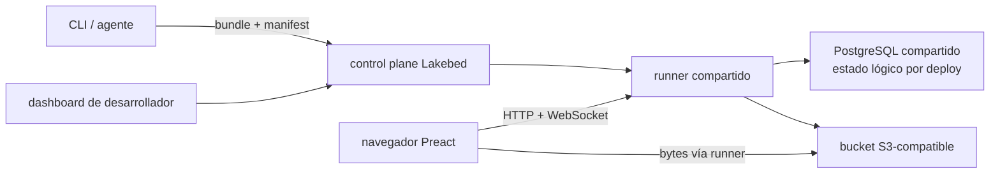

# Lakebed en Railway: qué es y qué aprender para el mini-app builder

_Investigación cerrada el 13 de agosto de 2026. Se han usado únicamente artefactos publicados por Lakebed/Theo y documentación oficial de Railway. Cuando una conclusión se deduce de esos artefactos, se marca como inferencia._

## Resumen ejecutivo

Lakebed no es «SQLite alojado en Railway» ni un template que levante un contenedor por aplicación. Es un runtime **agent-native** para pequeñas aplicaciones TypeScript, llamadas _capsules_, que compila una superficie deliberadamente limitada y despliega cada app como un **tenant lógico** dentro de una plataforma compartida. La web lo identifica como producto en **alpha** y el paquete oficial lo describe como «Agent-native CLI and runtime for building and deploying Lakebed capsules» ([lakebed.dev](https://lakebed.dev/), [`lakebed@0.0.29`](https://unpkg.com/lakebed@0.0.29/package.json)).

La identidad exacta verificable es:

- producto y documentación: [lakebed.dev](https://lakebed.dev/) y [docs.lakebed.dev](https://docs.lakebed.dev/);
- paquete público: [`lakebed@0.0.29` en npm/UNPKG](https://unpkg.com/lakebed@0.0.29/package.json);
- repositorio declarado por el propio `package.json`: [`github.com/pingdotgg/lakebed`](https://github.com/pingdotgg/lakebed), subdirectorio `packages/lakebed` ([metadatos publicados](https://unpkg.com/lakebed@0.0.29/package.json)). Ese repositorio devuelve 404 sin credenciales en la fecha de esta investigación, por lo que **no es correcto presentarlo como repositorio público ni completamente auditable**.

El namespace `pingdotgg` y el perfil oficial de Theo —que se presenta como CEO de Ping.gg y creador del T3 Stack— permiten describirlo prudentemente como un proyecto de Ping.gg asociado a Theo ([perfil oficial `t3dotgg`](https://github.com/t3dotgg)). No hay evidencia primaria de que Lakebed sea parte del T3 Stack ni use su arquitectura; no deben confundirse.

La idea más valiosa para nosotros no es su implementación, sino su unidad de producto: una app restringida, barata y multitenant, con `deploy → URL temporal → claim`, auth, base de datos, realtime y objetos como primitivas de plataforma. Para nuestro objetivo mantendría esa experiencia, pero con contratos portables —SQL over HTTP, blobs, auth y deploy— y una implementación inicial en Cloudflare. Railway quedaría como _build plane_ y escape hatch para código que necesite Node/Docker, no como un servicio y volumen por mini-app.

## Qué construye Lakebed

Una capsule tiene una forma mínima: `server/index.ts`, `client/index.tsx`, código compartido opcional y variables de servidor. El servidor importa una API propia de `lakebed/server`; el cliente usa Preact y `lakebed/client`. El flujo principal es `npx lakebed new`, `npx lakebed dev` y `npx lakebed deploy` ([documentación oficial](https://docs.lakebed.dev/), [README incluido en el paquete](https://app.unpkg.com/lakebed%400.0.25/files/README.md)).

No pretende ejecutar cualquier repositorio generado por un agente. La documentación excluye imports npm arbitrarios, built-ins de Node, ficheros CSS y configuración libre de Tailwind/PostCSS; el estilo se expresa con clases Tailwind. El paquete publicado depende de `esbuild`, `preact` y `ws`, coherente con un bundle pequeño, interfaz reactiva y canal WebSocket ([referencia oficial](https://docs.lakebed.dev/reference/), [`package.json`](https://unpkg.com/lakebed@0.0.29/package.json)).

Ésta es la topología que se puede reconstruir de los artefactos publicados:

El README publicado expone entradas separadas para servicio alojado, dashboard y runner, configuración de dominio wildcard y runner respaldado por PostgreSQL. También documenta un tratamiento específico de las cabeceras de IP cuando el tráfico llega desde el edge proxy de Railway. Esto demuestra que el software publicado está preparado para Railway; **no demuestra por sí solo la topología exacta de producción ni que cada capsule sea un servicio Railway** ([README oficial publicado](https://app.unpkg.com/lakebed%400.0.25/files/README.md)).

## Datos: no es SQLite/libSQL

Lakebed ofrece una API de tablas asíncrona propia, no SQL. El modelo soporta campos tipados e índices declarados; las relaciones se representan mediante IDs y las relaciones muchos-a-muchos con tablas de unión. No expone joins SQL: el acceso relacionado se resuelve con recorridos acotados en la aplicación ([Database API](https://docs.lakebed.dev/database/)).

La semántica transaccional está bastante cuidada:

- cada query obtiene un snapshot de solo lectura repetible;
- una mutation o endpoint confirma filas e índices de forma atómica, con _read-your-writes_;
- un error, timeout o exceso de cuota revierte toda la operación;
- en la versión actual, las escrituras se serializan por deploy.

La documentación dice que la codificación canónica se comparte entre ejecución en memoria, runtime de fuentes y ejecución en PostgreSQL; el README habla explícitamente de runners respaldados por PostgreSQL ([Database API](https://docs.lakebed.dev/database/), [README publicado](https://app.unpkg.com/lakebed%400.0.25/files/README.md)). Por tanto:

- **no hay SQLite, libSQL ni Lake como motor de persistencia publicado**;
- «SQLite over HTTP» no describe Lakebed;
- `db export` produce JSON, no un fichero SQLite portable. Además, cada página de un export paginado es un snapshot separado, no una única fotografía point-in-time ([Database API](https://docs.lakebed.dev/database/)).

**Inferencia arquitectónica:** todo apunta a un PostgreSQL compartido con aislamiento lógico por `deployId`, porque la unidad de serialización, cuota, limpieza y despliegue es el deploy y no aparece ningún aprovisionamiento de base de datos por capsule. El esquema físico no es público, así que no debe afirmarse si usa schemas, tablas compartidas o bases separadas.

Para nuestro producto, la API de Lakebed es atractiva por su sencillez para agentes, pero es una mala base de portabilidad: es una abstracción documental propietaria sobre PostgreSQL. Conviene dar al agente un SDK pequeño, pero implementarlo sobre **SQL estándar/SQLite over HTTP**, mantener migraciones explícitas y ofrecer export de base de datos completo.

## HTTP, realtime y caché

El servidor puede declarar endpoints HTTP relativos a la app y leer método, URL, cabeceras, query y cuerpo como texto, JSON o bytes. Las queries del cliente son reactivas; las mutations publican cambios a suscriptores y la documentación contempla suscripciones WebSocket. La dependencia `ws` publicada refuerza esa lectura ([referencia oficial](https://docs.lakebed.dev/reference/), [`package.json`](https://unpkg.com/lakebed@0.0.29/package.json)).

No hay una API general de caché de aplicación documentada. La política explícita encontrada es para objetos públicos: `Cache-Control: public, max-age=3600` ([Object storage](https://docs.lakebed.dev/storage/)). Sería incorrecto equiparar esto con KV, Cache API o un CDN programable. El realtime continuo también importa en Railway: conexiones WebSocket, conexiones a base de datos o telemetría pueden impedir que un servicio entre en reposo ([Railway Serverless](https://docs.railway.com/deployments/serverless)).

## Assets y object storage

Lakebed incorpora almacenamiento de objetos detrás del mismo origen de la app. Expone rutas HTTP para subir, leer objetos públicos o privados y borrar. El runner conduce los bytes entre navegador y un bucket compatible con S3; la documentación recalca que no pasan por handlers de la capsule ([Object storage](https://docs.lakebed.dev/storage/)).

Propiedades relevantes:

- los objetos públicos usan IDs no adivinables como capability URL y caché pública de una hora;
- los privados requieren un usuario autenticado del mismo deploy, pero «privado» no significa automáticamente propietario del fichero: la app controla a quién revela la clave;
- subir o borrar exige una cuenta Google real con email verificado; invitados no pueden hacerlo;
- se guarda uploader, email y timestamp como metadatos;
- se bloquean HTML/JavaScript y tipos o magic bytes ejecutables; las respuestas añaden `nosniff`, CSP y descarga como attachment;
- límite publicado: 5 MiB por fichero y 100 MiB totales por desarrollador entre sus deploys;
- no hay multipart, resumable uploads, transforms de imagen, listado público ni API `ctx.storage` de servidor.

En local el object store es efímero/en memoria; alojado utiliza el bucket administrado ([Object storage](https://docs.lakebed.dev/storage/)). Es una buena experiencia de producto, pero para nuestra implementación usaría R2/S3 con URLs firmadas para que los bytes no atraviesen el runner. También haría explícitas las políticas por objeto —owner, público, capability o grants— en vez de considerar «cualquier usuario autenticado del deploy» suficiente.

## Auth y secretos

La auth es una primitiva de plataforma. Hay sesión invitada y login Google sin configuración de la app; el servidor recibe un `userId` opaco, estable e inmutable. La documentación insiste correctamente en no usar email como clave de autorización. Los tokens quedan ligados al origen exacto y las revocaciones afectan tanto requests como suscripciones activas ([Auth](https://docs.lakebed.dev/auth/)).

La aplicación sigue siendo responsable de la autorización de datos: debe filtrar por `ctx.auth.userId` y volver a comprobar ownership en mutations. Lakebed no promete row-level security automática. De igual forma, una clave de objeto privado debe guardarse y revelarse según reglas de la propia app ([Auth](https://docs.lakebed.dev/auth/), [Object storage](https://docs.lakebed.dev/storage/)).

El control de desarrollador usa GitHub OAuth y cookies de sesión, según las variables de configuración publicadas. Los secretos de servidor solo existen en deploys reclamados; los despliegues anónimos no tienen variables ni salida de red. En runners PostgreSQL, el README exige una clave de cifrado para esos valores ([README publicado](https://app.unpkg.com/lakebed%400.0.25/files/README.md)).

Hay una señal de churn importante: el README de una versión publicada menciona el broker anterior, mientras la documentación actual dice que auth es first-party. Debemos tomar como vigente la documentación actual y considerar el cambio evidencia de madurez temprana, no describir el producto actual con el proveedor antiguo ([Auth actual](https://docs.lakebed.dev/auth/), [README versionado](https://app.unpkg.com/lakebed%400.0.25/files/README.md)).

## Despliegue, claim y Railway

El flujo de Lakebed permite desplegar anónimamente y reclamar después la app. Un deploy reclamado conserva su identidad, aparece en el dashboard y puede recibir un subdominio; `lakebed.json` guarda el identificador de deploy. Los anónimos caducan y sus datos se eliminan tras un periodo de retención; los reclamados no caducan, aunque mantienen límites de recursos ([documentación](https://docs.lakebed.dev/), [README publicado](https://app.unpkg.com/lakebed%400.0.25/files/README.md)).

El README publica defaults de protección para altas anónimas —50 por cliente y día y 5.000 globales—, límites de requests/mutations y limpieza de deploys no reclamados. También configura un dominio base wildcard para dirigir cada slug al runner ([README publicado](https://app.unpkg.com/lakebed%400.0.25/files/README.md)). Esto respalda la conclusión de que una capsule es un artefacto/tenant del runtime compartido, **no un proyecto Railway aprovisionado por app**.

No se ha localizado un **template público oficial de Lakebed en Railway** ni un manifiesto público con tamaños/topología. Por ello no se puede dar una URL de template ni calcular un coste exacto de Lakebed. Railway sí permite templates multi-servicio con repos privados o imágenes Docker privadas, variables, red y volúmenes; el deploy puede quedar ligado al source o eyectarse ([Templates](https://docs.railway.com/templates), [crear un template](https://docs.railway.com/templates/create), [desplegar/eject](https://docs.railway.com/templates/deploy)). Esa capacidad serviría para distribuir un fork o runtime propio, pero no prueba que Lakebed ofrezca uno.

Railway también expone una API GraphQL para automatizar proyectos, servicios y deployments ([Public API](https://docs.railway.com/integrations/api)). No parece participar en el hot path de cada `lakebed deploy`: la estrategia publicada es cargar un artefacto en la plataforma ya desplegada.

## Aislamiento multitenant y seguridad

El aislamiento visible es principalmente **lógico y de runtime**:

- cada app tiene `deployId`, estado, artefactos, slug, logs, secretos y cuotas propios;
- el código ejecuta en un «restricted source runtime», sin Node ni paquetes npm arbitrarios;
- los deploys anónimos tampoco pueden hacer outbound fetch;
- la auth está ligada a origen y deploy;
- los límites y la limpieza se aplican por deploy/usuario.

Estas restricciones reducen mucho la superficie y son precisamente lo que permite compartir runners. No son equivalentes a una VM, isolate o contenedor dedicado con un modelo de sandbox publicado. El código del repositorio no es auditable públicamente y no se ha encontrado una especificación formal de seguridad. Por tanto, no usaría este mismo grado de aislamiento para ejecutar código arbitrario generado con npm, acceso de red o Node completo.

Para nuestra alpha, un lenguaje/runtime restringido sobre Workers puede seguir este patrón. Cuando aceptemos código de servidor arbitrario o alcancemos un número alto de tenants, la separación debe ser una propiedad de la infraestructura —por ejemplo Workers for Platforms, isolates/sandboxes o contenedores— y no solo una lista de imports permitidos.

## Costes y límites

El coste marginal por capsule de Lakebed puede acercarse a cero en idle porque comparte runner, PostgreSQL y bucket. Eso es una **inferencia del modelo**, no un precio publicado. No se ha encontrado tarifa pública, SLA ni garantía de capacidad de Lakebed.

Para quien opere una arquitectura parecida en Railway, los precios oficiales actuales son:

| Concepto | Precio oficial | Implicación |
|---|---:|---|
| Free | $0, con $1/mes de crédito de recursos | útil para prueba, insuficiente para prometer plataforma |
| Hobby | mínimo $5/mes, $5 incluidos | suelo razonable de prototipo |
| Pro | mínimo $20/mes, $20 incluidos | equipo/producción temprana |
| RAM | $10/GB-mes | runners y Postgres always-on dominan el idle |
| CPU | $20/vCPU-mes | cobro por uso medido |
| Egress | $0.05/GB | relevante si el runner sirve bytes |
| Volumen | $0.15/GB-mes | necesario para Postgres persistente |
| Object storage | $0.015/GB-mes, egress gratis | preferible para assets |

Fuentes: [planes de Railway](https://docs.railway.com/pricing/plans) y [pricing de recursos](https://railway.com/pricing). Un servicio de 0,5 GB que permaneciera activo todo el mes consumiría aproximadamente $5 solo en RAM, antes de CPU; es una aproximación lineal a partir de la tarifa, no el coste observado de Lakebed.

Railway puede dormir un servicio después de diez minutos sin tráfico saliente, pero WebSockets, conexiones a DB o telemetría pueden impedirlo y el primer request paga cold start ([Serverless](https://docs.railway.com/deployments/serverless)). Tampoco conviene usar un volumen SQLite por app: Railway admite un volumen por servicio, los servicios con volumen no pueden replicarse y el despliegue implica downtime ([Volumes](https://docs.railway.com/volumes/reference)). Un diseño «servicio + volumen por mini-app» destruye la ventaja económica de Lakebed.

Límites de Lakebed verificables: 5 MiB/objeto y 100 MiB de objetos por desarrollador; los defaults del paquete `0.0.29` limitan además a 1 MiB tanto el artefacto como el estado y a 10.000 requests por deploy y día. Hay también cuotas de mutations y caducidad de previews no reclamadas. Los deploys reclamados dejan de caducar, pero no pierden las cuotas ([Object storage](https://docs.lakebed.dev/storage/), [paquete `0.0.29`](https://unpkg.com/browse/lakebed@0.0.29/), [README operativo versionado](https://app.unpkg.com/lakebed%400.0.25/files/README.md)).

## Licencia y madurez

- La portada dice explícitamente **alpha** ([lakebed.dev](https://lakebed.dev/)).
- El paquete vigente inspeccionado es `0.0.29`, todavía en serie `0.0.x`; una versión publicada muy reciente lo describía como prototipo público temprano ([`0.0.29`](https://unpkg.com/lakebed@0.0.29/package.json), [README `0.0.25`](https://app.unpkg.com/lakebed%400.0.25/files/README.md)).
- `0.0.29` declara licencia **MIT**, mientras `0.0.25` declaraba `UNLICENSED`: la apertura es reciente y el cambio entre snapshots refuerza la señal de churn ([metadatos `0.0.29`](https://unpkg.com/lakebed@0.0.29/package.json), [metadatos `0.0.25`](https://app.unpkg.com/lakebed%400.0.25/files/package.json)). El código incluido en el paquete MIT puede estudiarse y reutilizarse conforme a esa licencia; el backend completo no es auditable públicamente mientras el repo siga inaccesible.
- El repositorio declarado no es accesible públicamente sin credenciales ([repo declarado](https://github.com/pingdotgg/lakebed)).
- Auth y otras superficies siguen cambiando; no hay precio/SLA público identificado.

Conclusión: es una referencia excelente de producto y DX, pero una dependencia de alto riesgo para basar nuestra plataforma. Podemos aprender de sus contratos visibles y, si interesa, del código distribuido bajo MIT, pero no asumir que el paquete contiene toda la plataforma ni depender del hosted alpha para una oferta propia.

## Qué reutilizar conceptualmente

1. **Capsule estrecha para el agente.** Un árbol mínimo y una API pequeña producen código más predecible que aceptar cualquier framework.
2. **Deploy anónimo → claim.** Crear URL inmediata y reclamarla después elimina onboarding del camino creativo. En Cloudflare, implementarlo con deployments temporales y OAuth; token manual solo como fallback.
3. **Tenant lógico, no infraestructura por app.** Bundle + manifiesto + recursos lógicos compartidos conserva coste idle bajo.
4. **Manifest pequeño y artefactos versionados.** Guardar solo `deployId`, hashes y versión del runtime; tokens de CI limitados al deploy.
5. **Auth como primitive.** ID opaco estable, origen exacto, revocación en HTTP y realtime; autorización de negocio explícita en código.
6. **Previews con TTL y garbage collection.** Cuotas de creación, requests, mutations, estado y objetos desde el primer día.
7. **Object API en el origen de la app.** Mantener una interfaz HTTP homogénea, aunque debajo use R2/S3 y URLs firmadas.
8. **Introspección para agentes.** Logs, manifest, esquema y export deben ser legibles por CLI sin dashboard obligatorio.

## Qué evitar

1. **Copiar a ciegas la plataforma:** el paquete actual es MIT, pero el repo/backend completo no es público; cualquier reutilización debe limitarse al artefacto licenciado y conservar atribución/licencia.
2. **Inventar otra base propietaria:** nuestro requisito es SQLite over HTTP; usar SQL, migraciones y export estándar, no una API documental irreversible.
3. **Confundir restricción con sandbox fuerte:** permitir npm/Node arbitrario exige aislamiento infraestructural.
4. **Bytes atravesando el runner:** R2/S3 firmado reduce CPU, egress y superficie de fallo.
5. **«Privado» igual a «usuario autenticado»:** modelar ownership y grants por objeto.
6. **Una instancia Railway por app:** el idle de RAM/volúmenes y sus limitaciones de réplica no escala económicamente.
7. **Acoplar identidad, dominio, DB y objetos al proveedor:** todo debe tener export y adaptador.
8. **Prometer consistencia/export no existente:** una exportación paginada debe declarar su semántica o producir un snapshot real.

## Camino recomendado para nuestro mini-app builder

### Fase 1 — alpha Cloudflare, código restringido

- Definir una capsule inspirada en Lakebed: UI + handlers + esquema/migraciones + assets, sin npm arbitrario.
- Runtime compartido en Workers Paid; assets estáticos/R2, D1 como SQLite real, KV para routing/configuración y Durable Objects solo donde hagan falta presencia, colas o WebSockets.
- Crear deploy temporal sin cuenta, límites agresivos y TTL; claim con OAuth de Cloudflare o cuenta propia. Para BYO Cloudflare, preferir OAuth y transferencia/claim temporal; aceptar API token manual solo como fallback, con scopes mínimos y cifrado.
- Mantener SQL over HTTP como contrato público. El agente puede recibir helpers sencillos, pero las migraciones y export siguen siendo SQL/SQLite.
- No superar artificialmente el modelo: código generado validado, imports permitidos y egress controlado. En esta fase, el plan Workers Paid normal permite validar producto con un coste base bajo y un máximo operativo de 500 Workers.

### Fase 2 — aislamiento y escala

- Pasar a Workers for Platforms cuando aceptemos código arbitrario o la escala/aislamiento rebase el modelo de hasta 500 Workers.
- Separar formalmente cuatro contratos: `DeployAdapter`, `SqlHttpAdapter`, `BlobAdapter` y `AuthAdapter`.
- Añadir bundle portable, export transaccional de DB, export de objetos/manifiesto y dominio desacoplado.
- Medir coste por tenant y aplicar cuotas por request, CPU, almacenamiento, egress y realtime.

### Papel de Railway

Usarlo como **build plane/escape hatch**, no como runtime por defecto:

- builds pesados, herramientas nativas, previews Docker o apps incompatibles con Workers;
- un runner compartido y multitenant si necesitamos compatibilidad Node controlada;
- Postgres de control/metadata si D1 no cubre el plano central;
- plantillas o API para desplegar componentes grandes, nunca un volumen SQLite por mini-app.

La lección central de Lakebed es que el coste bajo no viene de elegir Railway frente a Cloudflare, sino de **no aprovisionar una máquina por aplicación**. Cloudflare ofrece una ejecución más natural para tenants pequeños y ociosos; Railway es valioso donde realmente necesitamos procesos, Docker o build tooling.

## Decisión

Tomaría Lakebed como benchmark de experiencia y modelo económico, no como base técnica. Construiría una primera versión Cloudflare con la misma sensación de inmediatez —capsule restringida, deploy anónimo, claim, auth, DB, realtime y objetos—, preservando desde el inicio SQL/SQLite y contratos de portabilidad. Railway quedaría detrás de `DeployAdapter` para cargas incompatibles o un build plane compartido. Así obtenemos el beneficio importante de Lakebed —coste marginal mínimo por app— sin heredar su base de datos propietaria, un backend no auditable públicamente ni dependencia del hosted alpha.
