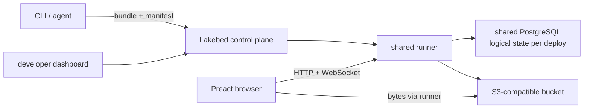

# Lakebed on Railway: what it is and what to learn for the mini-app builder

_Research closed on 13 August 2026. It uses only artifacts published by Lakebed/Theo and official Railway documentation. When a conclusion is deduced from those artifacts, it is marked as an inference._

## Executive summary

Lakebed is neither "SQLite hosted on Railway" nor a template that starts one container per application. It is an **agent-native** runtime for small TypeScript applications, called _capsules_, that compiles a deliberately limited surface and deploys each app as a **logical tenant** inside a shared platform. The website labels the product **alpha**, and the official package describes it as "Agent-native CLI and runtime for building and deploying Lakebed capsules" ([lakebed.dev](https://lakebed.dev/), [`lakebed@0.0.29`](https://unpkg.com/lakebed@0.0.29/package.json)).

The exact identity we can verify is:

- product and documentation: [lakebed.dev](https://lakebed.dev/) and [docs.lakebed.dev](https://docs.lakebed.dev/);
- public package: [`lakebed@0.0.29` on npm/UNPKG](https://unpkg.com/lakebed@0.0.29/package.json);
- repository declared by the package's own `package.json`: [`github.com/pingdotgg/lakebed`](https://github.com/pingdotgg/lakebed), subdirectory `packages/lakebed` ([published metadata](https://unpkg.com/lakebed@0.0.29/package.json)). That repository returns 404 without credentials as of this research, so **it is not correct to present it as a public or fully auditable repository**.

The `pingdotgg` namespace and Theo's official profile, which presents him as CEO of Ping.gg and creator of the T3 Stack, allow us to describe it cautiously as a Ping.gg project associated with Theo ([official `t3dotgg` profile](https://github.com/t3dotgg)). There is no primary evidence that Lakebed is part of the T3 Stack or uses its architecture; the two should not be confused.

The most valuable idea for us is its product unit rather than its implementation: a restricted, cheap, multi-tenant app, with `deploy → temporary URL → claim`, and auth, database, realtime and objects as platform primitives. For our goal I would keep that experience, but with portable contracts (SQL over HTTP, blobs, auth and deploy) and an initial implementation on Cloudflare. Railway would remain a _build plane_ and escape hatch for code that needs Node/Docker, not a service and volume per mini-app.

## What Lakebed builds

A capsule has a minimal shape: `server/index.ts`, `client/index.tsx`, optional shared code and server variables. The server imports Lakebed's own API from `lakebed/server`; the client uses Preact and `lakebed/client`. The main flow is `npx lakebed new`, `npx lakebed dev` and `npx lakebed deploy` ([official documentation](https://docs.lakebed.dev/), [README included in the package](https://app.unpkg.com/lakebed%400.0.25/files/README.md)).

It does not try to run any repository an agent generates. The documentation excludes arbitrary npm imports, Node built-ins, CSS files and free-form Tailwind/PostCSS configuration; styling is expressed with Tailwind classes. The published package depends on `esbuild`, `preact` and `ws`, which is consistent with a small bundle, a reactive interface and a WebSocket channel ([official reference](https://docs.lakebed.dev/reference/), [`package.json`](https://unpkg.com/lakebed@0.0.29/package.json)).

This is the topology that can be reconstructed from the published artifacts:

The published README exposes separate entry points for the hosted service, dashboard and runner, wildcard domain configuration and a PostgreSQL-backed runner. It also documents specific handling of IP headers when traffic arrives from Railway's edge proxy. This shows that the published software is prepared for Railway; **on its own it does not show the exact production topology, nor that each capsule is a Railway service** ([official published README](https://app.unpkg.com/lakebed%400.0.25/files/README.md)).

## The data layer is not SQLite or libSQL

Lakebed offers its own asynchronous table API, not SQL. The model supports typed fields and declared indexes; relations are represented through IDs, and many-to-many relations through join tables. It exposes no SQL joins; related data is fetched through bounded traversals in the application ([Database API](https://docs.lakebed.dev/database/)).

The transactional semantics are carefully designed:

- each query gets a repeatable read-only snapshot;
- a mutation or endpoint commits rows and indexes atomically, with _read-your-writes_;
- an error, timeout or quota overrun rolls back the whole operation;
- in the current version, writes are serialized per deploy.

The documentation says the canonical encoding is shared between in-memory execution, the source runtime and PostgreSQL execution; the README talks explicitly about PostgreSQL-backed runners ([Database API](https://docs.lakebed.dev/database/), [published README](https://app.unpkg.com/lakebed%400.0.25/files/README.md)). Therefore:

- **there is no SQLite, libSQL or Lake as a published persistence engine**;
- "SQLite over HTTP" does not describe Lakebed;
- `db export` produces JSON, not a portable SQLite file. Each page of a paginated export is also a separate snapshot, not a single point-in-time picture ([Database API](https://docs.lakebed.dev/database/)).

**Architectural inference.** Everything points to a shared PostgreSQL with logical isolation by `deployId`, because the deploy is the unit of serialization, quota, cleanup and deployment, and no per-capsule database provisioning appears anywhere. The physical schema is not public, so we should not claim whether it uses schemas, shared tables or separate databases.

For our product, Lakebed's API is attractive because it is simple for agents, but it is a poor base for portability, because it is a proprietary document abstraction over PostgreSQL. We should give the agent a small SDK, but implement it on **standard SQL/SQLite over HTTP**, keep explicit migrations and offer a complete database export.

## HTTP, realtime and cache

The server can declare HTTP endpoints relative to the app and read the method, URL, headers, query and body as text, JSON or bytes. Client queries are reactive; mutations publish changes to subscribers, and the documentation covers WebSocket subscriptions. The published `ws` dependency supports that reading ([official reference](https://docs.lakebed.dev/reference/), [`package.json`](https://unpkg.com/lakebed@0.0.29/package.json)).

There is no documented general application cache API. The only explicit policy found is for public objects, `Cache-Control: public, max-age=3600` ([Object storage](https://docs.lakebed.dev/storage/)). Treating this as equivalent to KV, the Cache API or a programmable CDN would be wrong. Continuous realtime also matters on Railway, because WebSocket connections, database connections or telemetry can keep a service from sleeping ([Railway Serverless](https://docs.railway.com/deployments/serverless)).

## Assets and object storage

Lakebed includes object storage behind the app's own origin. It exposes HTTP routes to upload, read public or private objects, and delete. The runner moves the bytes between the browser and an S3-compatible bucket; the documentation stresses that they do not pass through capsule handlers ([Object storage](https://docs.lakebed.dev/storage/)).

Relevant properties:

- public objects use unguessable IDs as capability URLs and a one-hour public cache;
- private objects require an authenticated user of the same deploy, but "private" does not automatically mean owner of the file, since the app decides who it reveals the key to;
- uploading or deleting requires a real Google account with a verified email; guests cannot do it;
- uploader, email and timestamp are stored as metadata;
- HTML/JavaScript and executable types or magic bytes are blocked; responses add `nosniff`, CSP and download as attachment;
- published limit: 5 MiB per file and 100 MiB total per developer across their deploys;
- there is no multipart, resumable uploads, image transforms, public listing or server-side `ctx.storage` API.

Locally the object store is ephemeral/in-memory; when hosted it uses the managed bucket ([Object storage](https://docs.lakebed.dev/storage/)). It is a good product experience, but for our implementation I would use R2/S3 with signed URLs so the bytes do not go through the runner. I would also make per-object policies explicit (owner, public, capability or grants) instead of treating "any authenticated user of the deploy" as sufficient.

## Auth and secrets

Auth is a platform primitive. There is a guest session and Google login with no app configuration; the server receives an opaque, stable and immutable `userId`. The documentation rightly insists on not using email as an authorization key. Tokens are bound to the exact origin, and revocations affect both requests and active subscriptions ([Auth](https://docs.lakebed.dev/auth/)).

The application is still responsible for data authorization. It must filter by `ctx.auth.userId` and recheck ownership in mutations. Lakebed does not promise automatic row-level security. Likewise, a private object key must be stored and revealed according to the app's own rules ([Auth](https://docs.lakebed.dev/auth/), [Object storage](https://docs.lakebed.dev/storage/)).

Developer access uses GitHub OAuth and session cookies, according to the published configuration variables. Server secrets exist only in claimed deploys; anonymous deploys have no variables and no network egress. On PostgreSQL runners, the README requires an encryption key for those values ([published README](https://app.unpkg.com/lakebed%400.0.25/files/README.md)).

There is a significant churn signal. The README of one published version mentions the previous broker, while the current documentation says auth is first-party. We should treat the current documentation as authoritative and read the change as evidence of early maturity, not describe the current product with the old provider ([current Auth](https://docs.lakebed.dev/auth/), [versioned README](https://app.unpkg.com/lakebed%400.0.25/files/README.md)).

## Deployment, claim and Railway

Lakebed's flow lets you deploy anonymously and claim the app later. A claimed deploy keeps its identity, appears in the dashboard and can receive a subdomain; `lakebed.json` stores the deploy identifier. Anonymous deploys expire and their data is deleted after a retention period; claimed ones do not expire, although they keep resource limits ([documentation](https://docs.lakebed.dev/), [published README](https://app.unpkg.com/lakebed%400.0.25/files/README.md)).

The README publishes protection defaults for anonymous sign-ups (50 per client per day and 5,000 globally), request/mutation limits and cleanup of unclaimed deploys. It also configures a wildcard base domain that routes each slug to the runner ([published README](https://app.unpkg.com/lakebed%400.0.25/files/README.md)). This supports the conclusion that a capsule is an artifact/tenant of the shared runtime, **not a Railway project provisioned per app**.

We found no **official public Lakebed template on Railway** and no public manifest with sizes/topology. So we cannot give a template URL or calculate an exact cost for Lakebed. Railway does allow multi-service templates with private repos or private Docker images, variables, networking and volumes; the deploy can stay tied to the source or be ejected ([Templates](https://docs.railway.com/templates), [create a template](https://docs.railway.com/templates/create), [deploy/eject](https://docs.railway.com/templates/deploy)). That capability would work for distributing a fork or our own runtime, but it does not prove that Lakebed offers one.

Railway also exposes a GraphQL API to automate projects, services and deployments ([Public API](https://docs.railway.com/integrations/api)). It does not seem to take part in the hot path of each `lakebed deploy`; the published strategy is to upload an artifact to the already deployed platform.

## Multi-tenant isolation and security

The visible isolation is mainly **logical and at the runtime level**:

- each app has its own `deployId`, state, artifacts, slug, logs, secrets and quotas;
- code runs in a "restricted source runtime", with no Node and no arbitrary npm packages;
- anonymous deploys cannot make outbound fetches either;
- auth is bound to origin and deploy;
- limits and cleanup apply per deploy/user.

These restrictions shrink the surface a lot, and they are exactly what makes shared runners possible. They are not equivalent to a VM, isolate or dedicated container with a published sandbox model. The repository code is not publicly auditable and we found no formal security specification. So I would not use this same level of isolation to run arbitrary generated code with npm, network access or full Node.

For our alpha, a restricted language/runtime on Workers can follow this pattern. Once we accept arbitrary server code or reach a high number of tenants, the infrastructure must enforce separation, for example with Workers for Platforms, isolates, sandboxes or containers. A list of allowed imports is not enough.

## Costs and limits

Lakebed's marginal cost per capsule can approach zero when idle because it shares runner, PostgreSQL and bucket. That is an **inference from the model**, not a published price. We found no public pricing, SLA or capacity guarantee for Lakebed.

For anyone running a similar architecture on Railway, the current official prices are:

| Item | Official price | Implication |
|---|---:|---|
| Free | $0, with $1/month of resource credit | useful for testing, not enough to promise a platform |
| Hobby | $5/month minimum, $5 included | reasonable floor for a prototype |
| Pro | $20/month minimum, $20 included | team/early production |
| RAM | $10/GB-month | always-on runners and Postgres dominate idle cost |
| CPU | $20/vCPU-month | billed by measured usage |
| Egress | $0.05/GB | relevant if the runner serves bytes |
| Volume | $0.15/GB-month | needed for persistent Postgres |
| Object storage | $0.015/GB-month, free egress | preferable for assets |

Sources: [Railway plans](https://docs.railway.com/pricing/plans) and [resource pricing](https://railway.com/pricing). A 0.5 GB service that stayed active all month would use about $5 in RAM alone, before CPU; this is a linear approximation from the rate, not Lakebed's observed cost.

Railway can put a service to sleep after ten minutes without outbound traffic, but WebSockets, DB connections or telemetry can prevent it, and the first request pays a cold start ([Serverless](https://docs.railway.com/deployments/serverless)). A SQLite volume per app is also a bad fit. Railway allows one volume per service, services with a volume cannot be replicated, and deploys involve downtime ([Volumes](https://docs.railway.com/volumes/reference)). A "service + volume per mini-app" design destroys Lakebed's economic advantage.

Verifiable Lakebed limits are 5 MiB per object and 100 MiB of objects per developer. The defaults of package `0.0.29` also cap both the artifact and the state at 1 MiB, and requests at 10,000 per deploy per day. There are also mutation quotas and expiry for unclaimed previews. Claimed deploys stop expiring, but keep their quotas ([Object storage](https://docs.lakebed.dev/storage/), [package `0.0.29`](https://unpkg.com/browse/lakebed@0.0.29/), [versioned operational README](https://app.unpkg.com/lakebed%400.0.25/files/README.md)).

## License and maturity

- The home page explicitly says **alpha** ([lakebed.dev](https://lakebed.dev/)).
- The current package inspected is `0.0.29`, still in the `0.0.x` series; a very recent published version described it as an early public prototype ([`0.0.29`](https://unpkg.com/lakebed@0.0.29/package.json), [README `0.0.25`](https://app.unpkg.com/lakebed%400.0.25/files/README.md)).
- `0.0.29` declares an **MIT** license, while `0.0.25` declared `UNLICENSED`. The opening is recent, and the change between snapshots adds to the churn signal ([`0.0.29` metadata](https://unpkg.com/lakebed@0.0.29/package.json), [`0.0.25` metadata](https://app.unpkg.com/lakebed%400.0.25/files/package.json)). The code included in the MIT package can be studied and reused under that license; the full backend is not publicly auditable while the repo stays inaccessible.
- The declared repository is not publicly accessible without credentials ([declared repo](https://github.com/pingdotgg/lakebed)).
- Auth and other surfaces keep changing; we found no public pricing/SLA.

In short, it is an excellent product and DX reference, but a high-risk dependency to build our platform on. We can learn from its visible contracts and, if useful, from the code distributed under MIT, but we should not assume the package contains the whole platform or depend on the hosted alpha for our own offering.

## What to reuse conceptually

1. Give the agent a narrow capsule. A minimal tree and a small API produce more predictable code than accepting any framework.
2. Use anonymous deploy, then claim. Creating an immediate URL and claiming it later removes onboarding from the creative path. On Cloudflare, implement it with temporary deployments and OAuth, with a manual token only as a fallback.
3. Use logical tenants, not per-app infrastructure. A bundle, a manifest and shared logical resources keep idle cost low.
4. Keep a small manifest and versioned artifacts. Store only `deployId`, hashes and the runtime version, with CI tokens scoped to the deploy.
5. Treat auth as a primitive. Use a stable opaque ID, exact origin binding and revocation over HTTP and realtime, with business authorization explicit in code.
6. Give previews a TTL and garbage collection. Apply quotas on creation, requests, mutations, state and objects from day one.
7. Serve the object API on the app's origin. Keep a uniform HTTP interface, even if R2/S3 and signed URLs sit underneath.
8. Build introspection for agents. Logs, manifest, schema and export should be readable from the CLI without requiring the dashboard.

## What to avoid

1. Copying the platform blindly. The current package is MIT, but the full repo/backend is not public; any reuse must stay within the licensed artifact and keep the attribution/license.
2. Inventing another proprietary database. Our requirement is SQLite over HTTP, so we should use SQL, migrations and a standard export, not an irreversible document API.
3. Mistaking restriction for a strong sandbox. Allowing arbitrary npm/Node requires infrastructure-level isolation.
4. Bytes going through the runner. Signed R2/S3 URLs reduce CPU, egress and failure surface.
5. Equating "private" with "authenticated user". Model ownership and grants per object.
6. One Railway instance per app. Idle RAM/volume cost and the replication limits do not scale economically.
7. Tying identity, domain, DB and objects to the provider. Everything needs an export and an adapter.
8. Promising consistency or exports that do not exist. A paginated export must declare its semantics or produce a real snapshot.

## Recommended path for our mini-app builder

### Phase 1, Cloudflare alpha with restricted code

- Define a capsule inspired by Lakebed: UI + handlers + schema/migrations + assets, with no arbitrary npm.
- Shared runtime on Workers Paid; static assets/R2, D1 as real SQLite, KV for routing/configuration and Durable Objects only where presence, queues or WebSockets need them.
- Create a temporary deploy without an account, with aggressive limits and a TTL; claim through Cloudflare OAuth or our own account. For BYO Cloudflare, prefer OAuth and a temporary transfer/claim; accept a manual API token only as a fallback, with minimum scopes and encryption.
- Keep SQL over HTTP as the public contract. The agent can get simple helpers, but migrations and export stay SQL/SQLite.
- Do not stretch the model artificially: validated generated code, allowed imports and controlled egress. In this phase, the plain Workers Paid plan lets us validate the product at a low base cost with an operational maximum of 500 Workers.

### Phase 2, isolation and scale

- Move to Workers for Platforms when we accept arbitrary code or when scale or isolation needs outgrow the model of up to 500 Workers.
- Formally separate four contracts: `DeployAdapter`, `SqlHttpAdapter`, `BlobAdapter` and `AuthAdapter`.
- Add a portable bundle, a transactional DB export, an object/manifest export and a decoupled domain.
- Measure cost per tenant and apply quotas on requests, CPU, storage, egress and realtime.

### Role of Railway

Use it as a **build plane/escape hatch**, not as the default runtime:

- heavy builds, native tools, Docker previews or apps incompatible with Workers;
- a shared, multi-tenant runner if we need controlled Node compatibility;
- control/metadata Postgres if D1 does not cover the central plane;
- templates or the API to deploy large components, never a SQLite volume per mini-app.

The central lesson from Lakebed is that low cost comes from **not provisioning a machine per application**, not from choosing Railway over Cloudflare. Cloudflare offers a more natural execution model for small, idle tenants; Railway is valuable where we actually need processes, Docker or build tooling.

## Decision

I would take Lakebed as a benchmark for experience and economic model, not as a technical base. I would build a first Cloudflare version with the same sense of immediacy (restricted capsule, anonymous deploy, claim, auth, DB, realtime and objects) while keeping SQL/SQLite and portability contracts from the start. Railway would sit behind `DeployAdapter` for incompatible workloads or a shared build plane. That way we get Lakebed's main benefit, minimal marginal cost per app, without inheriting its proprietary database, a backend that is not publicly auditable, or a dependency on the hosted alpha.
